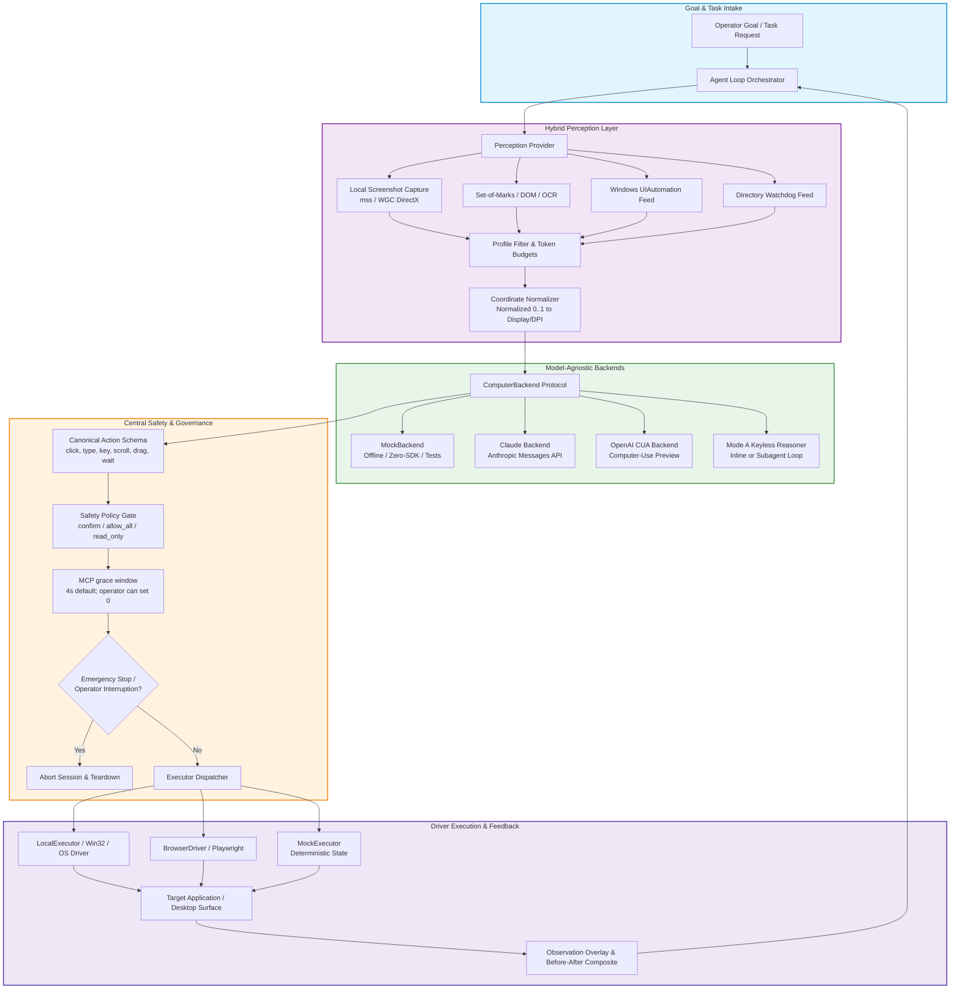
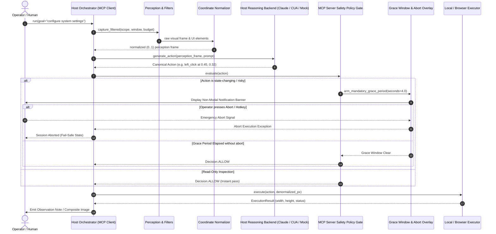

# open-compute


[🇬🇧 English](README.md) | [🇩🇪 Deutsch](README_de.md) | **🇪🇸 Español** | [🇫🇷 Français](README_fr.md)

[](CHANGELOG.md)
[](pyproject.toml)
[](https://github.com/ellmos-ai/open-compute/actions/workflows/tests.yml)
[](tests)
[](tests)
[](CONTRIBUTING.md)
[](NOTICE)
[](pyproject.toml)
[](SECURITY.md)
[](SECURITY.md)
[](https://github.com/astral-sh/ruff)
[](llms.txt)
[](THIRD_PARTY_LICENSES.md)
[](THIRD_PARTY_LICENSES.txt)
[](https://github.com/ellmos-ai)
[](https://github.com/open-bricks)
[](LICENSE)

**Un núcleo de uso del ordenador independiente del modelo: un ciclo de agente y cualquier modelo de razonamiento tras una única interfaz.**

**Standalone Cowork (en desarrollo):** `oc cowork` abre una ventana de aplicación local independiente con texto, voz opcional del navegador, cuatro roles de trabajo para personas y modelos, observaciones acotadas de los objetivos y autorizaciones explícitas por tarea. Un worker de Codex en ejecución usa el inicio de sesión existente (predeterminado `gpt-6-astra`, configurable); `--worker none` habilita un host MCP externo. No se requiere una dependencia de Cowork Protocol ni un servicio Node. Consulta [configuración, contratos y límites de verificación](docs/cowork/README.md).

open-compute es un núcleo de Python pequeño y con pocas dependencias para crear agentes de uso del ordenador
(automatización de GUI, escritorio y navegador impulsada por LLM). Implementa el
ciclo **percepción → llamada a herramienta del modelo → acción → respuesta**, y mantiene
intercambiable el modelo de razonamiento detrás de una única interfaz `ComputerBackend`. **Ningún
proveedor tiene prioridad**: Anthropic Claude y OpenAI CUA son dos backends de API con la misma prioridad,
y el backend sin conexión `mock` es el predeterminado. También existe una vía **sin clave**
mediante el modo A, en el que razona el propio modelo anfitrión; puede
ejecutar ese ciclo en línea o en un subagente que él mismo crea para ahorrar contexto
(consulta el [patrón de uso](#usage-pattern--inline-a-vs-self-subagent-b)). El núcleo tiene
**cero dependencias de ejecución**; los SDK de proveedores (`anthropic`, `openai`) son
extras **opcionales que se importan bajo demanda**: `import open_compute` funciona aunque no
estén instalados, y la configuración predeterminada con mock funciona completamente sin conexión.

> [!NOTE]
> **Aviso de integración con IA/LLM**: `open-compute` incluye un archivo legible por máquinas [`llms.txt`](llms.txt), diseñado para agentes de IA, rastreadores RAG y flujos de trabajo asistidos por LLM.

---

## Navegación rápida

- [✨ Aspectos destacados y filosofía central](#highlights--core-philosophy)
- [🎯 Perfiles objetivo y facilidad de descubrimiento](#target-personas--discoverability)
- [📊 Matriz comparativa con alternativas](#comparative-matrix-vs-alternatives)
- [🏗️ Flujo de arquitectura del sistema](#system-architecture-flow)
- [🔄 Ciclo del agente y ciclo de seguridad](#agent-loop--safety-lifecycle)
- [🛡️ Gobernanza e invariantes de ejecución](#governance--runtime-invariants)
- [🌐 Ecosistema relacionado y repositorios asociados](#sibling-ecosystem--partner-repositories)
- [💡 Por qué open-compute](#why-open-compute)
- [🤖 Backends compatibles y estado](#supported-backends--status)
- [📦 Instalación y extras](#installation--extras)
- [🚀 Inicio rápido y patrones de uso](#quick-start--usage-patterns)
- [⏱️ Ventana de gracia obligatoria antes de la acción](#mandatory-pre-action-grace-window)
- [🔍 Percepción filtrada por perfil y delimitación de ventanas](#profile-filtered-perception--window-scoping)
- [💻 Referencia de comandos CLI](#cli-command-reference)
- [🔒 Política de seguridad y notificación de vulnerabilidades](#security-policy--vulnerability-reporting)
- [🧪 Ejecución de pruebas](#running-tests)
- [📜 Licencias de terceros y transparencia](#third-party-licenses--transparency)
- [📄 Licencia](#license)

---

<a id="sec-01"></a><a id="highlights--core-philosophy"></a><a id="highlights--kernphilosophie"></a>
## Aspectos destacados y filosofía central

- 🎯 **Independencia real del modelo**: ejecuta Claude (Messages API), OpenAI CUA o simulaciones deterministas sin conexión, sin reescribir la orquestación ni la lógica de prompts.
- 📐 **Coordenadas normalizadas unificadas (0..1)**: los modelos producen valores decimales invariantes `[0.0, 1.0]`. Las diferencias de resolución, los desplazamientos de monitores dobles y el escalado DPI del sistema operativo se resuelven de forma centralizada en `coordinates.py`.
- 🛡️ **Espera de gracia de MCP antes de actuar**: las llamadas MCP relevantes para el control usan el tiempo configurado por el operador (4 segundos de forma predeterminada, con un enfriamiento por actividad de 120 segundos); el operador puede fijarlo en 0. Las rutas directas de CLI y SDK `AgentLoop` no usan esta espera MCP.
- 🚦 **Control de seguridad centralizado**: los modos de política configurables (`confirm`, `allow_all`, `read_only`) interceptan cada clic, pulsación de tecla, arrastre y ejecución de proceso antes de que llegue al sistema operativo.
- 🔌 **Cero dependencias de ejecución**: el ciclo central del agente y el ejecutor simulado solo requieren la biblioteca estándar de Python. Los SDK de proveedores (`anthropic`, `openai`, `mss`, `playwright`) son extras que se cargan bajo demanda.
- 🪟 **Percepción filtrada por perfil**: las herramientas MCP filtradas aplican el perfil elegido al contenido que devuelven. La herramienta normal `capture` no aplica esos filtros y puede devolver todo el escritorio virtual.

---

<a id="sec-08"></a><a id="why-open-compute"></a><a id="warum-open-compute"></a>
## Por qué open-compute

Todos los modelos de uso del ordenador —la herramienta `computer` de Claude de Anthropic y la herramienta
computer-use de OpenAI— comparten la misma *estructura* de ciclo de agente, pero difieren en transporte,
marco de coordenadas y nombres de acciones. open-compute separa las partes comunes para que
escribas el ciclo una sola vez y cambies libremente el modelo de razonamiento detrás de una única
interfaz `ComputerBackend`:

- Un **esquema canónico de acciones** con un conversor para cada backend.
- **Coordenadas normalizadas (0..1)** internamente, convertidas a coordenadas nativas según backend /
  resolución / DPI mediante una utilidad comprobada; el problema de DPI se resuelve de forma centralizada.
- Un **control de seguridad central** («confirmar antes de acciones arriesgadas») que se evalúa antes
  de cada acción.
- Una interfaz de **percepción híbrida** (captura de pantalla + Set-of-Marks / accesibilidad /
  DOM), para pasar más adelante de la visión basada solo en píxeles a la selección semántica.

---

<a id="sec-02"></a><a id="target-personas--discoverability"></a><a id="zielgruppen--auffindbarkeit"></a>
## Perfiles objetivo y facilidad de descubrimiento

`open-compute` está diseñado para responder a las necesidades operativas, los límites de privacidad y los estándares de precisión de cuatro perfiles principales de profesionales:

| ID del perfil | Público objetivo | Necesidad principal | Solución arquitectónica clave de open-compute |
|---|---|---|---|
| `[PERSONA-01]` | **Ingenieros de agentes de IA empresariales y arquitectos de plataforma** | Núcleo de agente de escritorio con modelo intercambiable, sin dependencia propietaria de proveedores ni fragmentación de coordenadas. | Protocolo único `ComputerBackend`, esquema canónico unificado `Action` (`actions.py`), coordenadas normalizadas `[0.0, 1.0]` (`coordinates.py`) y `MockBackend` sin conexión. |
| `[PERSONA-02]` | **Desarrolladores de agentes de código abierto e investigadores de IA** | Núcleo transparente y ligero para evaluar ciclos de percepción y acción sin imágenes Docker enormes ni costes de nube. | Cero dependencias de ejecución obligatorias (núcleo basado en la biblioteca estándar de Python), banco de pruebas determinista sin conexión y fuentes de percepción híbridas conectables. |
| `[PERSONA-03]` | **Responsables de cumplimiento de seguridad, protección y gobernanza** | Aplicar supervisión humana, abortos de emergencia y límites estrictos de telemetría cero al ejecutar la GUI. | Espera MCP configurada por el operador (4 segundos de forma predeterminada; se puede fijar en 0) (`INV-GRC-04`), control de seguridad cerrado ante fallos con 3 niveles (`INV-SAF-05`) y modo de usuario sin privilegios (`INV-USR-06`). El bucle mock predeterminado permanece sin conexión; los proveedores configurados y el trabajador Codex de Cowork pueden usar servicios externos (`INV-EGR-07`). |
| `[PERSONA-04]` | **Especialistas en automatización de escritorio y GUI (modernización de RPA)** | Modernizar scripts RPA frágiles basados en píxeles (PyAutoGUI, AutoHotkey) para convertirlos en acciones semánticas robustas impulsadas por LLM. | Reescalado de coordenadas independiente del DPI, delimitación de ventanas UIA con presupuesto de tokens (`perception_filter.py`) y utilidades CLI nativas (`oc do`, `oc capture`, `oc click-name`). |

### Búsquedas de alta intención y facilidad de descubrimiento

Para facilitar el descubrimiento técnico rápido y la indexación en lenguaje natural en catálogos de código abierto, registros de paquetes y buscadores para desarrolladores:

- `python computer use agent core` — Entorno de ejecución ligero en Python puro para agentes de uso del ordenador independientes del modelo.
- `claude computer use alternative python` — Framework independiente de proveedores compatible con Anthropic Claude, OpenAI CUA y simulaciones sin conexión.
- `model agnostic gui automation llm` — Un único ciclo de agente para que modelos visión-lenguaje controlen interfaces de escritorio y navegador.
- `normalized coordinates screen automation` — Normalización de coordenadas (0..1) independiente de la resolución y el DPI para acciones de IA en pantalla.
- `safe desktop automation agent framework` — Control de seguridad cerrado ante fallos, con ventana de gracia obligatoria de 4 segundos antes de actuar y opción de aborto por el operador.
- `set of marks gui agent python` — Percepción híbrida que combina visión de capturas de pantalla, Set-of-Marks y árboles de Windows UIAutomation.

---

<a id="sec-03"></a><a id="comparative-matrix-vs-alternatives"></a><a id="vergleichsmatrix-gegenüber-alternativen"></a>
## Matriz comparativa con alternativas

La siguiente matriz compara `open-compute` con arquitecturas alternativas habituales en 10 dimensiones técnicas directamente vinculadas a sus invariantes formales de gobernanza:

| Dimensión técnica | Invariante de gobernanza | open-compute | Demostración de referencia de Anthropic (Docker) | Frameworks de evaluación OSWorld / Agent-S | Herramientas RPA clásicas (PyAutoGUI / Selenium) | Scripts ad hoc / envoltorios de shell |
|---|---|:---:|:---:|:---:|:---:|:---:|
| **Independencia del modelo** | `INV-MOD-01` | **Completa (Claude, OpenAI CUA, Mock, modo A)** | Solo Claude Messages API | Varios modelos mediante envoltorios | Ninguna (sin razonamiento LLM) | Ninguna (lógica codificada) |
| **Dependencias de ejecución** | `INV-DEP-02` | **0 (núcleo con biblioteca estándar de Python)** | Docker + Node + Python pesados | Imagen Docker enorme (>20 GB) | Extensiones C nativas y controladores pesados | Binarios dependientes del sistema |
| **Normalización de coordenadas** | `INV-CRD-03` | **Normalizadas de 0..1 y reescalado DPI centralizado** | Coordenadas de píxeles fijas (1024x768, etc.) | Basadas en píxeles, con desviación de escala | Píxeles de pantalla fijos (fallan al cambiar DPI) | Coordenadas de píxeles codificadas |
| **Ventana de gracia previa a la acción** | `INV-GRC-04` | **4 s predeterminados + enfriamiento de 120 s; el operador puede fijar 0** | Ninguna (ejecución inmediata) | Ninguna (ejecución de evaluación) | Ninguna (ejecución instantánea) | Ninguna |
| **Control de seguridad cerrado ante fallos** | `INV-SAF-05` | **Control de política de 3 niveles (`confirm`, `allow_all`, `read_only`)** | Solo advertencias orientativas en prompts | Ninguno (sin restricciones en la VM) | Ninguno (ejecución ciega) | Ninguno |
| **Ejecución sin privilegios** | `INV-USR-06` | **RunAsInvoker estricto (modo de usuario sin elevación)** | Root dentro del contenedor Docker | Root / Sudo dentro de la máquina virtual | Suele pedir elevación de administrador | Riesgo de elevación sin control |
| **Egress del mock predeterminado** | `INV-EGR-07` | **El bucle mock predeterminado está sin conexión; los proveedores configurados, Cowork y los hosts MCP pueden transmitir datos** | Conexión obligatoria a la nube | VM con red y telemetría | Ejecución local, pero sin política de privacidad | Depende del script |
| **Persistencia de claves API** | `INV-SEC-08` | **Las capturas y acciones pueden contener datos sensibles; no se ocultan automáticamente todos esos datos** | Variables de entorno en el contenedor | Archivos de configuración con tokens incrustados | Credenciales de texto sin formato codificadas | Variables de entorno o scripts en texto sin formato |
| **Delimitación semántica de ventanas** | `INV-SCP-09` | **Filtros del perfil elegido; `capture` normal no está filtrado** | Solo captura de pantalla completa | Capturas de todo el escritorio | Búsqueda de identificador de ventana o escritorio completo | Enfoque ingenuo en ventanas |
| **Compromiso de seguridad y SLA** | `INV-SLA-10` | **SLA contractual: respuesta en 48 h y triaje en 5 días** | Vista previa para desarrolladores con soporte de mejor esfuerzo | Repositorio académico (lista de incidencias pendientes) | Foro comunitario / planes comerciales | Sin SLA de seguridad ni mantenimiento |

---

## Arquitectura

<a id="sec-04"></a><a id="system-architecture-flow"></a><a id="systemarchitektur-ablauf"></a>
### Flujo de arquitectura del sistema



### Proyección de topología arquitectónica en cuatro vistas

```
+===================================================================================================================+
|                                    OPEN-COMPUTE ARCHITECTURAL TOPOLOGY (4 VIEWS)                                  |
+===================================================================================================================+
| [VIEW 1: CALLER RUNTIMES & AGENT CLIENTS]                                                                         |
|  * Autonomous LLM Agents (Claude Desktop, Antigravity, OpenAI Codex, Ollama) via MCP Server (open-compute-mcp)    |
|  * Developer Terminal & DevOps CLI Harness (oc do | capture | click-name | move-window)                            |
|  * Python SDK Client Consumers (from open_compute import AgentLoop, MockBackend, LocalExecutor)                   |
|  * Unprivileged User-Mode Invocation [INV-USR-06] -- Strict RunAsInvoker, zero administrative elevation prompts   |
+-------------------------------------------------------------------------------------------------------------------+
                                                          |
                                                          v
+-------------------------------------------------------------------------------------------------------------------+
| [VIEW 2: SOVEREIGN ENGINE & ORCHESTRATION PIPELINE]                                                               |
|  * Core Agent Loop (loop.py) -- Deterministic perception -> backend -> safety -> execute -> feedback orchestrator  |
|  * Model-Agnostic Backend Router (backends/) [INV-MOD-01] -- Claude Messages API, OpenAI CUA, MockBackend, Mode A |
|  * Canonical Action Schema (actions.py) -- click, type, key, scroll, drag, wait normalized across models           |
|  * Unified Coordinate Normalizer (coordinates.py) [INV-CRD-03] -- Normalized [0.0, 1.0] to native resolution/DPI   |
|  * Central Safety Policy Gate (safety.py) [INV-SAF-05] -- 3-tier policy interception (confirm / allow_all / read)  |
|  * MCP grace: 4s default, operator can set 0 (mcp_server.py) [INV-GRC-04] -- 120s activity cooldown         |
+-------------------------------------------------------------------------------------------------------------------+
                                                          |
                                                          v
+-------------------------------------------------------------------------------------------------------------------+
| [VIEW 3: RUNTIME PERSISTENCE, RUN RECEIPTS & EVIDENCE LEDGER]                                                     |
|  * Profile-Filtered Perception & Window Scoping (perception_filter.py) [INV-SCP-09] -- Token-budgeted UIA filter   |
|  * Visual Evidence & Composites (compose / Pillow) -- Before/after screenshots, Set-of-Marks, observation overlays |
|  * Offline Deterministic Mock Substrate (MockExecutor, MockBackend) [INV-DEP-02] -- 0 mandatory runtime deps      |
|  * API-key handling [INV-SEC-08] -- no intentional package persistence; captures may contain sensitive data    |
+-------------------------------------------------------------------------------------------------------------------+
                                                          |
                                                          v
+-------------------------------------------------------------------------------------------------------------------+
| [VIEW 4: DEFAULT-MOCK EGRESS, CONFIGURED NETWORK PATHS & GOVERNANCE BOUNDARY]                                      |
|  * Default mock loop offline; configured providers/Cowork/MCP hosts may transmit data [INV-EGR-07]             |
|  * Pure Python Standard Library Core Runtime -- Zero external dependencies (cpython) [INV-DEP-02]                  |
|  * Dependency license inventory -- listed packages only; future/transitive terms not guaranteed                  |
|  * Multi-Host Cloud-Sync & Lock Defense -- Hardened .gitignore, conflict-copy resistance, canonical lock guards   |
|  * Binding Security Response Commitment [INV-SLA-10] -- 48h initial response SLA & 5-day triage SLA              |
+===================================================================================================================+
```

<a id="sec-05"></a><a id="agent-loop--safety-lifecycle"></a><a id="agenten-loop--sicherheits-lebenszyklus"></a>
### Ciclo del agente y ciclo de seguridad



Este es un flujo conceptual de MCP orquestado por el host, no el grafo de llamadas del SDK `AgentLoop`: el razonamiento del modelo ocurre en el host, no en el servidor MCP. Los 4 segundos del diagrama son el valor predeterminado; el operador puede fijar 0. Las rutas directas de CLI/SDK no usan esta espera MCP, y las llamadas MCP a `capture` también pasan por la comprobación.

### Disposición de componentes

```
                        +-----------------------------------------+
                        |        AGENT LOOP / ORCHESTRATOR        |
                        |  goal -> perceive -> backend -> safety  |
                        |        -> execute -> re-perceive        |
                        +-------------------+---------------------+
                                            |
        +-----------------------------------+-----------------------------------+
        |                                   |                                   |
+-------v---------+              +----------v-----------+            +----------v----------+
| PERCEPTION      |              | CANONICAL ACTIONS    |            | SAFETY / POLICY     |
| - screenshot    |              | click/type/key/      |            | - confirm-at-action |
| - set-of-marks  |              | scroll/drag/wait/    |            | - allow / deny list |
|   (OmniParser)* |              | screenshot + OS ext  |            | - read-only mode    |
| - accessibility*|              | (launch/activate)    |            | - audit log         |
+-------+---------+              +----------+-----------+            +----------+----------+
        |                                   |                                   |
        +-----------------+-----------------+----------------------------------+
                          |
              +-----------v------------+   COORDINATE / DPI NORMALIZATION
              | BACKEND ABSTRACTION    |   - internal: normalized (0..1)
              | (ComputerBackend)      |   - denormalize per backend:
              +-----+--------+---------+     * Claude: global px (display_w x display_h)
                    |        |    |          * OpenAI: px (computer_call)
        +-----------+        |    +-----------+   * Mock: synthetic
        |                    |                |
+-------v-------+   +--------v-------+  +-----v---------+
| Claude        |   | OpenAI CUA     |  | Mock backend  |
| computer_2025 |   | computer-use-  |  | (no SDK,      |
| 1124 + beta   |   | preview [?]    |  |  offline)     |
| (host runs)   |   | (host runs)    |  |               |
+---------------+   +----------------+  +---------------+

  * = stub / interface in this release (see Status)
```

---

<a id="sec-06"></a><a id="governance--runtime-invariants"></a><a id="governance--laufzeit-invarianten"></a>
## Gobernanza e invariantes de ejecución

La arquitectura aplica invariantes operativos estrictos para garantizar la seguridad, la repetibilidad y una ejecución no destructiva:

| ID | Capacidad / invariante | Mecanismo de implementación | Garantía de seguridad y arquitectura |
|:---|:---|:---|:---|
| `INV-MOD-01` | **Núcleo independiente del modelo** | Abstracción del protocolo `ComputerBackend` | Cambia Claude, OpenAI CUA o Mock sin conexión sin reescribir el ciclo del agente. |
| `INV-DEP-02` | **Cero dependencias de ejecución** | Importaciones opcionales bajo demanda para SDK y controladores de plataforma | Al importar, solo se usa la biblioteca estándar de Python; los SDK de proveedores (`anthropic`, `openai`) son estrictamente opcionales. |
| `INV-CRD-03` | **Coordenadas normalizadas (0..1)** | Reescalado centralizado de resolución y DPI en `coordinates.py` | La resolución de pantalla y el escalado DPI se resuelven de forma centralizada; los modelos siempre operan en el espacio invariable (0..1). |
| `INV-GRC-04` | **Espera de gracia MCP antes de actuar** | 4 segundos predeterminados; el operador puede fijar 0 | Se aplica a las llamadas MCP relevantes para el control, no a las rutas directas de CLI/SDK `AgentLoop`. |
| `INV-SAF-05` | **Control de seguridad cerrado ante fallos** | Evaluador central `SafetyPolicy` (`confirm`, `allow_all`, `read_only`) | Las acciones potencialmente destructivas se bloquean de forma predeterminada hasta que una función de confirmación humana las apruebe. |
| `INV-USR-06` | **Modo de usuario sin privilegios** | Permisos de usuario estándar de las API Win32/sistema operativo | Sin elevación administrativa (`RunAsInvoker`); se ejecuta de forma segura dentro del contexto de seguridad de un usuario estándar. |
| `INV-EGR-07` | **Egress del mock predeterminado** | Backend mock sin conexión y ejecutor local predeterminado | El bucle mock predeterminado está sin conexión; los proveedores configurados y el worker de Codex de Cowork pueden usar servicios externos, y un host MCP puede transmitir el contenido que devuelve el servidor. |
| `INV-SEC-08` | **Persistencia de claves API** | Claves del backend en memoria/entorno | El paquete no persiste claves API de forma intencionada; las capturas y acciones pueden contener datos sensibles y no se ocultan automáticamente todos esos datos. |
| `INV-SCP-09` | **Percepción filtrada por perfil** | Filtros y lentes del perfil elegido | Las herramientas MCP filtradas aplican las exclusiones configuradas al resultado; `capture` normal no está filtrado y puede devolver todo el escritorio. |
| `INV-SLA-10` | **SLA de respuesta de seguridad** | Contacto de seguridad y proceso de vulnerabilidades específicos | `SECURITY.md` garantiza acuse de recibo en 48 horas y triaje en 5 días laborables. |

---

<a id="sec-07"></a><a id="sibling-ecosystem--partner-repositories"></a><a id="geschwisterwerkzeuge--partner-repositories"></a>
## Ecosistema relacionado y repositorios asociados

`open-compute` está diseñado para actuar como motor de ejecución visual y de GUI dentro del ecosistema federado de automatización multiagente de **ellmos-ai** y **open-bricks**:

| Repositorio | Función y especialización | Integración en el ecosistema |
|:---|:---|:---|
| [`ellmos-ai/bach`](https://github.com/ellmos-ai/bach) | Orquestación y canalizaciones multiagente | Framework principal de orquestación de flujos de trabajo de agentes autónomos. |
| [`ellmos-ai/usmc`](https://github.com/ellmos-ai/usmc) | Gestión universal del estado y controlador | Coordinación central del estado del sistema entre agentes distribuidos. |
| [`ellmos-ai/connectors`](https://github.com/ellmos-ai/connectors) | Conectores asíncronos sin dependencias | Adaptadores de protocolo para Telegram, Discord, GitHub y webhooks locales. |
| [`ellmos-ai/clutch`](https://github.com/ellmos-ai/clutch) | Clutch multiagente de alto rendimiento | Enrutamiento IPC de baja latencia, transferencias y acoplamiento de procesos. |
| [`ellmos-ai/companion-for-agy`](https://github.com/ellmos-ai/companion-for-agy) | Asistente de escritorio y supervisor | Supervisor de sesiones en segundo plano y superposición indicadora para Antigravity. |
| [`ellmos-ai/system-auditor`](https://github.com/ellmos-ai/system-auditor) | Suite de diagnóstico de salud multiagente | Verificación exhaustiva del sistema operativo, entorno anfitrión y estado de los procesos. |
| [`dev-bricks/lock-master`](https://github.com/dev-bricks/lock-master) | Sincronización canónica de bloqueos | Gestión de concurrencia de archivos y procesos entre varios dispositivos. |
| [`dev-bricks/ticket-master`](https://github.com/dev-bricks/ticket-master) | Envío unificado de tickets e incidencias | Seguimiento de incidencias entre repositorios y asignación automática de tareas. |
| [`dev-bricks/automation-master`](https://github.com/dev-bricks/automation-master) | Supervisor del ciclo de vida de tareas | Orquestación de tareas programadas, supervisión de procesos auxiliares y señales de actividad. |
| [`file-bricks/CloudLockFixer`](https://github.com/file-bricks/CloudLockFixer) | Resolución de bloqueos en la nube y reparación de conflictos | Resolución autónoma de interbloqueos en OneDrive y almacenamiento en la nube. |
| [`open-bricks/.github`](https://github.com/open-bricks/.github) | Gobernanza general y estándares de CI | Estándares globales de código abierto, base de seguridad y políticas de publicación. |

---

<a id="sec-10"></a><a id="installation--extras"></a><a id="installation"></a>
## Instalación y extras

> [!IMPORTANT]
> **No está en PyPI: instálalo desde Git.** Este proyecto aún no tiene una versión en PyPI. El
> nombre `open-compute` en PyPI está ocupado por un proyecto **no relacionado** («sistemas
> multiagente para tecnología sanitaria»), así que `pip install open-compute` instala
> el paquete de otra persona. Instálalo siempre desde este repositorio:

```bash
pip install "git+https://github.com/ellmos-ai/open-compute.git"                        # core only, zero runtime deps
pip install "open-compute[claude] @ git+https://github.com/ellmos-ai/open-compute.git" # + anthropic SDK
```

El mismo formato `extra @ git+…` sirve para todos los extras siguientes:

| Extra | Añade |
|---|---|
| `claude` | SDK anthropic |
| `openai` | SDK openai |
| `local` | mss: capturas de pantalla e interacción reales en Windows |
| `wgc` | Alternativa WGC para superficies DirectX (instala numpy/OpenCV) |
| `compose` | Pillow: composiciones Antes\|Después y capturas anotadas |
| `watch` | watchdog: eventos nativos del sistema de archivos para el flujo de vigilancia de directorios |
| `clirec` | Paquete externo clirec para los flujos de trabajo `oc rec` |
| `record` | Compatibilidad con el backend de captura clirec[record] |
| `mcp` | SDK mcp: servidor MCP (script de consola: `open-compute-mcp`) |
| `dev` | pytest |
| `all` | anthropic, openai, playwright, mss, WGC, Pillow, watchdog, clirec, mcp |

Los extras se combinan como de costumbre, por ejemplo `open-compute[local,wgc,claude]`. Si trabajas desde
un clon, ejecuta `pip install -e ".[local,claude]"` desde la raíz del repositorio.

Hasta que `clirec` publique un paquete, instálalo directamente para usar `oc rec`:

```bash
pip install git+https://github.com/ellmos-ai/clirec.git
```

Python 3.10 o superior.

---

<a id="sec-11"></a><a id="quick-start--usage-patterns"></a><a id="schnellstart--nutzungsmuster"></a>
## Inicio rápido y patrones de uso

<a id="sec-14"></a><a id="cli-command-reference"></a><a id="cli-befehlsreferenz"></a>
### Modo A y referencia de comandos CLI: el agente de sesión como razonador (habilidad de chat)

Ejecuta `oc capture` / `oc do` manualmente desde una sesión de Claude Code. El modelo
de la sesión ve el PNG mediante la herramienta Read y decide la acción siguiente:

```bash
# 1. Install the local extra (Windows only; provides real screenshots + input)
pip install "open-compute[local] @ git+https://github.com/ellmos-ai/open-compute.git"

# 2. Capture a screenshot — saved automatically to _session/ (never loose on Desktop)
oc capture
# -> {"path": ".../_session/0001_20260620_143200.png", "width": 1920, "height": 1080}
# Then: read the PNG with your Read tool to see the screen.

# 3a. Execute one canonical action (single, backwards-compatible)
oc do '{"type":"mouse_move","x":0.5,"y":0.5}' --mode allow_all
oc click-name "Save" --window "Word" --yes  # semantic click, verified window

# 3b. Execute with Before|After composite (Pillow optional)
oc do '{"type":"key","text":"ctrl+s"}' --label "save" --yes
# -> {"result":"executed","action":"key","composite":"_session/0002_save.png"}

# 3c. Execute a batch/macro (JSON array, one call = multiple actions)
oc do '[{"type":"mouse_move","x":0.5,"y":0.5},{"type":"key","text":"tab"}]' --yes
# -> {"result":"batch","count":2,"width":1920,"height":1080}

# 3d. Ensure the target window is in the foreground before acting
oc do '{"type":"key","text":"ctrl+s"}' --ensure-foreground "Word" --yes

# 3e. Save a full-res after-shot + annotated click marker (v0.5, Pillow optional)
oc click-name "Save" --window "Word" --yes --fullres
# -> {"result":"executed",...,"fullres_annotated":"_session/...fullres.png"}

# 3f. Capture only the active window's bounding rect (v0.5, Windows)
oc capture --window "Word"
# -> {"path":"...","width":800,"height":600,"window":"Word","region":{...}}

# 3g. Watch a directory for changes (v0.5)
oc watch-dir ~/Downloads --for 5       # collect 5 s, print JSON events
oc watch-dir ~/Downloads --once        # one-time snapshot diff

# 3h. Explicit companion handoff (mutations need a granted, scoped lease)
oc session companion --owner local-user
oc session request-control --owner agent-a --scope window:42 --ttl 60
oc session grant --lease-id <lease_id-from-previous-output>
oc window minimize --hwnd 42 --yes

# 3i. Bounded, deduplicated window capture (full screen needs explicit opt-in)
oc capture-series --window "Word" --max-frames 8 --stable-frames 2

# 4. Recapture and repeat until done (or read the "composite" After-shot directly).
```

Consulta `SKILL.md` para ver el protocolo completo del ciclo, el esquema de acciones, la guía de coordenadas y
la referencia de variables de entorno.

### Flujo de observación y portapapeles en pareja

Cuando la persona quiere conservar el control del ratón, teclado, decisiones y acciones finales de publicación,
usa la habilidad incluida
[`open-compute-clipboard-companion`](./skills/open-compute-clipboard-companion/SKILL.md)
habilidad. El agente mantiene visible la señal azul `OBSERVE`, lee el campo actual
y coloca en el portapapeles del anfitrión solo el texto correspondiente o la ruta de archivo verificada.
En este flujo no hace clic, pega, autentica ni envía nada.

### Modo de trabajo conjunto (observación y ayuda acotada)

Para un modo en pareja más completo de tres partes (ticket T-20260825-767105130), usa la
incluida
[`open-compute-work-together`](./skills/open-compute-work-together/SKILL.md)
habilidad: (1) `note_observation` escribe observaciones breves y claras en una
pequeña ventana de notas no modal y siempre visible (el reflejo de `chat`), una
vista poco ruidosa de «lo que ve la máquina» en lugar de un registro de consola abarrotado; la respuesta vuelve por `chat`, cuyos
`choices` opcionales permiten elegirla con un clic en vez de escribir; (2)
la parte del portapapeles descrita arriba, a la que se hace referencia en vez de duplicarla; (3) una
**microtoma de control** de alcance limitado: después de que la persona enfoque visiblemente un campo,
el agente puede emitir exactamente una llamada `type` (precedida opcionalmente por
una llamada `left_click` de confirmación sobre ese mismo campo) para rellenarlo; después
devuelve el control de inmediato y nunca encadena más acciones sin que la persona
vuelva a enfocar el campo de forma visible. El periodo de enfriamiento de actividad de la
ventana obligatoria de gracia previa a la acción (véase más abajo) ya evita que una microtoma de control posterior
vuelva a activar una espera, sin necesidad de casos especiales.

Pregunta con opciones en lugar de un campo vacío:

```python
chat(
    context="Which hypothesis fits what bothers you here?",
    choices=["The list is too long", "Wrong sort order", "I cannot find the button"],
)
# -> {"chat_message": "Wrong sort order", "choice_index": 1, "screenshot": None}
```

Se muestran hasta ocho opciones, de un máximo de 120 caracteres cada una, como botones de un clic
encima del campo de texto libre habitual, que sigue disponible; una
respuesta escrita simplemente devuelve `choice_index: null`.

#### Conversación continua de escritorio mediante MCP

La herramienta MCP `chat` abre una ventana de escritorio Tk convencional y la conecta con el modelo anfitrión que realiza la llamada mediante un canal de retorno. El modelo anfitrión responde en su propio canal y luego envía su respuesta real de vuelta como `assistant_message` con el mismo `chat_id`. El host asigna un `assistant_turn_id` único a cada respuesta; los reintentos con el mismo ID devuelven el mismo turno de la persona y no muestran la respuesta dos veces.

```text
1. chat() -> chat_id, chat_message, mode, screenshot
2. Host model creates a real answer based on that message
3. chat(chat_id=..., assistant_turn_id="turn-1", assistant_message="...")
   -> next chat_message; the answer appears in the same window
4. Repeat until the window is closed (status="closed")
```

La ventana muestra un historial etiquetado por rol, admite los modos “General”, “Brief”, “Brainstorming” y “Screen help”, y presenta las sugerencias del modelo como respuestas en las que se puede hacer clic. El modo seleccionado y una instrucción concreta para responder se devuelven al modelo anfitrión. Las capturas de todo el escritorio se toman solo cuando la casilla de consentimiento está marcada o se pasa explícitamente `shot=true`. Una llamada MCP en espera termina tras un máximo de 3600 segundos; el estado `status="waiting_for_human"` puede reanudarse con `poll=true` usando el mismo `chat_id`. “End chat” o cerrar la ventana libera la llamada. El historial permanece visible durante la sesión de esa ventana y no se guarda en una base de datos de chat.

Tres atajos de colaboración — “Short break”, “I’m back” y “Help and suggestions” — insertan borradores editables en el campo de mensaje. No envían el borrador ni inician trabajo en segundo plano. La observación continua de pantalla no está implementada; la ayuda en pantalla utiliza únicamente la captura consentida explícitamente para ese turno.

El botón del micrófono se habilita cuando están instalados el entorno de ejecución de voz local y el modelo alemán. Haz clic una vez para iniciar la grabación y otra para detenerla; las grabaciones se limitan a 60 segundos. El grabador MCI existente de Windows escribe un WAV temporal, y `ellmos-voice-io` lo transcribe localmente mediante Vosk. La transcripción se inserta en el campo de mensaje editable y nunca se envía automáticamente. El audio no forma parte de los mensajes MCP; el WAV temporal se elimina después de la transcripción, la cancelación o el cierre de la ventana. La herramienta de chat no descarga ningún modelo.

En el mismo entorno virtual que ejecuta el servidor MCP, instala el extra Vosk y el checkout local de `ellmos-voice-io`:

```powershell
python -m pip install ".[voice-vosk]"
python -m pip install --no-deps --editable "<path to ellmos-voice-io checkout>"
```

Coloca el modelo alemán pequeño oficial en
`%LOCALAPPDATA%\open-compute\models\vosk-model-small-de-0.15`, o define
`OPEN_COMPUTE_VOSK_MODEL` con la ruta de otro directorio de modelo local. El archivo del modelo ocupa
45 MB y tiene licencia Apache-2.0. El runtime sigue siendo opcional: si falta el
paquete o el modelo, el botón del micrófono queda deshabilitado y la ventana indica
el requisito local que falta.

#### Línea Messages-Line local en la ventana de chat

La ventana de chat puede mostrar directamente la Messages-Line local de Ticket-Master. Solo utiliza `MessagesLine.list_for_delivery()`, `read_for_delivery()`, `delivery_targets()`, `record_observation()` y la API explícita `acknowledge()` del commit fijado de Ticket-Master
`3b3fc86f2b9e2aedc8886cd737d439d70a1e3b2a`. El iniciador prepara una instantánea inmutable junto a open-compute y VoiceIO; no hay una instalación global de Python ni una segunda bandeja de entrada ni un registro de recibos adicional.

Sin una política y un almacén proporcionados explícitamente, y sin un destino `local_gui` existente, la visualización de Messages-Line permanece OFF. Cuando Ticket-Master registre un almacén local canónico, un archivo de política activo y un destino `local_gui` coincidente, pasa esas rutas existentes al iniciar:

```powershell
.\scripts\open_compute_chat.ps1 `
  -Model "<available host model>" `
  -Workspace "<selected workspace folder>" `
  -MessagesDir "<existing Ticket-Master Messages-Line store>" `
  -MessagesConfig "<active Ticket-Master policy file>" `
  -MessagesTargetRef "<configured local_gui target>"
```

La barra lateral de la ventana carga `chat_start` al abrirse, `on_demand` solo cuando se hace clic en “Check now” y `active_chat` como máximo una vez cada 15 segundos mientras el diálogo está abierto. Las listas muestran únicamente IDs y modos; al seleccionar un elemento, se resuelve su contenido y se vuelve a evaluar la política vigente antes de mostrarlo, confirmar su recepción y mantenerlo visible. La confirmación automática de recepción al abrir la GUI solo ocurre después de renderizar y únicamente cuando lo permite la política activa. “Confirm receipt” solo llama a la API de confirmación manual de recepción. El texto de los mensajes se trata estrictamente como contenido de datos, no como instrucciones para el modelo o el sistema.

La herramienta no llama por sí misma a ningún modelo ni proveedor. Utiliza el razonador anfitrión ya conectado y no necesita claves adicionales de proveedores.

Se incluye un iniciador específico para el diálogo de escritorio de Codex conectado directamente. A partir de un commit limpio, prepara una instantánea inmutable de esa revisión exacta y un perfil de Codex cuyo nombre identifica el commit, que registra el servidor MCP fijado con solo la herramienta `chat`, sin modificar la configuración global:

```powershell
.\scripts\open_compute_chat.ps1 -PrepareOnly
```

Para un diálogo interactivo, pasa explícitamente tanto un modelo disponible en tu cuenta de Codex como el directorio del espacio de trabajo de destino:

```powershell
.\scripts\open_compute_chat.ps1 -Model "<model from your Codex account>" -Workspace "<workspace folder>" -Context "How can I help?"
```

El iniciador usa tu inicio de sesión existente de Codex y abre la ventana de chat nativa mediante el servidor MCP que expone únicamente la herramienta de chat. Al cerrar la sesión de Codex o la ventana se cierra el canal de retorno del host.

### Modo B: ciclo autónomo con un backend de API

El backend se selecciona por nombre; `claude` y `openai` tienen el mismo nivel de compatibilidad
(cada uno requiere su propia clave y extra). Para usarlo **sin clave**, elige el modo A de arriba: el
modelo anfitrión razona por sí mismo, opcionalmente dentro de un subagente que crea él mismo (consulta el
[patrón de uso](#usage-pattern--inline-a-vs-self-subagent-b)).

```bash
# Claude (needs ANTHROPIC_API_KEY + open-compute[local,claude]):
oc run "Find the latest invoice in the Downloads folder" --backend claude --max-steps 15

# OpenAI (needs OPENAI_API_KEY + open-compute[local,openai]):
oc run "Find the latest invoice in the Downloads folder" --backend openai --max-steps 15
```

También puedes usar Python: `get_backend(name, ...)` crea el backend indicado; inyecta tu
propio ejecutor o usa `LocalExecutor`:

```python
from open_compute import AgentLoop, Config, get_backend
from open_compute.drivers.local import LocalExecutor   # Windows; needs mss
from open_compute.safety import SafetyPolicy

executor = LocalExecutor()   # real display + input
config = Config(backend="claude", scope="os",
                display_width=executor.width, display_height=executor.height)
backend = get_backend("claude", executor.width, executor.height, model="claude-opus-4-8")

loop = AgentLoop(
    config,
    backend=backend,
    executor=executor,
    policy=SafetyPolicy(mode="confirm",
                        confirm_callback=lambda a: input(f"run {a.type.value}? [y/N] ") == "y"),
)
loop.run("Find the latest invoice in the Downloads folder")
```

### Ejecución de prueba sin conexión (sin clave API, sin pantalla, solo mock)

```python
from open_compute import AgentLoop, Config

loop = AgentLoop(Config(backend="mock", safety_mode="allow_all"))
result = loop.run("Open the settings page and enable dark mode")
print(result.done, result.steps)
for trace in result.traces:
    print(trace.index, trace.backend_message, [a.type.value for a in trace.executed])
```

---

## Servidor MCP (llamadas nativas a herramientas, sin clave)

Expón el ciclo **Modo A**, que no requiere clave, a cualquier cliente MCP como **herramientas nativas**: el
cliente es quien razona (sin clave API e independiente del modelo). Frente a controlar `oc` manualmente,
un servidor de larga duración mantiene **un único `LocalExecutor` ya inicializado** (sin reiniciar Python
en cada acción) y devuelve capturas como bloques **de imagen** MCP. Para capturas e interacción
reales, solo Windows.

```bash
pip install "open-compute[mcp,local,uia,wgc] @ git+https://github.com/ellmos-ai/open-compute.git"
open-compute-mcp          # stdio server (console script)
```

**Herramientas (19):** `capture` · `observe_filtered` · `capture_filtered` · `do`
(acciones canónicas individuales o por lotes) · `tree` ·
`click_name` · `invoke` (selección semántica UIA) · `list_windows` ·
`get_screen_size` · `watch_dir` · `push_status` · `rec_replay` · `signal_show` /
`signal_hide` / `signal_status` / `signal_abort` (señal en pantalla con supervisión humana
humana) · `chat` (de la persona al modelo) · `note_observation` (del modelo a la persona,
ventana de notas no modal) · `talk` (pulsar para hablar). Las coordenadas están
normalizadas entre 0 y 1; `list_windows` y `get_screen_size` describen ese marco, para que el
cliente pueda indicar una ventana exacta en vez de adivinar una subcadena del título.

<a id="sec-13"></a><a id="profile-filtered-perception--window-scoping"></a><a id="profilgefilterte-wahrnehmung--fensterfokussierung"></a>
### Percepción filtrada por perfil y delimitación de ventanas

**Percepción filtrada por perfil.** Los anfitriones que necesitan ahorrar tokens pueden enviar un único
perfil de caso de uso estricto a `observe_filtered` y `capture_filtered`. El filtrado
se realiza localmente antes de enviar datos al modelo: primero se usan los elementos semánticos UIA cercanos al foco declarado,
los recuentos de texto, valores y elementos tienen límites estrictos, el aumento de detalle visual usa una lente acotada
y las exclusiones de ventana configuradas se ocultan localmente en la imagen filtrada después de la captura. La herramienta normal `capture` no aplica estos filtros y puede devolver todo el escritorio virtual.
Los campos de perfil, herramientas o tipos de acción desconocidos provocan un cierre seguro.
`do(profile=...)` también rechaza acciones fuera de la misma lista permitida. Ejemplo:

```json
{
  "profileId": "form-cowork-v1",
  "semanticFirst": true,
  "maxElements": 12,
  "maxCharacters": 1200,
  "textLimit": 120,
  "valuePolicy": "focused-only",
  "selectionLimit": 160,
  "focusRadius": 0.18,
  "visualLens": {"width": 400, "height": 400},
  "allowFullscreen": false,
  "excludeElementNameContains": ["Cowork Companion", "ChatGPT", "Claude"],
  "excludeWindowTitleContains": ["Cowork Companion", "ChatGPT", "Claude"],
  "allowedTools": ["observe_filtered", "capture_filtered", "signal_show", "signal_hide", "signal_status", "do"],
  "allowedActionTypes": ["mouse_move", "left_click", "type", "key", "scroll", "wait"]
}
```

**Modos con nombre.** Especificar el perfil en cada llamada hacía que `capture` simple —una
captura Full HD— fuese la opción más fácil, por lo que las herramientas de menor consumo apenas se usaban.
Por eso, `observe_filtered` y `capture_filtered` también aceptan un nombre `mode`
que selecciona un perfil incluido; si se indica `profile`, este tiene prioridad.

| Modo | Elementos / caracteres | Imagen | `do` |
|---|---|---|---|
| `observe-lite` | 8 / 800, radio de foco 0.12 | ampliación, requiere `reason` | no |
| `observe-full` | 12 / 1200, radio de foco 0.18 | ampliación, requiere `reason` | no |
| `act` | 12 / 1200 | no requiere motivo | sí |

Ningún modo permite capturar la pantalla completa y la lente mide 400x400 en los tres. En una prueba
con un árbol sintético de 40 elementos, el paquete de foco tiene 695 caracteres en
`observe-lite` y 1.111 en `observe-full`; la lente de 400x400 ocupó 7.495 bytes
frente a 190.075 para una captura de 1920x1080. Una selección que supera el presupuesto
se sustituye por un resumen, en lugar de truncarse. Los modos de observación incluyen `wait` como
único tipo de acción: un marcador de posición que exige el esquema, pero que no llega
a ejecutarse porque `do` no forma parte de sus herramientas.

**Ventanas compuestas por hardware (extra `wgc`).** Una captura GDI de una ventana DirectX —
Roblox Studio, Blender o un navegador acelerado por GPU— no falla; devuelve silenciosamente
un rectángulo **completamente negro**. Por ello, `capture(window=...)` comprueba el
fotograma y, si aparece en blanco, vuelve a capturarlo mediante Windows.Graphics.Capture.
Instala `open-compute[wgc]` para habilitar esa alternativa; sin ella, se devuelve el fotograma
negro en vez de producir un error. `OC_WGC_WINDOWS` (subcadenas de títulos separadas por comas)
omite por completo el intento GDI en ventanas que requieren WGC.
Ten en cuenta que WGC solo genera un fotograma cuando la ventana *se vuelve a dibujar*: una ventana inactiva
o no capturable falla rápidamente (en unos segundos, con límite) en lugar de quedarse bloqueada.

**Presupuesto de captura (coste en tokens).** La facturación de un modelo de visión depende de los píxeles, por lo que una captura Full HD
`capture` es, con diferencia, el elemento más costoso que devuelve este servidor; además, cada fotograma
permanece en la conversación y su coste se vuelve a pagar en cada solicitud posterior.
Como todas las coordenadas se normalizan entre 0 y 1, reducir la imagen no afecta
**en absoluto la precisión del control**; solo disminuye la legibilidad. Hay tres opciones:

| Variable | Efecto | Coste de una captura de 1920×1080 |
|---|---|---|
| *(sin definir)* | resolución completa | ~1600 tokens |
| `OC_CAPTURE_SCALE=0.5` | reduce a la mitad ambos lados | ~690 tokens |
| `OC_CAPTURE_MAX_DIM=768` | limita el lado más largo | ~440 tokens |
| `OC_CAPTURE_GRAYSCALE=1` | elimina el color | solo afecta al contenido, **no** a los tokens, que dependen únicamente del número de píxeles |

`OC_CAPTURE_SCALE=0.5` ofrece un buen equilibrio para trabajar con GUI: los botones y bordes de campo
siguen siendo reconocibles, aunque el texto pequeño del cuerpo resulta difícil de leer. Los dos controles de tamaño
se combinan (primero se aplica la escala y luego el límite); si no se puede reducir, la
captura no falla: se devuelve el fotograma original.

**Seguridad.** `OC_SAFETY_MODE` establece un **límite máximo** fijado por el operador (predeterminado `confirm` ·
`read_only` · `allow_all`); el `mode` de cada llamada solo puede *hacerlo más estricto*, nunca relajarlo,
para que un agente manipulado mediante prompt no pueda eludir un servidor `read_only`/`confirm` usando
`mode="allow_all"`. Como MCP sobre stdio no dispone de una función de confirmación del servidor al cliente,
`confirm`/`read_only` devuelven `needs_confirmation`/`deny` **sin ejecutar la acción**.

**Contrato de interacción cerrado ante fallos (MCP 0.8).** Usa primero `invoke` y luego
`click_name`; ambos buscan primero nombres exactos de elementos y rechazan coincidencias ambiguas o débiles.
Sus resultados incluyen `match_type`, `score` y alternativas;
`exact=true` está disponible para operaciones destructivas o externas. Ambos requieren un
descriptor o token de ventana emitido. Las coordenadas sin semántica
mediante `do` son el último recurso. Llama a `list_windows` y conserva el descriptor completo de ventana
o `window_token`; después llama a `capture`/`tree` y conserva el
`observation_id` devuelto (`capture` también lo denomina `screenshot_id`). Pasa ambos como
`expected_window` y `observation_id` a una única acción por coordenadas. El ID
solo se puede usar una vez: si se reutiliza, cambia la captura/árbol, se desplaza el fotograma o el foco, o
el objetivo queda cubierto, la acción se bloquea de forma segura. Una acción correcta devuelve un nuevo
`post_action_observation` e informa de posibles ventanas nuevas o propias.

`type`, las acciones de tecla y `activate_window` también requieren un
descriptor o token de ventana emitido. El foco se comprueba justo antes de enviar cada segmento de texto o tecla;
los resultados de texto indican cuántos caracteres se solicitaron y enviaron, y
si el envío fue completo o parcial, sin repetir el texto sin cifrar. El argumento opcional
`coordinate_frame` se conserva únicamente como afirmación que se contrasta con el marco
asociado a la observación. La CLI mantiene su contrato explícito actual de
`--expected-window` / `--coordinate-frame` antes del clic.

Para uso interactivo, ejecuta el servidor con `OC_SAFETY_MODE=allow_all`
**en una VM aislada** y deja que el diálogo de permisos de herramientas del cliente proporcione la supervisión humana. La variable opcional
`OC_DENY` (tipos de acción separados por comas) establece una lista de denegación estricta.

**Señal automática (`OC_SIGNAL_AUTO`).** Asígnale el nombre de un `SessionMode` (por ejemplo,
`control`) para mostrar automáticamente la *superposición* de uso de pantalla antes de que se ejecute
una herramienta aprobada que cambie el estado (`do` / `click_name` / `invoke` / `rec_replay`). Nunca reemplaza una señal ya visible
(manual o automática, de cualquier modo), ni se activa por una llamada bloqueada por el control o por una
herramienta de solo lectura. Si no se define o se establece en `off` (predeterminado), se desactiva la superposición *visual*;
un nombre de modo no válido aparece como `auto_signal_error` en el resultado de la herramienta
en lugar de hacer fallar la llamada. Consulta `signal_show`/`signal_hide`/`signal_status`
más abajo para los controles manuales y `OC_SIGNAL_CONFIG` para los colores de cada modo.
`OC_SIGNAL_AUTO` solo controla si se *muestra* esa superposición; desde
el ticket T-20260825-540085216 ya no controla si se aplica la
espera obligatoria de gracia descrita a continuación, que ahora se aplica siempre (véase el párrafo siguiente).

<a id="sec-12"></a><a id="mandatory-pre-action-grace-window"></a><a id="verbindliches-pre-action-grace-window"></a>
### Ventana de gracia obligatoria antes de la acción

**Espera de gracia de MCP: configurable por el operador, no por el modelo.** Cada
llamada relevante para el control (`do` / `click_name` / `invoke` / `rec_replay` / `capture`) espera el
periodo de gracia configurado antes de su *primera* acción en una sesión, tanto si
se ha llamado a `signal_show` como si no, e independientemente de `OC_SIGNAL_AUTO`. Esto
cierra una vía real para eludirlo (ticket T-20260825-540085216): antes, quien llamaba
podía saltarse toda la ventana sin cambiar la configuración simplemente al no llamar a `signal_show`;
una llamada explícita a `signal_show` la activaba, pero nada
obligaba a realizar esa llamada primero. El objetivo de esta ventana es proteger e informar a la persona usuaria;
no es un obstáculo para el modelo del que este pueda excluirse voluntariamente.
Por eso, la espera ya no depende de la cooperación del propio modelo. Solo se aplica a estas llamadas MCP; las rutas directas de CLI y SDK `AgentLoop` no usan esta espera MCP.
- **4 segundos de forma predeterminada** (antes de este ticket eran 20 s, un tiempo considerado excesivo).
- **Enfriamiento por actividad: 120 segundos de forma predeterminada** (`grace_cooldown_seconds`,
  `OC_SIGNAL_GRACE_COOLDOWN_SECONDS`): una vez transcurrida una ventana de gracia,
  las llamadas siguientes durante el periodo de enfriamiento no esperan otra; así, una sesión
  en uso continuo no se interrumpe en cada acción. `0` desactiva
  el enfriamiento (cada llamada vuelve a esperar todo el periodo de gracia, como antes del ticket).
  comportamiento).
- **La única forma de desactivar por completo la espera** es establecer `pre_action_grace_seconds: 0`
  en la configuración *canónica* de señales —`OC_SIGNAL_CONFIG`, si está definida; de lo contrario,
  `<package>/_state/signal-config.json`, si existe ese archivo; de lo contrario, se usan los valores
  predeterminados integrados— o bien la variable de entorno exclusiva del operador `OC_SIGNAL_GRACE_SECONDS=0`.
  Ninguna de estas opciones puede establecerse mediante una
  llamada a una herramienta MCP: `signal_show` acepta un argumento `config_path`
  para indicar un archivo *alternativo* creado localmente (una función legítima
  para el operador), pero una configuración cargada de este modo nunca puede
  reducir la espera efectiva por debajo del valor de la configuración canónica: solo puede
  aumentarla, nunca rebajarla por debajo del límite fijado por el operador. Si
  quieres una espera más breve o nula, modifica la configuración canónica o define la
  variable de entorno; un argumento por llamada no puede hacerlo.

Una llamada explícita a `signal_show` sigue activando y *mostrando* la cuenta atrás como siempre:
la superposición usa un color de gracia estático y muestra
`Start in N Sekunden`, con una cuenta atrás que avanza cada segundo; al llegar a cero, cambia
una sola vez al color del modo elegido. La duración procede de
`pre_action_grace_seconds` (o de la variable de mayor prioridad
`OC_SIGNAL_GRACE_SECONDS`), nunca de una constante exclusiva de la interfaz. La configuración JSON de señales
también admite `pre_action_grace_color: [r, g, b]` y la plantilla localizable
`pre_action_grace_label`, que debe contener `{seconds}`.
`signal_status` informa de `phase`, `countdown_seconds`, el `color` actual y una
`accessible_label`. El título de la ventana nativa contiene el mismo texto semántico y
emite un evento de cambio de nombre accesible cada segundo. No hay destellos,
pulsaciones ni transiciones de color animadas; por tanto, desactivar las animaciones de Windows no
elimina información y el color nunca es la única señal. Ten en cuenta que la espera *obligatoria*
descrita arriba bloquea la acción incluso si no se muestra la superposición (`OC_SIGNAL_AUTO`
no está definida y nunca se ha llamado a `signal_show`); define también `OC_SIGNAL_AUTO` si quieres
que la espera se vea en pantalla y no solo se aplique.

**Limpieza de señales y concesiones.** Cada superposición tiene un TTL (`ttl_seconds` o
`OC_SIGNAL_TTL`, 120 segundos de forma predeterminada). `do`, `click_name`, `invoke` y `rec_replay` la ocultan
al final normal del turno y, de forma predeterminada, también ante errores o abortos; usa `keep_signal=true` solo
si una concesión visible debe mantenerse entre llamadas. El cierre del servidor también la elimina.
`signal_status` informa del propietario, la sesión, el modo, la visibilidad y la caducidad.
Para las señales automáticas que se mantienen explícitamente, `OC_SIGNAL_IDLE_HIDE` añade una
cuenta atrás de inactividad: cada llamada a una herramienta que cambia el estado la vuelve a activar.
El valor se expresa en **segundos y es 60 de forma predeterminada**; `0`, un valor vacío u `off` desactivan la
cuenta atrás de inactividad, pero el TTL estricto sigue vigente.
La cuenta atrás de inactividad solo afecta a las superposiciones mostradas por `OC_SIGNAL_AUTO`;
una llamada manual a `signal_show` sobre una superposición automática pasa a ser su propietaria y cancela
esa cuenta atrás. Ambos tipos se eliminan al final del siguiente turno de acción, salvo que
se indique `keep_signal=true`. Un valor de inactividad no válido aparece como
`signal_idle_hide_error` en lugar de hacer fallar la acción.

**Solución de problemas: `do`/`click_name` siempre devuelven `needs_confirmation` y nunca
actúan.** Ese es el límite `confirm` funcionando según lo previsto con MCP sobre stdio: no hay
función de confirmación, así que el servidor informa de la acción en lugar de ejecutarla. Para el uso interactivo,
define `"env": {"OC_SAFETY_MODE": "allow_all"}` en el registro del servidor y deja
que el diálogo de permisos de herramientas del cliente controle cada acción (**no** habilites automáticamente
las herramientas `do`/`click_name`/`invoke` allí, o perderás ese control). Ten en cuenta que el cambio
de entorno solo surte efecto cuando se inicia o reinicia el proceso del servidor; un cliente ya conectado
mantiene el límite anterior hasta volver a conectarse.

Configuración del cliente (mediante `uvx`, sin instalación manual):

```json
{ "mcpServers": { "open-compute": {
  "command": "uvx",
  "args": ["--from", "open-compute[mcp,local,uia] @ git+https://github.com/ellmos-ai/open-compute.git", "open-compute-mcp"] } } }
```

El fragmento anterior se inicia con el límite seguro `confirm`: el servidor *informa*
de las acciones, pero no las ejecuta. Para permitirle actuar, añade
`"env": {"OC_SAFETY_MODE": "allow_all"}` (en una VM aislada), bajo el control del diálogo del cliente.
También se publica un lanzador npm (`npx open-compute-mcp`) para mantener la paridad con los
servidores MCP de Node, y aparece en el [directorio MCP de Glama](https://glama.ai/mcp/servers/ellmos-ai/open-compute-mcp).
El servidor MCP es ideal para tareas breves en línea; para ejecuciones largas y
con mucho contexto, delega igualmente en un subagente que tú mismo crees (consulta el
patrón de uso más abajo) y llama a estas herramientas desde allí.

---

<a id="sec-09"></a><a id="supported-backends--status"></a><a id="unterstützte-backends--status"></a>
## Backends compatibles y estado

### Matriz de backends

| Backend | SDK | Herramienta / modelo | Coordenadas | Estado |
|---|---|---|---|---|
| `mock` | ninguno | guionizado, sin conexión | sintéticas | Implementado por completo (**backend predeterminado**) |
| `claude` | `anthropic` (bajo demanda) | herramienta `computer` `computer_20251124`, encabezado beta `computer-use-2025-11-24`, modelo predeterminado `claude-opus-4-8` | píxeles globales; ejecuta el anfitrión | Implementado; probado con un cliente inyectado |
| `openai` | `openai` (bajo demanda) | computer-use, modelo `computer-use-preview` *(configurable, `[UNSICHER]`)* | píxeles; ejecuta el anfitrión | Implementado; el nombre del modelo y la estructura de la solicitud no están completamente verificados |
| `local` (razonador externo) | ninguno | un modelo *distinto* como razonador —Ollama local o las CLI de agy / codex / kimi— | ejecuta el anfitrión | **Idea independiente, opcional y de baja prioridad**: sería un backend nuevo real, con posibles diferencias de capacidad. No está planificado. |

La vía sin clave ni API **no** es una fila de backend: es el modo A, en el que
razona el **propio modelo anfitrión** (en línea o en un subagente creado por él para ahorrar contexto;
consulta el [patrón de uso](#usage-pattern--inline-a-vs-self-subagent-b)).

Los backends implementados (`mock` / `claude` / `openai`) comparten un único
protocolo `ComputerBackend` y se seleccionan por nombre desde `get_backend()`
(`open_compute/backends/factory.py`); ningún proveedor está integrado de forma fija en el ciclo.
El par de tipo de herramienta y encabezado beta de Claude
se puede configurar en el backend
(`tool_type=`, `beta_header=`), para que puedas usar el par anterior `computer_20250124`
/ `computer-use-2025-01-24` con modelos anteriores.

### Matriz de ejecutores

| Ejecutor | Requisitos | Plataforma | Estado |
|---|---|---|---|
| `MockExecutor` | ninguno | cualquiera | Implementado por completo; se usa en pruebas y ejecuciones de simulación |
| `LocalExecutor` | `mss` (`open-compute[local]`), alternativa WGC opcional (`open-compute[wgc]`) | Solo Windows | Implementado; `oc capture` probado en vivo (PNG de 368 KB a 1920×1080); `oc do mouse_move` probado en vivo |

---

## Estado: funcionalidad real y marcadores de posición

**Implementado y probado por completo**

- Esquema canónico de acciones y conversores `to_claude` / `to_openai`.
- Normalización, desnormalización y reescalado de coordenadas.
- Control de política de seguridad (`confirm` / `allow_all` / `read_only`, lista de denegación,
  función de confirmación y registro de auditoría).
- Dataclass `Config` y cargador JSON.
- Orquestador del ciclo del agente (simulación mediante mocks).
- **Núcleo cooperativo sin interfaz** (`cooperative.py`, `human_activity.py`):
  puertos inyectables de percepción/estabilización/acción/verificación, concesión de alcance limitado y
  controles humanos y de parada de emergencia, identificadores de acción no reutilizables, reintentos limitados,
  bloqueo de inyección de prompts en pantalla, auditoría saneada encadenada por hashes, retención y eliminación
  explícitas y limpieza tras fallos. `GetLastInputInfo` es un adaptador de una sola llamada,
  probado únicamente con funciones inyectadas; no se activa ningún hook ni monitor.
- Enrutamiento de backends mediante factory y `MockBackend`; backend de Claude probado con un
  cliente falso inyectado.
- **`LocalExecutor`** (Windows, `open-compute[local]`): captura real mediante mss,
  control real de ratón/teclado mediante ctypes SendInput con VIRTUALDESK y adaptación al DPI.
  El extra opcional `open-compute[wgc]` añade una alternativa Windows.Graphics.Capture para
  superficies DirectX o compuestas por hardware cuando falla la captura mss/GDI. El envío
  de acciones está implementado para todos los tipos. Probado en vivo: `oc capture` → PNG de 368 KB
  (1920×1080); `oc do mouse_move` → el cursor se movió.
- **CLI `oc`** (`oc capture` / `oc do` / `oc run`): modo A (ciclo de habilidad sin clave)
  y modo B (AgentLoop autónomo con backend de API) conectados de extremo a extremo.
  - v0.3: `oc capture` usa `_session/` de forma predeterminada (nunca deja archivos sueltos en CWD/Escritorio).
  - v0.3: `oc do` acepta matrices JSON (lote/macro) y `--label` para
    generar automáticamente capturas compuestas Antes|Después.
  - v0.3: `--ensure-foreground SUBSTR` / `OC_ALWAYS_FOREGROUND` en `oc do`
    y `oc run` activan automáticamente una ventana antes de las acciones.
  - v0.3: campo `Config.always_foreground` y extra opcional `[compose]` (Pillow).
- **`SKILL.md`**: protocolo del ciclo para el agente de sesión (modo A).
- **Abstracción multiflujo** (v0.4, `open_compute/feeds/`): protocolos `PerceptionFeed` y
  `Targeter`, `ScreenshotFeed` (píxeles) y un registro de flujos en ejecución
  (`available_feeds()`) con detección de capacidades tolerante a fallos.
- **`UiaWindowsFeed`** (v0.4, Windows, `open-compute[uia]`): percepción del árbol de elementos UIA
  y selección semántica. `observe()` recorre el árbol ControlView;
  `resolve()` desambigua en este orden: coincidencia exacta > prefijo > contiene; `invoke()` activa
  sin hacer clic mediante InvokePattern → Toggle → SelectionItem →
  alternativa LegacyIAccessible. `center_norm` es la inversa exacta del
  mapeo de escritorio virtual de `LocalExecutor` (las pruebas cubren el recorrido de ida y vuelta,
  incluido un origen negativo en varios monitores). Toda la lógica invoke/resolve/coordenadas
  se prueba unitariamente con `uiautomation` **simulada**; las pruebas de humo en el sistema operativo real
  (`oc tree`, `oc click-name --mode confirm`, `oc invoke --mode confirm`) se
  ejecutaron en Windows 11; consulta `CHANGELOG.md`.
- **CLI `oc`** (v0.4): `oc tree`, `oc click-name`, `oc invoke`; todos pasan
  por el control de seguridad.
- **`DirwatchFeed`** (v0.5, `open_compute/feeds/dirwatch.py`): flujo de eventos de vigilancia de directorios.
  Supervisa las rutas configuradas y emite eventos de cambio (creado /
  modificado / eliminado / movido) en una cola rotativa. Hay dos backends: watchdog
  (MIT, eventos nativos del sistema operativo, `open-compute[watch]`) o sondeo con la biblioteca estándar (siempre
  disponible sin extras). `available()` siempre devuelve `True`.
  CLI `oc watch-dir <path> [--for SECS] [--once]`.
- **Captura de verificación a resolución completa o anotada** (v0.5): `oc do --fullres` y
  `oc click-name --fullres` guardan una captura adicional posterior a resolución completa
  junto a la composición. Pillow (opcional) marca la posición del clic con
  un círculo rojo y una cruz. Claves JSON: `"fullres"` / `"fullres_annotated"`.
- **`oc capture --window SUBSTR`** (v0.5, Windows): captura solo el
  rectángulo delimitador de la ventana indicada mediante Win32 `GetWindowRect`. La búsqueda no distingue mayúsculas y minúsculas,
  normaliza los espacios y busca por subcadena (igual que `UiaWindowsFeed`).

- **`FeedManager`** (v0.6, `open_compute/feed_manager.py`): inyección automática dosificada de flujos.
  Recopila los flujos disponibles, detecta cambios en cada ciclo (flujos de estado: hash SHA-256;
  flujos de eventos: ventana rotativa) y los envía a un `InjectorSink`. Modos de dosificación por flujo:
  `full` | `delta` | `notify` | `off`; ajustables en ejecución mediante `set_dosage()`.
  `LocalFileInjector` (opción predeterminada funcional; escribe en `_state/inject_queue/`).
  `BachInjectorAdapter` (marcador de posición; consulta el docstring de `feed_manager.py` para activarlo).
  CLI `oc push --status` / `oc push --once`.
- **`LearningManager`** (v0.6, `open_compute/learning.py`): ponderación Bandit/Bayes
  (`BetaPrior`), perfiles de casos de uso (JSON, inicialización mediante `apply_profile_to_manager()`),
  y aprendizajes entre sesiones (LESSONS-LEARNED en JSONL). Todo el estado se guarda en `_state/`, ignorado por Git.

**Interfaz / marcador de posición (con transparencia)**

- Los controladores de navegador y sistema operativo son **solo interfaces** (todavía no hay implementación anfitriona
  de Playwright / CDP / host).
- Los proveedores de percepción distintos de `ScreenshotPerception` y el flujo UIA de v0.4
  (Set-of-Marks, OCR, superposiciones visuales, DOM) **aún no están implementados**.
- `BachInjectorAdapter` es un marcador de posición documentado; `LocalFileInjector` es el destino predeterminado funcional.
- El demonio de envío siempre activo (ciclo permanente en segundo plano) **aún no está implementado**.
- La supervisión en vivo de entradas humanas, la representación de la superposición de propiedad, las
  teclas de emergencia globales, la voz, el control de pantalla virtual/sesión y cualquier integración funcional
  del núcleo cooperativo sin interfaz **no están implementados ni activados**.
- `oc rec` es una **capa de compatibilidad de carga diferida** para el paquete externo
  [`ellmos-ai/clirec`](https://github.com/ellmos-ai/clirec); instala
  `clirec` solo cuando necesites flujos de grabación o reproducción.
- El flujo UIA es **solo para Windows**; los flujos de accesibilidad de Linux (AT-SPI) y macOS (AXUIElement)
  están **pendientes / planificados**.
- El nombre del modelo del backend OpenAI y la estructura exacta de su solicitud a Responses API
  **no están completamente verificados**; compruébalos en la documentación actual de OpenAI antes de usarlo en producción.
- El **modo de autosubagente (b)** es un **patrón de uso** (documentación), no código nuevo de razonamiento
  ; consulta más abajo. Un **razonador externo o local** (Ollama / agy / codex / kimi)
  es una idea **independiente, opcional y de baja prioridad**, aún no implementada.

Consulta `TODO.md` para ver el desglose completo.

---

<a id="usage-pattern--inline-a-vs-self-subagent-b"></a>
## Patrón de uso: en línea (a) o autosubagente (b)

> **Es un patrón, no un backend nuevo.** Se usa el mismo modelo anfitrión, sin clave API; solo cambia el
> **presupuesto de contexto**. El diseño completo está en `ARCHITECTURE.md`
> («Contexto del modelo anfitrión: en línea (a) o autosubagente (b)»).

Cuando el modelo anfitrión (por ejemplo, Claude Code con suscripción) ejecuta el modo A sin clave,
puede usar su contexto de dos maneras: **mismo modelo, misma visión, mismo
razonamiento**:

- **(a) En línea (la solución actual).** El modelo anfitrión ejecuta
  `capture → decide → do → recapture` **en su propio contexto**. Ideal para
  tareas **breves y sencillas** (unos pocos pasos).
- **(b) Autosubagente (concepto).** El modelo anfitrión crea un subagente **del
  propio modelo** (por ejemplo, mediante una `Task`) que ejecuta todo el ciclo en el **contexto del subagente**
  y devuelve únicamente el **resultado sintetizado** («factura encontrada en …»).
  El **contexto principal queda despejado**; «parece una API», pero se trata del **mismo
  modelo**: la ventaja es **ahorrar contexto, no cambiar razonamiento o visión**.
  Ideal para tareas **largas, repetitivas o con mucho contexto**.

**El modelo decide para cada tarea**, como en una delegación normal a un subagente. Regla
aproximada: breve → en línea (a); larga, repetitiva o con mucho contexto → crea un
subagente (b).

Un **subagente de experiencia persistente durante 24 h** es una variante opcional de (b): un
autosubagente de larga duración que acepta tareas repetidas y reutiliza la experiencia
acumulada mediante el `learning.py` existente (`BetaPrior` / perfiles de casos de uso /
LESSONS-LEARNED en `_state/`). La experiencia se conserva en `_state/` (persistente), no
en el contexto volátil del subagente. (Las lecciones deberían incluir caducidad y confianza
para evitar conclusiones falsas; sería un pequeño añadido que aún no está implementado.)

> Usar un modelo *distinto* como razonador (Ollama local o las CLI de agy / codex / kimi) es una
> idea **independiente, opcional y de baja prioridad**; implicaría crear un
> `ComputerBackend` realmente nuevo, con posibles diferencias de capacidades, y **no** es el modo (b).

---

<a id="sec-15"></a><a id="security-policy--vulnerability-reporting"></a><a id="sicherheitsrichtlinie--meldung-von-schwachstellen"></a>
## Política de seguridad y notificación de vulnerabilidades

El uso del ordenador ofrece capacidades potentes. El modo predeterminado de `SafetyPolicy` es `confirm`: los clics,
la escritura, las pulsaciones de teclas, los arrastres y el inicio de aplicaciones se bloquean a menos que una función
de confirmación los apruebe. Prácticas recomendadas (acordes con las pautas de ambos proveedores):

- Ejecuta los backends reales en una **VM o contenedor aislado**, nunca en tu escritorio principal.
- Mantén a una **persona supervisando el proceso**.
- Considera **no confiable el contenido en pantalla** (riesgo de inyección de prompts).
- SLA de respuesta: acuse de recibo de informes de vulnerabilidad en un máximo de **48 horas**.

Consulta [SECURITY.md](SECURITY.md) para obtener instrucciones de notificación, borradores de avisos y el modelo de amenazas completo.

---

<!-- BEGIN GENERATED ELLMOS BUNDLE DISCOVERY -->

## Paquetes y colaboradores

Proyección de descubrimiento generada para `module:open-compute` a partir de `catalog:v4-bundles` (`546290dafbaafd810df1d59ef5a3d7183738472b48cd5a8a81f1e8f2b64d852e`).
Visibilidad del repositorio de destino: `public`. Los manifiestos de paquetes siguen siendo la autoridad sobre sus componentes; esta sección no instala ni activa componentes.
Aprobación del descubrimiento: registro `public` del módulo y lista explícita de paquetes permitidos con denegación predeterminada.

### `ellmos-media-production-bundle`

- Visibilidad de la receta del paquete: `private`; función: `declared-component`; requisito: `recommended`.
- módulos asociados: `module:ai-media-editor`, `module:report-forge`, `module:web-scraper`.
- habilidades asociadas: `skill:textproduction`, `skill:video-transcriber`.

### `ellmos-software-resource-tools-bundle`

- Visibilidad de la receta del paquete: `private`; función: `declared-component`; requisito: `recommended`.
- módulos asociados: `module:ApiProber`, `module:clirec`, `module:connectors`, `module:software-endpoint-registry`.
- habilidad asociada: `skill:ai-portable-setup`.

Los detalles de composición y ejecución se omiten intencionadamente.

<!-- END GENERATED ELLMOS BUNDLE DISCOVERY -->

---

<a id="sec-16"></a><a id="running-tests"></a><a id="tests-ausführen"></a>
## Ejecución de pruebas

```bash
python -X utf8 -m pytest -ra -v
```

Las pruebas usan únicamente mocks y no requieren SDK; `pip install -e ".[dev]"` desde un clon
instala pytest. Estado actual de la suite completa: **829 aprobadas, 2 omitidas** (100 % correctas, 2026-09-28).

---

<a id="sec-17"></a><a id="third-party-licenses--transparency"></a><a id="drittanbieter-lizenzen--transparenz"></a>
## Licencias de terceros y transparencia

Esta sección enumera las licencias registradas para las dependencias actuales. No constituye una garantía general sobre dependencias futuras o transitivas:
- **Entorno de ejecución principal:** biblioteca estándar de Python pura (no requiere código de terceros al importar).
- **Adaptadores opcionales:** el inventario actual registra los identificadores de licencia de las dependencias opcionales (`anthropic`, `openai`, `playwright`, `mss`, `Pillow`, `uiautomation`, `windows-capture`, `watchdog`, `clirec`, `mcp`); no es una garantía general sobre dependencias futuras o transitivas.
- **Egress del modo mock predeterminado:** el motor mock sin conexión no genera tráfico de red. Los proveedores configurados y el trabajador Codex de Cowork pueden usar servicios externos; el servidor MCP devuelve las capturas a quien lo llama. No se incluyen bibliotecas de seguimiento, análisis ni telemetría.

Consulta [THIRD_PARTY_LICENSES.md](THIRD_PARTY_LICENSES.md) y [THIRD_PARTY_LICENSES.txt](THIRD_PARTY_LICENSES.txt) para ver atribuciones de licencias, avisos de copyright y ámbitos de dependencias.

---

<a id="sec-18"></a><a id="license"></a><a id="lizenz"></a><a id="statutory-notice--521-bgb--liability-disclaimer"></a><a id="gesetzlicher-hinweis--521-bgb--haftungsausschluss"></a>
## Aviso legal (§ 521 BGB), licencia y contexto legible por máquinas

### Exención de responsabilidad legal (§ 521 BGB - Gefälligkeitsrecht)

Este software y las herramientas de automatización asociadas se ofrecen gratuitamente («tal cual»), en el espíritu de la colaboración de código abierto. Según la legislación alemana que regula la prestación gratuita de software (§ 521 BGB - *Gefälligkeitsrecht*), el autor y quienes contribuyen solo responden en caso de dolo (*Vorsatz*) o negligencia grave (*grobe Fahrlässigkeit*). En ningún caso el autor ni los titulares de derechos de autor serán responsables de daños indirectos, incidentales o consecuentes derivados del uso o de la imposibilidad de usar este software, incluidos, entre otros, la pérdida de datos, las interrupciones de procesos o la desviación del agente.

### SLA de respuesta de seguridad

De acuerdo con nuestro compromiso con la automatización segura y de prioridad local en código abierto, las vulnerabilidades notificadas mediante los canales canónicos (`security@ellmos.ai`, `security@open-bricks.org`) reciben un acuse de recibo inicial en un máximo de **48 horas** y un triaje formal en un máximo de **5 días laborables** (consulta [`SECURITY.md`](SECURITY.md)).

### Contexto legible por máquinas e integración con LLM

- **Estándar:** cumple las especificaciones de módulos autónomos `ellmos.module.v2`.
- **Índice de descubrimiento para agentes:** [`llms.txt`](llms.txt)
- **Aviso legal y atribución:** [`NOTICE`](NOTICE)
- **Transparencia sobre terceros e invariantes:** [`THIRD_PARTY_LICENSES.md`](THIRD_PARTY_LICENSES.md) | [`THIRD_PARTY_LICENSES.txt`](THIRD_PARTY_LICENSES.txt)

### Licencia

Licencia MIT — Copyright (c) 2026 Lukas Geiger, familia ellmos-ai, paraguas open-bricks. Consulta [`LICENSE`](LICENSE) y [`NOTICE`](NOTICE) para más detalles.
