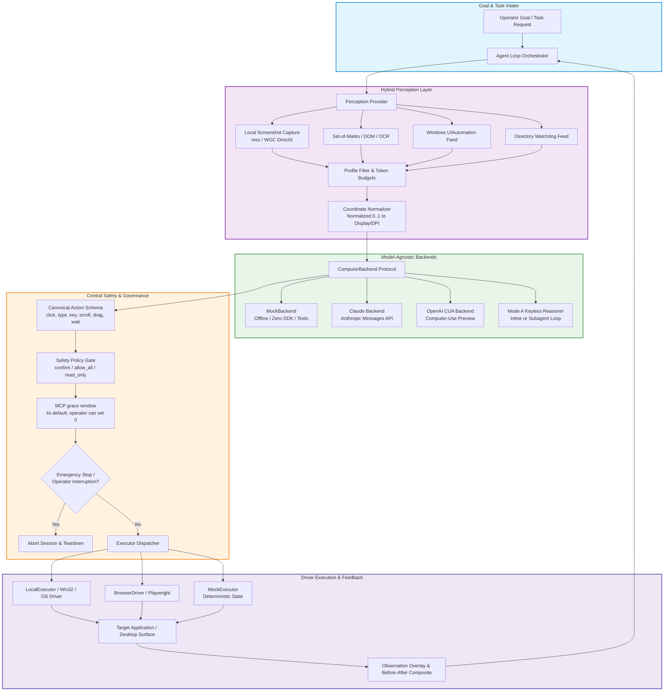
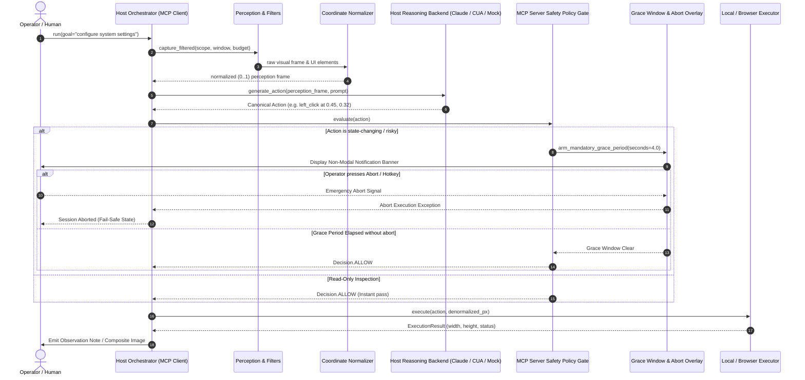

# open-compute


[🇬🇧 English](README.md) | [🇩🇪 Deutsch](README_de.md) | [🇪🇸 Español](README_es.md) | **🇫🇷 Français**

[](CHANGELOG.md)
[](pyproject.toml)
[](https://github.com/ellmos-ai/open-compute/actions/workflows/tests.yml)
[](tests)
[](tests)
[](CONTRIBUTING.md)
[](NOTICE)
[](pyproject.toml)
[](SECURITY.md)
[](SECURITY.md)
[](https://github.com/astral-sh/ruff)
[](llms.txt)
[](THIRD_PARTY_LICENSES.md)
[](THIRD_PARTY_LICENSES.txt)
[](https://github.com/ellmos-ai)
[](https://github.com/open-bricks)
[](LICENSE)

**Un cœur d’utilisation de l’ordinateur indépendant du modèle : une boucle d’agent, n’importe quel modèle de raisonnement derrière une interface unique.**

**Cowork autonome (développement) :** `oc cowork` ouvre une fenêtre d’application locale séparée
avec du texte, des fonctions vocales facultatives dans le navigateur, quatre rôles de travail humains/modèles et des observations de cible limitées
et des autorisations de tâche explicites. Un agent Codex en cours d’exécution utilise une connexion existante
(par défaut `gpt-6-astra`, configurable) ; `--worker none` active un hôte MCP externe.
Aucune dépendance à Cowork Protocol ni aucun service Node n’est nécessaire. Voir
[configuration, contrats et limites de vérification](docs/cowork/README.md).

open-compute est un petit cœur Python avec peu de dépendances, destiné à créer des
agents d’utilisation de l’ordinateur (automatisation d’interfaces graphiques/de bureau/de navigateur pilotée par LLM). Il implémente la
boucle **perception → appel d’outil du modèle → action → retour** et permet de remplacer le
modèle de raisonnement derrière une interface unique `ComputerBackend`. **Aucun
fournisseur n’est privilégié** : Anthropic Claude et OpenAI CUA sont deux backends API de
même rang, et le backend hors ligne `mock` est celui utilisé par défaut. Il existe aussi une voie **sans clé**
aujourd’hui via le mode A, où le modèle hôte raisonne lui-même — et peut exécuter cette boucle
directement dans son propre contexte ou dans un sous-agent qu’il lance lui-même pour économiser du contexte
(voir le [mode d’utilisation](#usage-pattern--inline-a-vs-self-subagent-b)). Le cœur n’a
**aucune dépendance à l’exécution** ; les SDK des fournisseurs (`anthropic`, `openai`) sont des options
**importées à la demande** — `import open_compute` fonctionne même si aucun n’est installé,
et le câblage mock par défaut d’`AgentLoop` fonctionne entièrement hors ligne. Cela ne s’applique pas aux backends Claude/OpenAI configurés ni à `oc cowork`, dont l’agent Codex utilisé par défaut peut recourir à sa connexion existante.

> [!NOTE]
> **Avis sur l’intégration IA / LLM** : `open-compute` inclut un fichier [`llms.txt`](llms.txt) lisible par machine, destiné aux agents IA, aux robots d’indexation RAG et aux flux de travail assistés par LLM.

---


## Navigation rapide

- [✨ Points forts et philosophie de base](#highlights--core-philosophy)
- [🎯 Personas cibles et facilité de découverte](#target-personas--discoverability)
- [📊 Matrice comparative avec les alternatives](#comparative-matrix-vs-alternatives)
- [🏗️ Flux d’architecture système](#system-architecture-flow)
- [🔄 Cycle de vie de la boucle d’agent et de la sécurité](#agent-loop--safety-lifecycle)
- [🛡️ Gouvernance et invariants d’exécution](#governance--runtime-invariants)
- [🌐 Écosystème voisin et dépôts partenaires](#sibling-ecosystem--partner-repositories)
- [💡 Pourquoi open-compute](#why-open-compute)
- [🤖 Backends pris en charge et état](#supported-backends--status)
- [📦 Installation et extras](#installation--extras)
- [🚀 Démarrage rapide et modes d’utilisation](#quick-start--usage-patterns)
- [⏱️ Délai de grâce obligatoire avant action](#mandatory-pre-action-grace-window)
- [🔍 Perception filtrée par profil et périmètre des fenêtres](#profile-filtered-perception--window-scoping)
- [💻 Référence des commandes CLI](#cli-command-reference)
- [🔒 Politique de sécurité et signalement des vulnérabilités](#security-policy--vulnerability-reporting)
- [🧪 Exécuter les tests](#running-tests)
- [📜 Licences tierces et transparence](#third-party-licenses--transparency)
- [📄 Licence](#license)

---

<a id="sec-01"></a><a id="highlights--core-philosophy"></a><a id="highlights--kernphilosophie"></a>
## Points forts et philosophie de base

- 🎯 **Véritable indépendance vis-à-vis du modèle** : exécutez Claude (API Messages), OpenAI CUA ou des simulations hors ligne déterministes sans réécrire votre orchestration ni la logique de vos prompts.
- 📐 **Coordonnées normalisées unifiées (0..1)** : les modèles produisent des flottants invariants `[0.0, 1.0]`. Les différences de résolution, les décalages entre écrans et les facteurs de mise à l’échelle PPP/DPI du système sont résolus de manière centralisée dans `coordinates.py`.
- 🛡️ **Délai de grâce MCP avant action** : les appels MCP soumis au contrôle utilisent l’attente configurée par l’opérateur (4 secondes par défaut, avec une période de refroidissement de 120 secondes après activité) ; l’opérateur peut la régler à 0. Les chemins CLI directs et `AgentLoop` du SDK n’utilisent pas cette attente MCP.
- 🚦 **Contrôle de sécurité centralisé** : les modes de politique configurables (`confirm`, `allow_all`, `read_only`) interceptent chaque clic de souris, frappe clavier, glissement et exécution de processus avant son envoi au système d’exploitation.
- 🔌 **Aucune dépendance à l’exécution** : la boucle d’agent centrale et l’exécuteur simulé n’exigent que la bibliothèque standard Python. Les SDK fournisseurs (`anthropic`, `openai`, `mss`, `playwright`) sont chargés à la demande comme extras.
- 🪟 **Perception filtrée par profil** : les outils MCP filtrés par profil appliquent le profil choisi aux résultats renvoyés ; `capture` ordinaire n’est pas filtré et peut renvoyer l’ensemble du bureau virtuel.

---

<a id="sec-08"></a><a id="why-open-compute"></a><a id="warum-open-compute"></a>
## Pourquoi open-compute

Chaque modèle d’utilisation de l’ordinateur — l’outil `computer` de Claude d’Anthropic et
l’outil d’utilisation de l’ordinateur d’OpenAI — partage la même *forme* de boucle d’agent, mais diffère par le transport,
le repère de coordonnées et les noms d’action. open-compute factorise les éléments communs pour
que vous écriviez la boucle une seule fois et puissiez remplacer librement le modèle de raisonnement derrière une
interface `ComputerBackend` unique :

- Un **schéma canonique d’actions**, avec un mapper par backend.
- Des **coordonnées normalisées (0..1)** en interne, dénormalisées selon le backend /
  la résolution / le DPI par un utilitaire testé unique — le problème du DPI est résolu de façon centralisée.
- Un **contrôle de sécurité central** (« confirmer avant les actions risquées »), évalué avant
  chaque action.
- Une interface de **perception hybride** (capture d’écran + Set-of-Marks / accessibilité /
  DOM), qui permet de passer de la vision purement pixelisée au ciblage sémantique.

---

<a id="sec-02"></a><a id="target-personas--discoverability"></a><a id="zielgruppen--auffindbarkeit"></a>
## Personas cibles et facilité de découverte

`open-compute` est conçu pour répondre aux exigences opérationnelles, aux limites de confidentialité et aux normes de précision de quatre grands profils de praticiens :

| ID persona | Public cible | Besoin principal | Solution architecturale clé d’open-compute |
|---|---|---|---|
| `[PERSONA-01]` | **Ingénieurs d’agents IA d’entreprise et architectes de plateformes** | Un cœur d’agent de bureau dont le modèle peut être remplacé, sans dépendance exclusive à un fournisseur propriétaire ni fragmentation des coordonnées. | Protocole `ComputerBackend` unique, schéma canonique `Action` unifié (`actions.py`), coordonnées normalisées `[0.0, 1.0]` (`coordinates.py`) et `MockBackend` hors ligne. |
| `[PERSONA-02]` | **Développeurs d’agents open source et chercheurs en IA** | Un cœur transparent et léger pour évaluer les boucles perception-action sans images Docker massives ni coûts cloud. | Aucune dépendance obligatoire à l’exécution (cœur en bibliothèque standard Python pure), banc de test hors ligne déterministe et flux de perception hybrides enfichables. |
| `[PERSONA-03]` | **Responsables conformité sécurité, sûreté et gouvernance** | Garantir la supervision humaine, les arrêts d’urgence et une absence stricte de télémétrie lors de l’exécution d’interfaces graphiques. | Délai MCP configuré par l’opérateur (4 secondes par défaut ; 0 est autorisé) (`INV-GRC-04`), contrôle de sécurité fail-closed à 3 niveaux (`INV-SAF-05`) et mode utilisateur non élevé (`INV-USR-06`). La boucle de simulation par défaut est hors ligne ; les backends fournisseurs configurés et l’agent Codex de Cowork peuvent utiliser des fournisseurs externes, tandis que MCP renvoie le contenu à son appelant (`INV-EGR-07`). |
| `[PERSONA-04]` | **Spécialistes de l’automatisation de bureau et d’interfaces graphiques (modernisation de la RPA)** | Moderniser des scripts RPA fragiles fondés sur les pixels (PyAutoGUI, AutoHotkey) en actions robustes, sémantiques et pilotées par LLM. | Remise à l’échelle des coordonnées indépendante du DPI, périmètre des fenêtres UIA avec budget de jetons (`perception_filter.py`) et utilitaires CLI natifs (`oc do`, `oc capture`, `oc click-name`). |

### Requêtes de recherche à forte intention et découverte

Pour faciliter la découverte technique rapide et l’indexation en langage naturel dans les catalogues open source, les registres de paquets et les moteurs de recherche pour développeurs :

- `python computer use agent core` — Runtime léger d’agent d’utilisation de l’ordinateur, indépendant du modèle et écrit en Python pur.
- `claude computer use alternative python` — Framework indépendant des fournisseurs prenant en charge Anthropic Claude, OpenAI CUA et les simulations hors ligne.
- `model agnostic gui automation llm` — Boucle d’agent unique pour les modèles vision-langage pilotant des interfaces de bureau et de navigateur.
- `normalized coordinates screen automation` — Normalisation des coordonnées (0..1) indépendante de la résolution et du DPI pour les actions IA à l’écran.
- `safe desktop automation agent framework` — Contrôle de sécurité fail-closed avec délai configurable de 4 secondes par défaut avant action et interruption par l’opérateur.
- `set of marks gui agent python` — Perception hybride combinant vision de capture d’écran, Set-of-Marks et arbres Windows UIAutomation.

---

<a id="sec-03"></a><a id="comparative-matrix-vs-alternatives"></a><a id="vergleichsmatrix-gegenüber-alternativen"></a>
## Matrice comparative avec les alternatives

La matrice suivante compare `open-compute` à des architectures alternatives courantes selon 10 dimensions techniques directement liées à ses invariants formels de gouvernance :

| Dimension technique | Invariant de gouvernance | open-compute | Démo de référence Anthropic (Docker) | Cadres de benchmark OSWorld / Agent-S | Outils RPA classiques (PyAutoGUI / Selenium) | Scripts ad hoc / wrappers Shell |
|---|---|---|:---:|:---:|:---:|:---:|
| **Indépendance vis-à-vis du modèle** | `INV-MOD-01` | **Complète (Claude, OpenAI CUA, Mock, Mode A)** | API Messages de Claude uniquement | Multi-modèle via wrapper | Aucun (pas de raisonnement LLM) | Aucun (logique codée en dur) |
| **Dépendances d’exécution** | `INV-DEP-02` | **0 (cœur en bibliothèque standard Python pure)** | Docker + Node + Python lourds | Image Docker massive (>20 GB) | Extensions C natives et pilotes lourds | Binaires dépendant du système |
| **Normalisation des coordonnées** | `INV-CRD-03` | **Normalisation unifiée 0..1 + remise à l’échelle DPI centrale** | Coordonnées fixes en pixels (1024x768, etc.) | Pixels avec dérive de mise à l’échelle | Pixels fixes de l’écran (échec si le DPI change) | Coordonnées en pixels codées en dur |
| **Délai de grâce avant action** | `INV-GRC-04` | **4 s par défaut + refroidissement de 120 s ; l’opérateur peut régler à 0** | Aucun (exécution immédiate) | Aucun (exécution du benchmark) | Aucun (exécution instantanée) | Aucun |
| **Contrôle de sécurité fail-closed** | `INV-SAF-05` | **Contrôle de politique à 3 niveaux (`confirm`, `allow_all`, `read_only`)** | Avertissements consultatifs dans le prompt uniquement | Aucun (non restreint dans la VM) | Aucun (exécution à l’aveugle) | Aucun |
| **Exécution sans élévation** | `INV-USR-06` | **RunAsInvoker strict (mode utilisateur sans élévation)** | Root dans le conteneur Docker | Root / Sudo dans la machine virtuelle | Demande souvent des privilèges administrateur | Risque d’élévation incontrôlée |
| **Sortie réseau de la simulation par défaut** | `INV-EGR-07` | **La boucle de simulation par défaut est hors ligne ; les fournisseurs/Cowork/hôtes MCP configurés peuvent transmettre des données** | Connexion cloud obligatoire | VM connectée au réseau avec télémétrie | Exécution locale, mais sans politique de confidentialité | Dépend du script |
| **Persistance des clés API** | `INV-SEC-08` | **Aucune persistance intentionnelle des clés API ; captures/actions peuvent contenir des données sensibles et ne sont pas systématiquement expurgées** | Variables d’environnement dans le conteneur | Fichiers de configuration avec jetons intégrés | Identifiants en clair codés en dur | Variables ou scripts en texte brut |
| **Périmètre sémantique des fenêtres** | `INV-SCP-09` | **Filtrage selon le profil choisi ; capture ordinaire non filtrée** | Capture plein écran uniquement | Captures du bureau complet | Recherche de poignée de fenêtre ou bureau complet | Mise au premier plan naïve |
| **Engagement de sécurité et SLA** | `INV-SLA-10` | **SLA contractuel : réponse sous 48 h et triage sous 5 jours** | Aperçu développeur au mieux des efforts | Dépôt académique (file de tickets) | Forum communautaire / offres commerciales | Aucun SLA de sécurité ou de maintenance |

---

## Architecture système

<a id="sec-04"></a><a id="system-architecture-flow"></a><a id="systemarchitektur-ablauf"></a>
### Flux d’architecture système



### Projection topologique de l’architecture en quatre vues

```
+===================================================================================================================+
|                                    OPEN-COMPUTE ARCHITECTURAL TOPOLOGY (4 VIEWS)                                  |
+===================================================================================================================+
| [VIEW 1: CALLER RUNTIMES & AGENT CLIENTS]                                                                         |
|  * Autonomous LLM Agents (Claude Desktop, Antigravity, OpenAI Codex, Ollama) via MCP Server (open-compute-mcp)    |
|  * Developer Terminal & DevOps CLI Harness (oc do | capture | click-name | move-window)                            |
|  * Python SDK Client Consumers (from open_compute import AgentLoop, MockBackend, LocalExecutor)                   |
|  * Unprivileged User-Mode Invocation [INV-USR-06] -- Strict RunAsInvoker, zero administrative elevation prompts   |
+-------------------------------------------------------------------------------------------------------------------+
                                                          |
                                                          v
+-------------------------------------------------------------------------------------------------------------------+
| [VIEW 2: SOVEREIGN ENGINE & ORCHESTRATION PIPELINE]                                                               |
|  * Core Agent Loop (loop.py) -- Deterministic perception -> backend -> safety -> execute -> feedback orchestrator  |
|  * Model-Agnostic Backend Router (backends/) [INV-MOD-01] -- Claude Messages API, OpenAI CUA, MockBackend, Mode A |
|  * Canonical Action Schema (actions.py) -- click, type, key, scroll, drag, wait normalized across models           |
|  * Unified Coordinate Normalizer (coordinates.py) [INV-CRD-03] -- Normalized [0.0, 1.0] to native resolution/DPI   |
|  * Central Safety Policy Gate (safety.py) [INV-SAF-05] -- 3-tier policy interception (confirm / allow_all / read)  |
|  * MCP grace: 4s default, operator can set 0 (mcp_server.py) [INV-GRC-04] -- 120s activity cooldown         |
+-------------------------------------------------------------------------------------------------------------------+
                                                          |
                                                          v
+-------------------------------------------------------------------------------------------------------------------+
| [VIEW 3: RUNTIME PERSISTENCE, RUN RECEIPTS & EVIDENCE LEDGER]                                                     |
|  * Profile-Filtered Perception & Window Scoping (perception_filter.py) [INV-SCP-09] -- Token-budgeted UIA filter   |
|  * Visual Evidence & Composites (compose / Pillow) -- Before/after screenshots, Set-of-Marks, observation overlays |
|  * Offline Deterministic Mock Substrate (MockExecutor, MockBackend) [INV-DEP-02] -- 0 mandatory runtime deps      |
|  * API-key handling [INV-SEC-08] -- no intentional API-key persistence; captures may include sensitive data              |
+-------------------------------------------------------------------------------------------------------------------+
                                                          |
                                                          v
+-------------------------------------------------------------------------------------------------------------------+
| [VIEW 4: DEFAULT-MOCK EGRESS, CONFIGURED NETWORK PATHS & GOVERNANCE BOUNDARY]                                      |
|  * Default mock loop offline; configured providers/Cowork/MCP hosts may transmit data [INV-EGR-07]             |
|  * Pure Python Standard Library Core Runtime -- Zero external dependencies (cpython) [INV-DEP-02]                  |
|  * Dependency license inventory -- see listed packages; future/transitive terms are not guaranteed                |
|  * Multi-Host Cloud-Sync & Lock Defense -- Hardened .gitignore, conflict-copy resistance, canonical lock guards   |
|  * Binding Security Response Commitment [INV-SLA-10] -- 48h initial response SLA & 5-day triage SLA              |
+===================================================================================================================+
```

<a id="sec-05"></a><a id="agent-loop--safety-lifecycle"></a><a id="agenten-loop--sicherheits-lebenszyklus"></a>
### Boucle d’agent et cycle de vie de la sécurité

Il s’agit d’un flux conceptuel orchestré par l’hôte via MCP, et non du graphe d’appels de l’`AgentLoop` du SDK : le raisonnement du modèle s’effectue dans l’hôte, pas dans le serveur MCP. La valeur de 4,0 secondes du diagramme est le délai par défaut ; l’opérateur peut la régler à 0, les chemins CLI/SDK directs n’utilisent pas ce mécanisme de grâce MCP et les appels MCP à `capture` sont eux aussi soumis au contrôle.



### Organisation des composants

```
                        +-----------------------------------------+
                        |        AGENT LOOP / ORCHESTRATOR        |
                        |  goal -> perceive -> backend -> safety  |
                        |        -> execute -> re-perceive        |
                        +-------------------+---------------------+
                                            |
        +-----------------------------------+-----------------------------------+
        |                                   |                                   |
+-------v---------+              +----------v-----------+            +----------v----------+
| PERCEPTION      |              | CANONICAL ACTIONS    |            | SAFETY / POLICY     |
| - screenshot    |              | click/type/key/      |            | - confirm-at-action |
| - set-of-marks  |              | scroll/drag/wait/    |            | - allow / deny list |
|   (OmniParser)* |              | screenshot + OS ext  |            | - read-only mode    |
| - accessibility*|              | (launch/activate)    |            | - audit log         |
+-------+---------+              +----------+-----------+            +----------+----------+
        |                                   |                                   |
        +-----------------+-----------------+----------------------------------+
                          |
              +-----------v------------+   COORDINATE / DPI NORMALIZATION
              | BACKEND ABSTRACTION    |   - internal: normalized (0..1)
              | (ComputerBackend)      |   - denormalize per backend:
              +-----+--------+---------+     * Claude: global px (display_w x display_h)
                    |        |    |          * OpenAI: px (computer_call)
        +-----------+        |    +-----------+   * Mock: synthetic
        |                    |                |
+-------v-------+   +--------v-------+  +-----v---------+
| Claude        |   | OpenAI CUA     |  | Mock backend  |
| computer_2025 |   | computer-use-  |  | (no SDK,      |
| 1124 + beta   |   | preview [?]    |  |  offline)     |
| (host runs)   |   | (host runs)    |  |               |
+---------------+   +----------------+  +---------------+

  * = stub / interface in this release (see Status)
```

---

<a id="sec-06"></a><a id="governance--runtime-invariants"></a><a id="governance--laufzeit-invarianten"></a>
## Gouvernance et invariants d’exécution

L’architecture applique des invariants opérationnels stricts afin d’assurer la sécurité, la répétabilité et une exécution non destructive :

| ID | Capacité / invariant | Mécanisme d’implémentation | Garantie de sécurité et d’architecture |
|:---|:---|:---|:---|
| `INV-MOD-01` | **Cœur indépendant du modèle** | Abstraction par le protocole `ComputerBackend` | Remplacer Claude, OpenAI CUA ou la simulation hors ligne sans réécrire la boucle d’agent. |
| `INV-DEP-02` | **Aucune dépendance à l’exécution** | Imports facultatifs et différés des SDK et pilotes de plateforme | Bibliothèque standard Python pure à l’importation ; les SDK fournisseurs (`anthropic`, `openai`) sont strictement facultatifs. |
| `INV-CRD-03` | **Coordonnées normalisées (0..1)** | Remise à l’échelle centrale selon le DPI et la résolution dans `coordinates.py` | Résolution d’écran et mise à l’échelle DPI traitées de manière centralisée ; les modèles travaillent toujours dans l’espace invariant (0..1). |
| `INV-GRC-04` | **Délai de grâce MCP avant action** | 4 secondes par défaut ; l’opérateur peut régler à 0 | S’applique uniquement aux appels MCP soumis au contrôle ; les chemins CLI/SDK directs et `AgentLoop` n’utilisent pas cette attente. |
| `INV-SAF-05` | **Contrôle de sécurité fail-closed** | Évaluateur central `SafetyPolicy` (`confirm`, `allow_all`, `read_only`) | Les actions potentiellement destructrices sont bloquées par défaut jusqu’à l’approbation d’un callback de confirmation humaine. |
| `INV-USR-06` | **Mode utilisateur sans élévation** | Permissions utilisateur standard de l’API Win32/du système d’exploitation | Aucune élévation administrative (`RunAsInvoker`) ; exécution dans le contexte de sécurité d’un utilisateur standard. |
| `INV-EGR-07` | **Sortie réseau de la simulation par défaut** | Backend de simulation hors ligne et exécuteur local par défaut | La boucle de simulation par défaut est hors ligne ; les fournisseurs configurés et l’agent Codex de Cowork peuvent utiliser des services externes, et un hôte MCP peut transmettre le contenu renvoyé par le serveur. |
| `INV-SEC-08` | **Persistance des clés API** | Injection de clé API dans le backend | Le paquet ne persiste pas intentionnellement les clés API ; les captures et le contenu des actions peuvent contenir des données sensibles et ne sont pas systématiquement expurgés. |
| `INV-SCP-09` | **Perception filtrée par profil** | Filtres et lentilles visuelles du profil sélectionné | Les outils MCP filtrés appliquent les exclusions configurées au contenu renvoyé ; `capture` ordinaire n’est pas filtré et peut renvoyer le bureau complet. |
| `INV-SLA-10` | **SLA de réponse aux incidents de sécurité** | Contact sécurité dédié et processus de gestion des vulnérabilités | Accusé de réception sous 48 heures et triage sous 5 jours ouvrés, selon l’engagement de `SECURITY.md`. |

---

<a id="sec-07"></a><a id="sibling-ecosystem--partner-repositories"></a><a id="geschwisterwerkzeuge--partner-repositories"></a>
## Écosystème voisin et dépôts partenaires

`open-compute` est conçu pour servir de moteur d’exécution visuelle et d’interface graphique au sein de l’écosystème fédéré plus vaste d’automatisation multi-agent **ellmos-ai** et **open-bricks** :

| Dépôt | Rôle et spécialisation | Intégration dans l’écosystème |
|:---|:---|:---|
| [`ellmos-ai/bach`](https://github.com/ellmos-ai/bach) | Orchestration et pipelines multi-agents | Framework principal d’orchestration des flux de travail d’agents autonomes. |
| [`ellmos-ai/usmc`](https://github.com/ellmos-ai/usmc) | Gestion et contrôle universels de l’état | Coordination centrale de l’état du système entre agents distribués. |
| [`ellmos-ai/connectors`](https://github.com/ellmos-ai/connectors) | Connecteurs asynchrones sans dépendance | Adaptateurs de protocole pour Telegram, Discord, GitHub et les webhooks locaux. |
| [`ellmos-ai/clutch`](https://github.com/ellmos-ai/clutch) | Clutch multi-agent hautes performances | Routage IPC à faible latence, transferts et couplage de processus. |
| [`ellmos-ai/companion-for-agy`](https://github.com/ellmos-ai/companion-for-agy) | Compagnon de bureau et superviseur | Superviseur de session en arrière-plan et superposition d’indicateur pour Antigravity. |
| [`ellmos-ai/system-auditor`](https://github.com/ellmos-ai/system-auditor) | Suite de diagnostic de santé multi-agent | Vérification approfondie du système d’exploitation, de l’environnement hôte et de l’état des processus. |
| [`dev-bricks/lock-master`](https://github.com/dev-bricks/lock-master) | Synchronisation canonique des verrous | Gestion de la concurrence des fichiers et processus sur plusieurs appareils. |
| [`dev-bricks/ticket-master`](https://github.com/dev-bricks/ticket-master) | Dispatch unifié des tickets et problèmes | Suivi des problèmes entre dépôts et attribution automatisée des tâches. |
| [`dev-bricks/automation-master`](https://github.com/dev-bricks/automation-master) | Superviseur du cycle de vie des tâches | Orchestration des tâches planifiées, surveillance des processus auxiliaires et signaux de vie. |
| [`file-bricks/CloudLockFixer`](https://github.com/file-bricks/CloudLockFixer) | Résolution des verrous cloud et réparation des conflits | Résolution automatique des blocages pour OneDrive et le stockage cloud. |
| [`open-bricks/.github`](https://github.com/open-bricks/.github) | Gouvernance de l’organisation et normes CI | Normes open source globales, socle de sécurité et politiques de publication. |

---

<a id="sec-10"></a><a id="installation--extras"></a><a id="installation"></a>
## Installation et extras

> [!IMPORTANT]
> **Pas de publication sur PyPI — installation depuis Git.** Ce projet n’a pas encore de version PyPI. Le
> nom `open-compute` sur PyPI est déjà utilisé par un projet **sans rapport** (« systèmes
> multi-agents pour les technologies de santé ») ; une commande `pip install open-compute` ordinaire installe
> donc le paquet d’un tiers. Installez toujours depuis ce dépôt :

```bash
pip install "git+https://github.com/ellmos-ai/open-compute.git"                        # core only, zero runtime deps
pip install "open-compute[claude] @ git+https://github.com/ellmos-ai/open-compute.git" # + anthropic SDK
```

La même forme `extra @ git+…` fonctionne pour chacun des extras ci-dessous :

| Extra | Ajoute |
|---|---|
| `claude` | SDK anthropic |
| `openai` | SDK openai |
| `local` | mss — captures d’écran et entrées réelles sous Windows |
| `wgc` | repli WGC pour les surfaces DirectX (installe numpy/OpenCV) |
| `compose` | Pillow — composites Before\|After et captures annotées |
| `watch` | watchdog — événements natifs du système de fichiers pour le flux de surveillance de répertoires |
| `clirec` | paquet externe clirec pour les flux `oc rec` |
| `record` | compatibilité avec le backend de capture clirec[record] |
| `mcp` | SDK mcp — serveur MCP (script console : `open-compute-mcp`) |
| `dev` | pytest |
| `all` | anthropic, openai, playwright, mss, WGC, Pillow, watchdog, clirec, mcp |

Les extras se combinent normalement, par exemple `open-compute[local,wgc,claude]`. Vous travaillez plutôt depuis un
clone ? Exécutez `pip install -e ".[local,claude]"` depuis la racine du dépôt.

Tant que `clirec` n’a pas de version publiée, installez-le directement si vous utilisez `oc rec` :

```bash
pip install git+https://github.com/ellmos-ai/clirec.git
```

Python 3.10 ou version ultérieure.

---

<a id="sec-11"></a><a id="quick-start--usage-patterns"></a><a id="schnellstart--nutzungsmuster"></a>
## Démarrage rapide et modes d’utilisation

<a id="sec-14"></a><a id="cli-command-reference"></a><a id="cli-befehlsreferenz"></a>
### Mode A et référence CLI : le session-agent comme raisonneur (compétence de chat)
Lancez `oc capture` / `oc do` manuellement depuis une session Claude Code. Le modèle de la session
voit le PNG via l’outil Read et décide de l’action suivante :

```bash
# 1. Install the local extra (Windows only; provides real screenshots + input)
pip install "open-compute[local] @ git+https://github.com/ellmos-ai/open-compute.git"

# 2. Capture a screenshot — saved automatically to _session/ (never loose on Desktop)
oc capture
# -> {"path": ".../_session/0001_20260620_143200.png", "width": 1920, "height": 1080}
# Then: read the PNG with your Read tool to see the screen.

# 3a. Execute one canonical action (single, backwards-compatible)
oc do '{"type":"mouse_move","x":0.5,"y":0.5}' --mode allow_all
oc click-name "Save" --window "Word" --yes  # semantic click, verified window

# 3b. Execute with Before|After composite (Pillow optional)
oc do '{"type":"key","text":"ctrl+s"}' --label "save" --yes
# -> {"result":"executed","action":"key","composite":"_session/0002_save.png"}

# 3c. Execute a batch/macro (JSON array, one call = multiple actions)
oc do '[{"type":"mouse_move","x":0.5,"y":0.5},{"type":"key","text":"tab"}]' --yes
# -> {"result":"batch","count":2,"width":1920,"height":1080}

# 3d. Ensure the target window is in the foreground before acting
oc do '{"type":"key","text":"ctrl+s"}' --ensure-foreground "Word" --yes

# 3e. Save a full-res after-shot + annotated click marker (v0.5, Pillow optional)
oc click-name "Save" --window "Word" --yes --fullres
# -> {"result":"executed",...,"fullres_annotated":"_session/...fullres.png"}

# 3f. Capture only the active window's bounding rect (v0.5, Windows)
oc capture --window "Word"
# -> {"path":"...","width":800,"height":600,"window":"Word","region":{...}}

# 3g. Watch a directory for changes (v0.5)
oc watch-dir ~/Downloads --for 5       # collect 5 s, print JSON events
oc watch-dir ~/Downloads --once        # one-time snapshot diff

# 3h. Explicit companion handoff (mutations need a granted, scoped lease)
oc session companion --owner local-user
oc session request-control --owner agent-a --scope window:42 --ttl 60
oc session grant --lease-id <lease_id-from-previous-output>
oc window minimize --hwnd 42 --yes

# 3i. Bounded, deduplicated window capture (full screen needs explicit opt-in)
oc capture-series --window "Word" --max-frames 8 --stable-frames 2

# 4. Recapture and repeat until done (or read the "composite" After-shot directly).
```
Voir `SKILL.md` pour le protocole complet de la boucle, le schéma des actions, le guide des coordonnées et la
référence des variables d’environnement.

### Flux jumelé d’observation et de presse-papiers
Lorsque la personne souhaite garder la maîtrise de la souris, du clavier, des choix et des actions finales de publication,
utilisez la compétence fournie
[`open-compute-clipboard-companion`](./skills/open-compute-clipboard-companion/SKILL.md).
L’agent laisse le signal bleu `OBSERVE` visible, lit le champ courant et place uniquement le texte correspondant ou le chemin de fichier
vérifié dans le presse-papiers de l’hôte. Dans ce flux, il ne clique, ne colle, ne s’authentifie ni ne soumet rien.

### Mode de collaboration (observation et aide ciblée)
Pour un mode jumelé plus riche en trois volets (ticket T-20260825-767105130), utilisez la compétence
fournie
[`open-compute-work-together`](./skills/open-compute-work-together/SKILL.md) :
(1) `note_observation` écrit de courtes observations en langage clair dans une petite fenêtre de notes non modale,
toujours au premier plan (miroir de `chat`) — un aperçu peu bruyant de « ce que voit la machine » plutôt qu’un journal de console chargé — et la réponse revient par `chat`, dont les `choices` facultatives transforment la réponse en un clic plutôt qu’en saisie ; (2)
la partie presse-papiers ci-dessus, référencée plutôt que dupliquée ; (3) une
**prise en main temporaire** strictement limitée — après que la personne a visiblement
placé le focus sur un champ, l’agent peut effectuer exactement un appel `type` (éventuellement précédé
d’un `left_click` de confirmation sur ce même champ) pour le remplir, puis
rend immédiatement le contrôle et n’enchaîne jamais d’autres actions sans un nouveau
focus visible de la personne. La période de refroidissement de la fenêtre obligatoire de
grâce avant action (voir plus bas) évite déjà qu’une prise en main temporaire suivante ne
redéclenche sa propre attente ; aucun traitement spécial n’est nécessaire.

Poser une question à choix plutôt que laisser un champ vide :

```python
chat(
    context="Which hypothesis fits what bothers you here?",
    choices=["The list is too long", "Wrong sort order", "I cannot find the button"],
)
# -> {"chat_message": "Wrong sort order", "choice_index": 1, "screenshot": None}
```
Jusqu’à huit options de 120 caractères maximum s’affichent sous forme de boutons
activables d’un clic au-dessus du champ de texte libre habituel, qui reste disponible — une réponse
saisie revient simplement avec `choice_index: null`.

#### Conversation de bureau continue via MCP

L’outil MCP `chat` ouvre une fenêtre de bureau Tk ordinaire et la relie au modèle hôte appelant
par un canal de retour. Le modèle hôte répond dans son propre canal, puis renvoie sa réponse effective sous la forme
`assistant_message` avec le même `chat_id`. L’hôte attribue un `assistant_turn_id` unique à chaque réponse ;
les nouvelles tentatives avec le même identifiant renvoient le même tour humain et n’affichent pas la
réponse deux fois.

```text
1. chat() -> chat_id, chat_message, mode, screenshot
2. Host model creates a real answer based on that message
3. chat(chat_id=..., assistant_turn_id="turn-1", assistant_message="...")
   -> next chat_message; the answer appears in the same window
4. Repeat until the window is closed (status="closed")
```

La fenêtre affiche l’historique avec les rôles, propose les modes « General », « Brief »,
« Brainstorming » et « Screen help », et présente les suggestions du modèle sous forme de
réponses cliquables. Le mode sélectionné et une instruction de réponse concrète sont
renvoyés au modèle hôte. Les captures du bureau complet ne sont prises que si la case de consentement
est cochée ou si `shot=true` est explicitement transmis. Un appel MCP en attente prend fin
après au plus 3 600 secondes ; l’état `status="waiting_for_human"` peut être repris avec
`poll=true` et le même `chat_id`. « End chat » ou fermer la fenêtre libère
l’appel. L’historique reste visible pendant la session de cette fenêtre et n’est pas stocké dans une base de données de chat.

Trois raccourcis de collaboration — « Short break », « I’m back » et « Help and
suggestions » — insèrent des brouillons modifiables dans le champ de message. Ils n’envoient pas
le brouillon et ne lancent aucun travail en arrière-plan. L’observation continue de l’écran n’est
pas implémentée ; l’aide à l’écran utilise uniquement la capture explicitement consentie pour
ce tour.

Le bouton du microphone est activé lorsque le runtime vocal local et le modèle allemand
sont installés. Cliquez une fois pour commencer l’enregistrement, puis de nouveau pour l’arrêter ; les enregistrements
sont limités à 60 secondes. L’enregistreur Windows MCI existant écrit un fichier WAV temporaire,
que `ellmos-voice-io` transcrit localement via Vosk. La transcription est
insérée dans le champ de message modifiable et n’est jamais envoyée automatiquement. L’audio
ne fait pas partie des messages MCP ; le WAV temporaire est supprimé après la transcription,
l’annulation ou la fermeture de la fenêtre. L’outil de chat ne télécharge aucun modèle.

Dans le même environnement virtuel que celui qui exécute le serveur MCP, installez l’extra Vosk
et le checkout local de `ellmos-voice-io` :
```powershell
python -m pip install ".[voice-vosk]"
python -m pip install --no-deps --editable "<path to ellmos-voice-io checkout>"
```

Placez le petit modèle allemand officiel dans
`%LOCALAPPDATA%\open-compute\models\vosk-model-small-de-0.15`, ou définissez
`OPEN_COMPUTE_VOSK_MODEL` sur un autre répertoire de modèle local. L’archive du modèle fait
45 MB et est sous licence Apache-2.0. Le runtime reste facultatif : sans le
paquet ou le modèle, le bouton du microphone est désactivé et la fenêtre indique
le prérequis local manquant.

#### Messages-Line local dans la fenêtre de chat

La fenêtre de chat peut afficher directement la Messages-Line locale de Ticket-Master. Elle
utilise uniquement les API `MessagesLine.list_for_delivery()`, `read_for_delivery()`,
`delivery_targets()`, `record_observation()` et `acknowledge()` explicite du commit Ticket-Master épinglé
`3b3fc86f2b9e2aedc8886cd737d439d70a1e3b2a`. Le lanceur prépare un instantané immuable à côté d’open-compute et de VoiceIO ; il n’y a ni installation Python globale
ni deuxième boîte de réception ou registre de reçus.

Sans politique, magasin ni cible `local_gui` existants fournis explicitement,
l’affichage de Messages-Line reste DÉSACTIVÉ. Lorsque Ticket-Master a enregistré un magasin local canonique,
un fichier de politique actif et une cible GUI locale correspondante, transmettez ces
chemins existants au lancement :

```powershell
.\scripts\open_compute_chat.ps1 `
  -Model "<available host model>" `
  -Workspace "<selected workspace folder>" `
  -MessagesDir "<existing Ticket-Master Messages-Line store>" `
  -MessagesConfig "<active Ticket-Master policy file>" `
  -MessagesTargetRef "<configured local_gui target>"
```

La barre latérale de la fenêtre charge `chat_start` à l’ouverture, `on_demand` uniquement quand « Check
now » est cliqué et `active_chat` au plus toutes les 15 secondes tant que la fenêtre est
ouverte. Les listes n’affichent que les identifiants et les modes ; la sélection d’un élément résout son contenu et
réévalue la politique actuelle avant l’affichage, la confirmation de réception et le maintien de la
visibilité. La confirmation automatique à l’ouverture de l’interface graphique n’a lieu qu’après le rendu et
uniquement si la politique active l’autorise. « Confirm receipt » appelle uniquement l’API
de confirmation manuelle. Le texte des messages est strictement traité comme du contenu de données,
et non comme des instructions du modèle ou du système.

L’outil lui-même n’appelle aucun modèle ni fournisseur. Il utilise le raisonneur hôte déjà connecté
et ne nécessite pas de clé fournisseur supplémentaire.

Un lanceur dédié est inclus pour la boîte de dialogue de bureau Codex directement connectée.
Depuis un commit propre, il prépare un instantané immuable de cette révision précise et un profil Codex
nommé d’après le commit, qui enregistre le serveur MCP épinglé avec le seul outil `chat`, sans modifier la
configuration globale :

```powershell
.\scripts\open_compute_chat.ps1 -PrepareOnly
```

Pour ouvrir une boîte de dialogue interactive, transmettez explicitement à la fois un modèle disponible dans votre compte
Codex et le répertoire de l’espace de travail cible :
```powershell
.\scripts\open_compute_chat.ps1 -Model "<model from your Codex account>" -Workspace "<workspace folder>" -Context "How can I help?"
```

Le lanceur utilise votre connexion Codex existante et ouvre la fenêtre native de chat
via le serveur MCP limité au chat. La fermeture de la session Codex ou de la fenêtre
ferme le canal de retour vers l’hôte.

### Mode B — Boucle autonome avec un backend API

Le backend se sélectionne par son nom ; `claude` et `openai` sont pris en charge au même titre
(chacun nécessite sa propre clé et son extra). Pour une voie **sans clé**, utilisez le mode A ci-dessus : le
modèle hôte raisonne lui-même, éventuellement dans un sous-agent qu’il lance (voir le
[mode d’utilisation](#usage-pattern--inline-a-vs-self-subagent-b)).

```bash
# Claude (needs ANTHROPIC_API_KEY + open-compute[local,claude]):
oc run "Find the latest invoice in the Downloads folder" --backend claude --max-steps 15

# OpenAI (needs OPENAI_API_KEY + open-compute[local,openai]):
oc run "Find the latest invoice in the Downloads folder" --backend openai --max-steps 15
```

Ou en Python — `get_backend(name, ...)` construit le backend nommé ; injectez votre
propre exécuteur ou utilisez `LocalExecutor` :

```python
from open_compute import AgentLoop, Config, get_backend
from open_compute.drivers.local import LocalExecutor   # Windows; needs mss
from open_compute.safety import SafetyPolicy

executor = LocalExecutor()   # real display + input
config = Config(backend="claude", scope="os",
                display_width=executor.width, display_height=executor.height)
backend = get_backend("claude", executor.width, executor.height, model="claude-opus-4-8")

loop = AgentLoop(
    config,
    backend=backend,
    executor=executor,
    policy=SafetyPolicy(mode="confirm",
                        confirm_callback=lambda a: input(f"run {a.type.value}? [y/N] ") == "y"),
)
loop.run("Find the latest invoice in the Downloads folder")
```

### Essai à blanc hors ligne (sans clé API, sans écran, simulation uniquement)

```python
from open_compute import AgentLoop, Config

loop = AgentLoop(Config(backend="mock", safety_mode="allow_all"))
result = loop.run("Open the settings page and enable dark mode")
print(result.done, result.steps)
for trace in result.traces:
    print(trace.index, trace.backend_message, [a.type.value for a in trace.executed])
```

---

## Serveur MCP (appels d’outils natifs, sans clé)

Exposez la boucle **mode A** sans clé sous forme d’**outils natifs** à tout client MCP — le
client assure le raisonnement (sans clé API, indépendant du modèle). Par rapport à l’utilisation manuelle de `oc`,
un serveur de longue durée conserve un `LocalExecutor` **unique et déjà initialisé** en mémoire (pas de redémarrage
de Python pour chaque action) et renvoie les captures d’écran sous forme de blocs MCP **image**. La capture et les entrées
réelles sont réservées à Windows.

```bash
pip install "open-compute[mcp,local,uia,wgc] @ git+https://github.com/ellmos-ai/open-compute.git"
open-compute-mcp          # stdio server (console script)
```

**Outils (19) :** `capture` · `observe_filtered` · `capture_filtered` · `do`
(actions canoniques simples ou en batch) · `tree` ·
`click_name` · `invoke` (ciblage sémantique UIA) · `list_windows` ·
`get_screen_size` · `watch_dir` · `push_status` · `rec_replay` · `signal_show` /
`signal_hide` / `signal_status` / `signal_abort` (signal d’écran avec contrôle humain) · `chat` (humain vers modèle) · `note_observation` (modèle vers humain,
fenêtre de notes non modale) · `talk` (appuyer pour parler). Les coordonnées sont
normalisées entre 0 et 1 ; `list_windows` et `get_screen_size` décrivent ce repère afin que le
client puisse désigner précisément une fenêtre, au lieu d’estimer une sous-chaîne de son titre.

<a id="sec-13"></a><a id="profile-filtered-perception--window-scoping"></a><a id="profilgefilterte-wahrnehmung--fensterfokussierung"></a>
### Perception filtrée par profil et périmètre des fenêtres

**Perception filtrée par profil.** Les hôtes qui souhaitent économiser des jetons peuvent transmettre un seul
profil strict de cas d’usage à `observe_filtered` et `capture_filtered`. Le filtrage
s’effectue localement avant l’envoi au modèle : la sémantique UIA proche du focus déclaré
est prioritaire, le nombre de textes / valeurs / éléments est soumis à des budgets stricts, l’escalade visuelle est une
lentille limitée et les fenêtres nommées — comme le chat de l’hôte — peuvent être masquées là où elles
chevauchent cette lentille. Les champs de profil, outils ou types d’action inconnus sont refusés par défaut.
`do(profile=...)` rejette aussi les actions hors de la même liste d’autorisations. Les rectangles des fenêtres exclues sont
masqués localement dans l’image `capture_filtered` renvoyée après la capture d’écran ;
`capture` standard n’applique pas ces filtres. Exemple :

```json
{
  "profileId": "form-cowork-v1",
  "semanticFirst": true,
  "maxElements": 12,
  "maxCharacters": 1200,
  "textLimit": 120,
  "valuePolicy": "focused-only",
  "selectionLimit": 160,
  "focusRadius": 0.18,
  "visualLens": {"width": 400, "height": 400},
  "allowFullscreen": false,
  "excludeElementNameContains": ["Cowork Companion", "ChatGPT", "Claude"],
  "excludeWindowTitleContains": ["Cowork Companion", "ChatGPT", "Claude"],
  "allowedTools": ["observe_filtered", "capture_filtered", "signal_show", "signal_hide", "signal_status", "do"],
  "allowedActionTypes": ["mouse_move", "left_click", "type", "key", "scroll", "wait"]
}
```

**Modes nommés.** Répéter un profil complet à chaque appel rendait `capture` standard — une capture d’écran Full HD —
la solution de facilité, si bien que les outils économes n’étaient pas utilisés. `observe_filtered` et
`capture_filtered` acceptent donc aussi un nom de `mode` qui charge un profil prédéfini ; un `profile`
explicite reste prioritaire.

| Mode | Éléments / caractères | Image | `do` |
|---|---|---|---|
| `observe-lite` | 8 / 800, rayon de focus 0.12 | escalade, exige `reason` | non |
| `observe-full` | 12 / 1200, rayon de focus 0.18 | escalade, exige `reason` | non |
| `act` | 12 / 1200 | pas de motif requis | oui |

Aucun mode n’autorise une capture plein écran ; la lentille mesure 400x400 dans les trois cas. Mesurée
sur un arbre synthétique de 40 éléments : le paquet de focus contient 695 caractères dans
`observe-lite` et 1 111 dans `observe-full` ; une lentille de 400x400 représente 7 495 octets,
contre 190 075 pour une capture d’écran 1920x1080. Une sélection dépassant le budget est
remplacée par un condensat et non tronquée. Les modes d’observation listent `wait` comme leur seul type d’action —
un espace réservé exigé par le schéma, auquel rien n’aboutit, car `do` ne fait pas partie de leurs outils.

**Fenêtres compositées par le matériel (extra `wgc`).** Une capture GDI d’une fenêtre DirectX —
Roblox Studio, Blender ou un navigateur accéléré par GPU — n’échoue pas : elle
renvoie silencieusement un rectangle **entièrement noir**. `capture(window=...)` vérifie donc l’image
et, si elle est vierge, la recapture avec Windows.Graphics.Capture.
Installez `open-compute[wgc]` pour disposer de ce repli ; sans lui, une image noire est renvoyée
au lieu de faire échouer l’appel. `OC_WGC_WINDOWS` (sous-chaînes de titres séparées par des virgules)
permet d’ignorer d’emblée la tentative GDI pour les fenêtres dont on sait qu’elles requièrent WGC.
Notez que WGC ne produit une image que lorsque la fenêtre *redessine son contenu* : une fenêtre inactive ou
impossible à capturer échoue rapidement (en quelques secondes, durée limitée) au lieu de rester bloquée.

**Budget de capture (coût en jetons).** La facturation d’un modèle de vision dépend du nombre de pixels ; une capture
`capture` Full HD est de loin la réponse la plus coûteuse du serveur — et chaque image
reste dans la conversation, donc son coût est de nouveau payé à chaque requête suivante.
Comme les coordonnées sont normalisées entre 0 et 1, réduire la taille de l’image ne coûte
**rien en précision de contrôle** ; seule sa lisibilité diminue. Trois réglages :

| Variable | Effet | Coût d’une capture 1920×1080 |
|---|---|---|
| *(non définie)* | pleine résolution | ~1600 jetons |
| `OC_CAPTURE_SCALE=0.5` | divise les deux côtés par deux | ~690 jetons |
| `OC_CAPTURE_MAX_DIM=768` | limite le côté le plus long | ~440 jetons |
| `OC_CAPTURE_GRAYSCALE=1` | supprime la couleur | charge utile uniquement — **pas** les jetons, qui dépendent uniquement du nombre de pixels |

`OC_CAPTURE_SCALE=0.5` constitue le meilleur compromis pour les interfaces graphiques : les boutons et les bordures de champs
restent clairement identifiables ; seul le petit texte courant devient difficile à lire. Les deux réglages de taille
se combinent (mise à l’échelle d’abord, puis limite maximale), et l’impossibilité de réduire l’image ne fait jamais échouer la
capture — l’image originale est alors renvoyée.


**Sécurité.** `OC_SAFETY_MODE` est un **plafond** fixé par l’opérateur (`confirm` par défaut ·
`read_only` · `allow_all`) ; un `mode` par appel ne peut que le *resserrer*, jamais l’assouplir,
afin qu’un agent exposé à une injection de prompt ne puisse pas contourner un serveur `read_only`/`confirm`
avec `mode="allow_all"`. Comme MCP sur stdio ne dispose pas de callback de confirmation serveur→client,
`confirm`/`read_only` renvoient un résultat `needs_confirmation`/`deny` **sans agir**.

**Contrat d’interaction fail-closed (MCP 0.8).** Préférez `invoke`, puis
`click_name` ; les deux résolvent d’abord les noms d’éléments exacts et rejettent les correspondances ambiguës ou faibles.
Leurs résultats incluent `match_type`, `score` et les alternatives ; `exact=true` est disponible
pour les opérations destructrices ou externes. Les deux exigent un descripteur / jeton de fenêtre délivré.
Les coordonnées brutes via `do` sont le dernier recours. Appelez `list_windows` et conservez son descripteur de fenêtre
complet ou `window_token`, puis appelez `capture`/`tree` et conservez l’`observation_id` renvoyé
(`capture` l’appelle aussi `screenshot_id`). Transmettez-les tous deux sous `expected_window` et
`observation_id` à une seule action par coordonnées. L’identifiant est à usage unique : une réutilisation,
une capture d’écran / un arbre modifié, une dérive de l’image, un changement de focus ou une cible masquée
entraîne un refus fail-closed. Une action réussie renvoie une nouvelle
`post_action_observation` et signale les fenêtres nouvellement ouvertes / détenues candidates.

`type`, les actions clavier et `activate_window` exigent également un descripteur / jeton de fenêtre délivré. Le focus est vérifié
immédiatement avant chaque segment de texte ou envoi de touche ; les résultats de saisie indiquent le nombre de caractères
demandés / envoyés ainsi que l’état complet / partiel sans répercuter le texte en clair. L’argument facultatif
`coordinate_frame` est conservé uniquement comme assertion par rapport à l’image associée à l’observation. La CLI conserve son contrat explicite
avant le clic avec `--expected-window` / `--coordinate-frame`.

Pour une utilisation interactive, exécutez le serveur avec `OC_SAFETY_MODE=allow_all` **dans une VM isolée**
et laissez la boîte de dialogue d’autorisation des outils du client jouer le rôle de contrôle humain. `OC_DENY` est une liste de refus
facultative (types d’action séparés par des virgules).


**Signalisation automatique (`OC_SIGNAL_AUTO`).** Définissez cette variable sur un nom de `SessionMode` (par ex.
`control`) pour afficher automatiquement la *superposition* d’utilisation de l’écran avant qu’un outil autorisé
modifiant l’état (`do` / `click_name` / `invoke` / `rec_replay`) n’agisse. Elle ne remplace jamais un signal
déjà visible (manuel ou automatique, quel que soit son mode) et ne se déclenche pas à la suite d’un appel bloqué
par le contrôle ni d’un outil en lecture seule. Une variable non définie ou réglée sur `off` (valeur par défaut)
désactive la superposition *visuelle* ; un nom de mode non valide apparaît sous la forme `auto_signal_error` dans le résultat
de l’outil au lieu de faire échouer l’appel. Voir `signal_show`/`signal_hide`/`signal_status`
ci-dessous pour les commandes manuelles et `OC_SIGNAL_CONFIG` pour les couleurs par mode.
`OC_SIGNAL_AUTO` détermine uniquement si cette superposition est *affichée* — depuis
le ticket T-20260825-540085216, elle ne détermine plus si l’attente bloquante
de grâce décrite ci-dessous s’applique : celle-ci est désormais inconditionnelle (voir le paragraphe suivant).


<a id="sec-12"></a><a id="mandatory-pre-action-grace-window"></a><a id="verbindliches-pre-action-grace-window"></a>
### Délai de grâce obligatoire avant action

**Délai de grâce MCP avant action — configuré par l’opérateur, et non contrôlé par le modèle.** Dans
le serveur MCP, chaque appel soumis au contrôle (`do` / `click_name` / `invoke` /
`rec_replay` / `capture`) attend l’expiration du délai configuré avant sa
*première* action d’une session, que `signal_show` ait été appelé ou non, et
indépendamment de `OC_SIGNAL_AUTO`. Les commandes CLI directes et les exécutions SDK d’`AgentLoop`
n’utilisent pas ce chemin de grâce MCP. Cela
corrige un véritable contournement (ticket T-20260825-540085216) : auparavant, un appelant
qui n’appelait tout simplement jamais `signal_show` évitait entièrement le délai sans aucun
changement de configuration — un appel explicite à `signal_show` l’armait, mais rien
n’imposait qu’il ait lieu en premier. Ce délai protège et informe l’utilisateur ; ce n’est pas
un obstacle que le modèle peut choisir de contourner. L’attente elle-même ne dépend donc plus de la coopération du modèle.
- **4 secondes par défaut** (20 s auparavant — valeur jugée trop longue dans ce ticket).
- **Période de refroidissement après activité, 120 secondes par défaut** (`grace_cooldown_seconds`,
  `OC_SIGNAL_GRACE_COOLDOWN_SECONDS`) : une fois le délai de grâce écoulé, les appels suivants pendant
  la période de refroidissement n’en déclenchent pas un nouveau — une session utilisée en continu
  n’est pas interrompue à chaque action. La valeur `0` désactive
  le refroidissement (chaque appel attend de nouveau l’intégralité du délai, comme avant le ticket).
- **Le seul moyen de désactiver entièrement l’attente** est de définir `pre_action_grace_seconds: 0`
  dans la configuration des signaux *canonique* — `OC_SIGNAL_CONFIG` si défini, sinon
  `<package>/_state/signal-config.json` si ce fichier existe, sinon
  les valeurs intégrées par défaut — ou d’utiliser la surcharge réservée à l’opérateur
  `OC_SIGNAL_GRACE_SECONDS=0`. Un appel
  d’outil MCP ne peut définir ni l’un ni l’autre : `signal_show` accepte bien un argument
  `config_path` pour indiquer un fichier local alternatif (fonctionnalité destinée à l’opérateur),
  mais une configuration chargée de cette façon ne peut jamais réduire le délai effectif en dessous de la valeur
  de la configuration canonique — elle peut uniquement l’augmenter, jamais le réduire sous le plancher fixé par l’opérateur. Si vous
  souhaitez un délai plus court ou nul, modifiez la configuration canonique ou définissez la surcharge d’environnement ;
  un argument par appel ne peut pas le faire à votre place.

Un appel explicite à `signal_show` arme et *affiche* toujours le compte à rebours de la même manière :
la superposition utilise une couleur de grâce statique distincte et affiche
`Start in N Sekunden`, en décomptant une fois par seconde ; à zéro, elle passe
une fois à la couleur du mode sélectionné. La durée provient de
`pre_action_grace_seconds` (ou de `OC_SIGNAL_GRACE_SECONDS`, prioritaire), jamais d’une constante propre à l’interface.
La configuration JSON des signaux accepte aussi `pre_action_grace_color: [r, g, b]` et le modèle
localisable `pre_action_grace_label`, qui doit contenir `{seconds}`.
`signal_status` indique `phase`, `countdown_seconds`, la `color` courante et un
`accessible_label`. Le titre de la fenêtre native porte le même texte sémantique et
émet un événement de changement de nom accessible chaque seconde. Il n’y a ni clignotement,
ni pulsation, ni transition animée des couleurs ; les animations Windows désactivées ne
suppriment donc aucune information et la couleur n’est jamais le seul indice. Notez que l’attente
*obligatoire* ci-dessus bloque même si aucune superposition n’est visible (`OC_SIGNAL_AUTO`
non défini et `signal_show` jamais appelé) — définissez aussi `OC_SIGNAL_AUTO` si vous souhaitez que
l’attente soit visible à l’écran, et pas seulement appliquée.


**Nettoyage des signaux et baux.** Chaque superposition a un TTL (`ttl_seconds` ou
`OC_SIGNAL_TTL`, 120 secondes par défaut). `do`, `click_name`, `invoke` et `rec_replay` la masquent
à la fin normale d’un tour, ainsi qu’en cas d’erreur ou d’interruption, par défaut ; utilisez
`keep_signal=true` uniquement si un bail visible doit couvrir plusieurs appels. L’arrêt du serveur la supprime aussi.
`signal_status` indique le propriétaire, la session, le mode, la visibilité et l’expiration.
Pour les signaux automatiques explicitement conservés, `OC_SIGNAL_IDLE_HIDE` ajoute un compte à rebours d’inactivité :
chaque appel d’outil modifiant l’état le réarme.
La valeur est en **secondes, 60 par défaut** ; `0`, une valeur vide ou `off` désactive le compte à rebours
d’inactivité, tandis que le TTL strict continue de s’appliquer.
Seule une superposition affichée par `OC_SIGNAL_AUTO` est soumise au compte à rebours d’inactivité ;
un appel manuel à `signal_show` sur une superposition affichée automatiquement en prend la propriété et annule
ce compte à rebours. Dans les deux cas, la superposition est supprimée à la fin du prochain tour d’action, sauf si
`keep_signal=true`. Une valeur d’inactivité inutilisable est indiquée par
`signal_idle_hide_error` au lieu de faire échouer l’action.

**Dépannage : `do`/`click_name` renvoient toujours `needs_confirmation` sans jamais
agir.** Le plafond `confirm` fonctionne comme prévu avec MCP sur stdio : aucun callback de confirmation n’est
disponible, le serveur signale donc l’action au lieu de l’exécuter. Pour une utilisation interactive :
définissez `"env": {"OC_SAFETY_MODE": "allow_all"}` dans l’enregistrement du serveur et laissez la boîte
de dialogue d’approbation de l’outil du client contrôler chaque action (n’autorisez **pas** automatiquement les outils
`do`/`click_name`/`invoke` dans cette boîte de dialogue, sinon ce contrôle disparaît). Le changement
de variable d’environnement ne prend effet qu’au redémarrage du processus serveur — un client déjà connecté
conserve l’ancien plafond jusqu’à sa reconnexion.

Configuration du client (via `uvx`, sans installation manuelle) :
```json
{ "mcpServers": { "open-compute": {
  "command": "uvx",
  "args": ["--from", "open-compute[mcp,local,uia] @ git+https://github.com/ellmos-ai/open-compute.git", "open-compute-mcp"] } } }
```

L’extrait ci-dessus démarre avec le plafond de sécurité `confirm` : le serveur signale
les actions, mais ne les exécute pas. Pour lui permettre d’agir, ajoutez
`"env": {"OC_SAFETY_MODE": "allow_all"}` (dans une VM isolée), avec contrôle par la boîte de dialogue du client.
Un lanceur npm (`npx open-compute-mcp`) est également publié pour assurer la parité avec les serveurs MCP Node
et figure dans le [répertoire MCP de Glama](https://glama.ai/mcp/servers/ellmos-ai/open-compute-mcp).
Le serveur MCP convient particulièrement aux tâches courtes réalisées dans le contexte courant ; pour les travaux
longs et gourmands en contexte, déléguez tout de même à un sous-agent lancé par le modèle (voir le mode
d’utilisation ci-dessous) et appelez ces outils depuis ce sous-agent.

---

<a id="sec-09"></a><a id="supported-backends--status"></a><a id="unterstützte-backends--status"></a>
## Backends pris en charge et état

### Matrice des backends

| Backend | SDK | Outil / modèle | Coordonnées | État |
|---|---|---|---|---|
| `mock` | aucun | scripté, hors ligne | synthétiques | Entièrement implémenté (**backend par défaut**) |
| `claude` | `anthropic` (chargé à la demande) | outil `computer` `computer_20251124`, en-tête bêta `computer-use-2025-11-24`, modèle par défaut `claude-opus-4-8` | pixels globaux ; exécution par l’hôte | Implémenté ; testé avec un client injecté |
| `openai` | `openai` (chargé à la demande) | computer-use, modèle `computer-use-preview` *(configurable, `[UNSICHER]`)* | pixels ; exécution par l’hôte | Implémenté ; nom du modèle / forme de la requête pas entièrement vérifiés |
| `local` (raisonneur externe) | aucun | un modèle *différent* comme raisonneur — Ollama local ou CLIs agy / codex / kimi | exécution par l’hôte | **Idée distincte, de priorité faible et facultative** — constituerait un véritable nouveau backend avec d’éventuelles différences de capacité. Non planifié. |

La voie sans clé / sans API n’est **pas** une ligne de backend : c’est le mode A, où le
**modèle hôte lui-même** raisonne (dans son contexte ou dans un sous-agent qu’il lance lui-même pour économiser du
contexte ; voir le [mode d’utilisation](#usage-pattern--inline-a-vs-self-subagent-b)).

Les backends implémentés (`mock` / `claude` / `openai`) partagent un
protocole `ComputerBackend` et sont répartis par nom par `get_backend()`
(`open_compute/backends/factory.py`) — aucun fournisseur n’est codé en dur dans la boucle.
La paire type d’outil / en-tête bêta de Claude
est configurable dans le backend
(`tool_type=`, `beta_header=`), ce qui permet de cibler l’ancienne paire `computer_20250124`
/ `computer-use-2025-01-24` sur les anciens modèles.

### Matrice des exécuteurs

| Exécuteur | Prérequis | Plateforme | État |
|---|---|---|---|
| `MockExecutor` | aucun | toute | Entièrement implémenté ; utilisé dans les tests et les essais à blanc |
| `LocalExecutor` | `mss` (`open-compute[local]`), repli WGC facultatif (`open-compute[wgc]`) | Windows uniquement | Implémenté ; `oc capture` testé en direct (PNG de 368 Ko en 1920×1080) ; `oc do mouse_move` testé en direct |

---

## État — fonctions réelles et éléments simulés

**Entièrement implémenté et testé**

- Schéma canonique des actions et mappers `to_claude` / `to_openai`.
- Normalisation / dénormalisation / remise à l’échelle des coordonnées.
- Contrôle de politique de sécurité (`confirm` / `allow_all` / `read_only`, liste de refus,
  callback de confirmation, journal d’audit).
- Classe de données `Config` et chargeur JSON.
- Orchestrateur de la boucle d’agent (essai à blanc via la simulation).
- **Cœur coopératif sans interface graphique** (`cooperative.py`, `human_activity.py`) :
  ports injectables de perception / stabilisation / action / vérification, bail limité et
  contrôles humains / arrêt d’urgence, identifiants d’action sans rejeu, nouvelles tentatives
  limitées, blocage de l’injection de prompt à l’écran, audit assaini à chaîne de hachage,
  conservation / suppression explicites et nettoyage après plantage. `GetLastInputInfo` est un adaptateur
  à appel unique testé uniquement avec des fonctions injectées ; aucun hook ni moniteur n’est activé.
- Répartition des backends via une fabrique et `MockBackend` ; backend Claude testé avec un
  faux client injecté.
- **`LocalExecutor`** (Windows, `open-compute[local]`) : capture d’écran réelle avec mss,
  souris/clavier réels via ctypes SendInput avec VIRTUALDESK et prise en compte du DPI.
  L’option `open-compute[wgc]` ajoute un repli Windows.Graphics.Capture pour les surfaces DirectX /
  compositées matériellement lorsque la capture mss/GDI échoue. Répartition des actions
  pour tous les types d’action. Testé en direct : `oc capture` → PNG de 368 Ko
  (1920×1080) ; `oc do mouse_move` → déplacement du curseur.
- **CLI `oc`** (`oc capture` / `oc do` / `oc run`) : les modes A (boucle de compétence sans clé)
  et B (AgentLoop autonome avec backend API) sont câblés de bout en bout.
  - v0.3 : `oc capture` enregistre par défaut dans `_session/` (jamais directement dans CWD / Desktop).
  - v0.3 : `oc do` accepte des tableaux JSON (batch/macro) et `--label` pour
    les captures composites automatiques Before|After.
  - v0.3 : `--ensure-foreground SUBSTR` / `OC_ALWAYS_FOREGROUND` sur `oc do`
    et `oc run` pour activer automatiquement une fenêtre avant les actions.
  - v0.3 : champ `Config.always_foreground` et extra facultatif `[compose]` (Pillow).
- **`SKILL.md`** : protocole de boucle pour le session-agent (mode A).
- **Abstraction multi-flux** (v0.4, `open_compute/feeds/`) : protocoles `PerceptionFeed` +
  `Targeter`, `ScreenshotFeed` (pixels) et registre de flux à l’exécution
  (`available_feeds()`) avec détection souple des capacités.
- **`UiaWindowsFeed`** (v0.4, Windows, `open-compute[uia]`) : perception par arbre d’éléments UIA
  et ciblage sémantique. `observe()` parcourt l’arbre ControlView ; `resolve()` désambiguïse dans l’ordre
  correspondance exacte > préfixe > inclusion ; `invoke()` active sans clic via InvokePattern → Toggle → SelectionItem →
  repli LegacyIAccessible. `center_norm` est l’inverse exact du mappage du bureau virtuel de
  `LocalExecutor` (le trajet aller-retour est couvert par des tests,
  y compris une origine multi-écran négative). Toute la logique invoke/resolve/coordonnées est testée unitairement avec
  `uiautomation` **simulé** ; les tests de fumée sur système réel
  (`oc tree`, `oc click-name --mode confirm`, `oc invoke --mode confirm`) ont été
  exécutés sous Windows 11 — voir `CHANGELOG.md`.
- **CLI `oc`** (v0.4) : `oc tree`, `oc click-name`, `oc invoke` — tous passent
  par le contrôle de sécurité.
- **`DirwatchFeed`** (v0.5, `open_compute/feeds/dirwatch.py`) : flux d’événements de surveillance de répertoires.
  Surveille les chemins configurés et émet les changements (créés /
  modifiés / supprimés / déplacés) dans une deque glissante. Deux backends : watchdog
  (MIT, événements natifs du système d’exploitation — `open-compute[watch]`) ou interrogation périodique de la bibliothèque standard (toujours
  disponible sans extras). `available()` renvoie toujours `True`.
  CLI `oc watch-dir <path> [--for SECS] [--once]`.
- **Capture de vérification pleine résolution / annotée** (v0.5) : `oc do --fullres` et
  `oc click-name --fullres` enregistrent une capture supplémentaire après action en pleine résolution
  à côté du composite. Pillow (facultatif) annote la position du clic avec
  un cercle rouge et un réticule. Clés JSON : `"fullres"` / `"fullres_annotated"`.
- **`oc capture --window SUBSTR`** (v0.5, Windows) : capture uniquement le rectangle
  délimité de la fenêtre nommée via Win32 `GetWindowRect`. Correspondance de sous-chaîne insensible
  à la casse et avec espaces normalisés (même convention que `UiaWindowsFeed`).

- **`FeedManager`** (v0.6, `open_compute/feed_manager.py`) : injection automatique Push dosée.
  Collecte les flux disponibles, applique la détection des changements à chaque cycle (flux d’état : hachage SHA-256 ;
  flux d’événements : fenêtre glissante) et les distribue à un `InjectorSink`. Modes de dosage par flux :
  `full` | `delta` | `notify` | `off` ; réglables à l’exécution via `set_dosage()`.
  `LocalFileInjector` (destination par défaut fonctionnelle ; écrit dans `_state/inject_queue/`).
  `BachInjectorAdapter` (stub ; voir le docstring de `feed_manager.py` pour les instructions d’activation).
  CLI `oc push --status` / `oc push --once`.
- **`LearningManager`** (v0.6, `open_compute/learning.py`) : pondération Bandit/Bayes
  (`BetaPrior`), profils de cas d’usage (JSON, démarrage à chaud via `apply_profile_to_manager()`),
  et leçons acquises entre sessions (LESSONS-LEARNED, JSONL). Tout l’état se trouve dans `_state/`, ignoré par git.

**Interfaces / éléments simulés (présentation fidèle)**

- Le pilote de navigateur et le pilote du système d’exploitation sont **uniquement des interfaces** (aucune implémentation Playwright / CDP /
  hôte pour l’instant).
- Les fournisseurs de perception autres que `ScreenshotPerception` et le flux UIA v0.4
  (Set-of-Marks, OCR, superpositions de vision, DOM) ne sont **pas encore implémentés**.
- `BachInjectorAdapter` est un stub documenté ; `LocalFileInjector` est la destination fonctionnelle par défaut.
- Le démon Push toujours actif (boucle permanente en arrière-plan) n’est **pas encore implémenté**.
- La surveillance active des saisies humaines, le rendu des superpositions de propriété, les raccourcis clavier d’urgence globaux, la voix, le contrôle de l’affichage virtuel / de la session et tout câblage fonctionnel du cœur coopératif sans interface graphique **ne sont pas implémentés ou activés**.
- `oc rec` est une **couche de compatibilité chargée à la demande** pour le paquet externe
  [`ellmos-ai/clirec`](https://github.com/ellmos-ai/clirec) ; installez
  `clirec` uniquement si vous avez besoin des flux d’enregistrement / relecture.
- Le flux UIA est **réservé à Windows** ; les flux d’accessibilité Linux (AT-SPI) et macOS (AXUIElement)
  sont **ouverts / prévus**.
- Le nom du modèle du backend OpenAI et la forme exacte de la requête Responses API ne sont
  **pas entièrement vérifiés** — validez-les avec la documentation OpenAI en vigueur avant la production.
- Le **mode sous-agent lancé par le modèle (b)** est un **mode d’utilisation** (documentation), pas du nouveau
  code de raisonnement — voir ci-dessous. Un raisonneur local / externe (Ollama / agy / codex / kimi)
  constitue une idée **distincte, de priorité faible et facultative**, non implémentée.

Voir `TODO.md` pour la liste détaillée.

---


<a id="usage-pattern--inline-a-vs-self-subagent-b"></a>
## Mode d’utilisation — contexte propre (a) ou sous-agent lancé par le modèle (b)

> **Un schéma d’utilisation, pas un nouveau backend.** Même modèle hôte, sans clé API — seul le
> **budget de contexte** diffère. Conception complète dans `ARCHITECTURE.md`
> (« Host-Modell-Kontext: Inline (a) vs. Selbst-Subagent (b) »).

Lorsque le modèle hôte (par exemple Claude Code avec un abonnement) exécute la boucle
du mode A sans clé, il peut utiliser son contexte de deux façons — **même modèle, même vision, même
raisonnement** :

- **(a) Dans son propre contexte (solution actuelle).** Le modèle hôte exécute
  `capture → decide → do → recapture` **dans son propre contexte**. Idéal pour les tâches
  **courtes / simples** (quelques étapes).
- **(b) Sous-agent lancé par le modèle (concept).** Le modèle hôte lance un sous-agent **de lui-même**
  (par exemple au moyen d’une `Task`) qui exécute toute la boucle dans le **contexte du sous-agent**
  et ne renvoie que le **résultat synthétisé** (« facture trouvée à … »).
  Le **contexte principal reste libre** ; cela « ressemble à une API », mais utilise le **même
  modèle** — le gain porte sur l’**économie de contexte, pas sur un compromis de raisonnement ou de vision**.
  Convient surtout aux tâches **longues / répétées / gourmandes en contexte**.

**Le modèle choisit pour chaque tâche**, comme pour une délégation normale à un sous-agent. Heuristique
approximative : tâche courte → contexte propre (a) ; tâche longue / répétée / gourmande en contexte → lancer un
sous-agent (b).

Un **sous-agent d’expérience persistant pendant 24 h** est une variante facultative de (b) : un
sous-agent de longue durée qui prend en charge des tâches répétées et réutilise l’expérience accumulée
via le `learning.py` existant (`BetaPrior` / profils de cas d’usage /
LESSONS-LEARNED dans `_state/`). L’expérience réside dans `_state/` (persistant), pas
dans le contexte volatile du sous-agent. (Les leçons devraient inclure une décroissance / un niveau de
confiance afin d’éviter les fausses leçons — petite modification additive, pas encore implémentée.)

> Un raisonneur utilisant un modèle *différent* (Ollama local ou CLIs agy / codex / kimi) est une
> idée **distincte, de priorité faible et facultative** — il s’agirait d’un nouveau
> `ComputerBackend` avec d’éventuelles différences de capacité, et ce n’est **pas** le mode (b).

---

---

<a id="sec-15"></a><a id="security-policy--vulnerability-reporting"></a><a id="sicherheitsrichtlinie--meldung-von-schwachstellen"></a>
## Politique de sécurité et signalement des vulnérabilités

L’utilisation d’un ordinateur est puissante. Le mode par défaut de `SafetyPolicy` est `confirm` : les clics,
la saisie, les frappes au clavier, les glissements et les lancements d’applications sont bloqués sauf si un callback
de confirmation les approuve. Pratique recommandée (conforme aux recommandations des deux fournisseurs) :

- Exécutez les backends réels dans une **VM ou un conteneur isolé**, jamais sur votre bureau principal.
- Gardez un **humain dans la boucle**.
- Considérez le **contenu affiché à l’écran comme non fiable** (risque d’injection de prompt).
- SLA de réponse : les signalements de vulnérabilités reçoivent un accusé de réception sous **48 heures**.

Pour les instructions de signalement, les avis préliminaires et le modèle complet de menaces, voir [SECURITY.md](SECURITY.md).

---

<!-- BEGIN GENERATED ELLMOS BUNDLE DISCOVERY -->

## Bundles and partners

Generated discovery projection for `module:open-compute` from `catalog:v4-bundles` (`546290dafbaafd810df1d59ef5a3d7183738472b48cd5a8a81f1e8f2b64d852e`).
Target repository visibility: `public`. Bundle manifests remain the membership authority; this section does not install or activate components.
Discovery approval: `public` module-registry record, explicit default-deny bundle allowlist.

### `ellmos-media-production-bundle`

- Bundle recipe visibility: `private`; role: `declared-component`; requirement: `recommended`.
- module partners: `module:ai-media-editor`, `module:report-forge`, `module:web-scraper`.
- skill partners: `skill:textproduction`, `skill:video-transcriber`.

### `ellmos-software-resource-tools-bundle`

- Bundle recipe visibility: `private`; role: `declared-component`; requirement: `recommended`.
- module partners: `module:ApiProber`, `module:clirec`, `module:connectors`, `module:software-endpoint-registry`.
- skill partners: `skill:ai-portable-setup`.

Composition and runtime details are intentionally omitted.

<!-- END GENERATED ELLMOS BUNDLE DISCOVERY -->

---

<a id="sec-16"></a><a id="running-tests"></a><a id="tests-ausführen"></a>
## Exécuter les tests


```bash
python -X utf8 -m pytest -ra -v
```
Les tests utilisent uniquement la simulation et ne nécessitent aucun SDK ; `pip install -e ".[dev]"` depuis un clone installe pytest. État actuel de la suite complète : **829 réussis, 2 ignorés** (100 % verts, 2026-09-28).

---

<a id="sec-17"></a><a id="third-party-licenses--transparency"></a><a id="drittanbieter-lizenzen--transparenz"></a>
## Licences tierces et transparence

`open-compute` publie un inventaire à jour des licences tierces ; celui-ci ne constitue pas une garantie générale concernant les dépendances futures ou transitives :
- **Runtime central :** bibliothèque standard Python pure (aucun code tiers requis pour l’importation).
- **Adaptateurs optionnels :** l’inventaire actuel des dépendances indique les identifiants de licence de `anthropic`, `openai`, `playwright`, `mss`, `Pillow`, `uiautomation`, `windows-capture`, `watchdog`, `clirec` et `mcp` ; cela ne constitue pas une garantie générale concernant les dépendances futures ou transitives.
- **Sortie réseau par défaut de la simulation :** le moteur de simulation hors ligne n’émet jamais de trafic réseau. Les backends fournisseurs configurés et l’agent Codex de Cowork peuvent utiliser des services externes ; un serveur MCP renvoie le contenu des captures à son appelant. Aucune bibliothèque de suivi, d’analytique ou de télémétrie n’est incluse.

Pour consulter les attributions de licences détaillées, les avis de droits d’auteur et les périmètres des dépendances, voir [THIRD_PARTY_LICENSES.md](THIRD_PARTY_LICENSES.md) et [THIRD_PARTY_LICENSES.txt](THIRD_PARTY_LICENSES.txt).

---

<a id="sec-18"></a><a id="license"></a><a id="lizenz"></a><a id="statutory-notice--521-bgb--liability-disclaimer"></a><a id="gesetzlicher-hinweis--521-bgb--haftungsausschluss"></a>
## Avis légal (§ 521 BGB), licence et contexte lisible par machine

### Clause de non-responsabilité légale (§ 521 BGB - Gefälligkeitsrecht)

Ce logiciel et les outils d’automatisation associés sont fournis gratuitement (« en l’état »), dans l’esprit de la collaboration open source. Selon le droit allemand régissant la fourniture gratuite de logiciels (§ 521 BGB - *Gefälligkeitsrecht*), l’auteur et les contributeurs ne sont responsables qu’en cas de dol (*Vorsatz*) ou de négligence grave (*grobe Fahrlässigkeit*). En aucun cas l’auteur ou les titulaires des droits d’auteur ne pourront être tenus responsables des dommages indirects, accessoires ou consécutifs résultant de l’utilisation de ce logiciel ou de l’impossibilité de l’utiliser, y compris, sans s’y limiter, la perte de données, les interruptions de processus ou la dérive de l’agent.

### SLA de réponse aux incidents de sécurité

Conformément à notre engagement envers une automatisation locale sûre, les vulnérabilités signalées par les canaux officiels (`security@ellmos.ai`, `security@open-bricks.org`) reçoivent un accusé de réception initial sous **48 heures** et font l’objet d’un triage formel sous **5 jours ouvrés** (voir [`SECURITY.md`](SECURITY.md)).

### Contexte lisible par machine et intégration des LLM

- **Norme :** conforme aux spécifications des modules autonomes `ellmos.module.v2`.
- **Index de découverte des agents :** [`llms.txt`](llms.txt)
- **Avis légal et attribution :** [`NOTICE`](NOTICE)
- **Transparence tierce et invariants :** [`THIRD_PARTY_LICENSES.md`](THIRD_PARTY_LICENSES.md) | [`THIRD_PARTY_LICENSES.txt`](THIRD_PARTY_LICENSES.txt)

### Licence

Licence MIT — Copyright (c) 2026 Lukas Geiger, famille ellmos-ai, ensemble open-bricks. Voir [`LICENSE`](LICENSE) et [`NOTICE`](NOTICE) pour plus de détails.