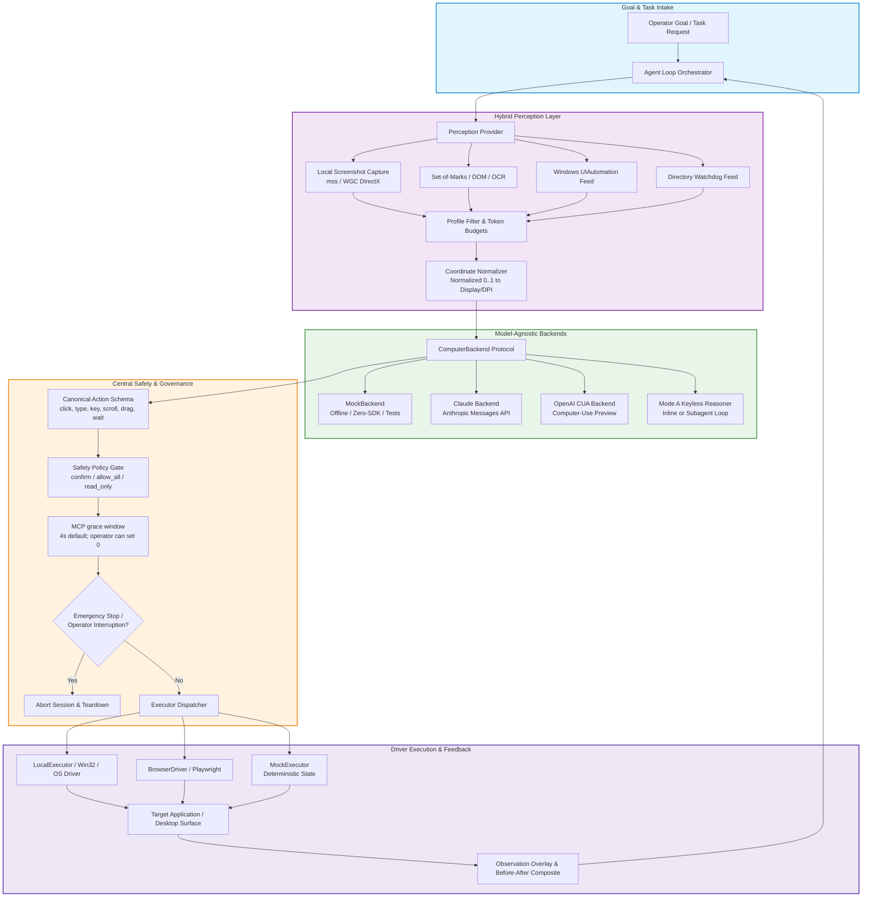
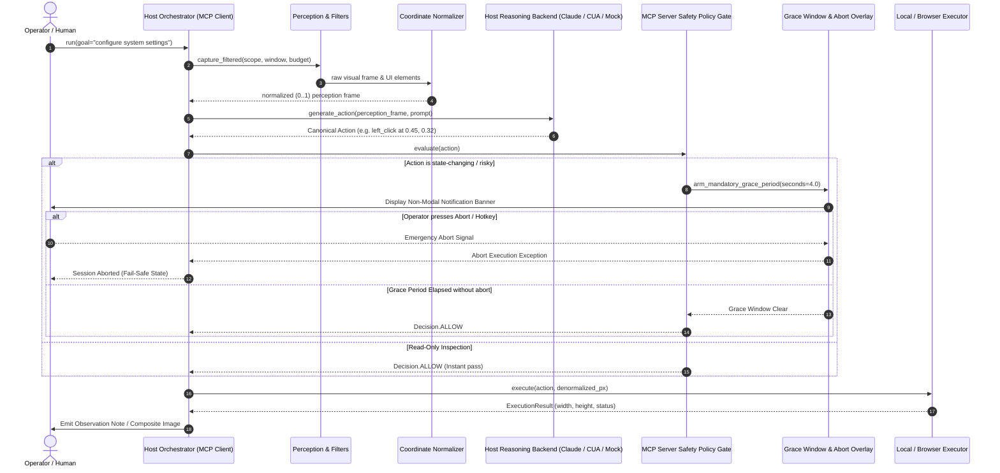

# open-compute


[🇬🇧 English](README.md) | [🇩🇪 Deutsch](README_de.md) | [🇪🇸 Español](README_es.md) | [🇫🇷 Français](README_fr.md) | **🇨🇳 简体中文**

[](CHANGELOG.md)
[](pyproject.toml)
[](https://github.com/ellmos-ai/open-compute/actions/workflows/tests.yml)
[](tests)
[](tests)
[](CONTRIBUTING.md)
[](NOTICE)
[](pyproject.toml)
[](SECURITY.md)
[](SECURITY.md)
[](https://github.com/astral-sh/ruff)
[](llms.txt)
[](THIRD_PARTY_LICENSES.md)
[](THIRD_PARTY_LICENSES.txt)
[](https://github.com/ellmos-ai)
[](https://github.com/open-bricks)
[](LICENSE)

**与模型无关的计算机操作核心：一个智能体循环，通过统一接口接入任意推理模型。**

**独立版 Cowork（开发中）：** `oc cowork` 会打开单独的本地应用窗口，提供文本、可选的浏览器语音、四种由人或模型承担的协作角色、范围受限的目标观察，以及明确授权的任务。运行中的 Codex worker 使用现有登录状态（默认 `gpt-6-astra`，可配置）；`--worker none` 可启用外部 MCP host。无需依赖 Cowork Protocol 或 Node 服务。参阅[设置、契约与验证限制](docs/cowork/README.md)。

open-compute 是一个轻量、依赖很少的 Python 核心，用于构建计算机操作智能体（由 LLM 驱动的 GUI、桌面及浏览器自动化）。它实现**感知 → 模型工具调用 → 操作 → 反馈**循环，并通过统一的 `ComputerBackend` 接口让推理模型可替换。**没有供应商享有优先地位**：Anthropic Claude 与 OpenAI CUA 是地位相同的 API 后端，离线 `mock` 后端则为默认选项。目前也提供**无需密钥**的 Mode A 路径：由 host 模型本身进行推理；为节省上下文，该循环既可在当前流程中运行，也可由自行启动的子智能体运行（见[用法模式](#usage-pattern--inline-a-vs-self-subagent-b)）。核心**没有任何运行时依赖**；供应商 SDK（`anthropic`、`openai`）是**可选且延迟导入**的扩展——即使未安装这些 SDK，`import open_compute` 仍可工作，默认 `AgentLoop` 的 mock 配置也可完全离线运行。但此说明不适用于已配置的 Claude/OpenAI 后端或 `oc cowork`；其默认 Codex worker 可以使用现有登录状态。

> [!NOTE]
> **AI / LLM 集成说明**：`open-compute` 提供机器可读的 [`llms.txt`](llms.txt) 文件，供 AI 智能体、RAG 爬虫及 LLM 辅助工作流使用。

---

## 快速导航

- [✨ 亮点与核心理念](#highlights--core-philosophy)
- [🎯 目标用户与可发现性](#target-personas--discoverability)
- [📊 与替代方案的比较矩阵](#comparative-matrix-vs-alternatives)
- [🏗️ 系统架构流程](#system-architecture-flow)
- [🔄 智能体循环与安全生命周期](#agent-loop--safety-lifecycle)
- [🛡️ 治理与运行时不变量](#governance--runtime-invariants)
- [🌐 相关生态与合作仓库](#sibling-ecosystem--partner-repositories)
- [💡 为什么选择 open-compute](#why-open-compute)
- [🤖 支持的后端与状态](#supported-backends--status)
- [📦 安装与扩展](#installation--extras)
- [🚀 快速开始与用法模式](#quick-start--usage-patterns)
- [⏱️ 操作前等待时间](#mandatory-pre-action-grace-window)
- [🔍 按配置筛选的感知与窗口范围](#profile-filtered-perception--window-scoping)
- [💻 CLI 命令参考](#cli-command-reference)
- [🔒 安全策略与漏洞报告](#security-policy--vulnerability-reporting)
- [🧪 运行测试](#running-tests)
- [📜 第三方许可证与透明度](#third-party-licenses--transparency)
- [📄 许可证](#license)

---

<a id="sec-01"></a><a id="highlights--core-philosophy"></a><a id="highlights--kernphilosophie"></a>
## 亮点与核心理念

- 🎯 **真正的模型无关性**：无需重写编排逻辑或提示词，即可运行 Claude（Messages API）、OpenAI CUA 或确定性的离线 mock。
- 📐 **统一的归一化坐标（0..1）**：模型输出范围固定的浮点数 `[0.0, 1.0]`。分辨率差异、双显示器偏移和操作系统 DPI 缩放系数均由 `coordinates.py` 集中处理。
- 🛡️ **MCP 操作前等待窗口**：与安全门相关的 MCP 调用使用由操作员配置的等待时间（默认为 4 秒，活动冷却时间为 120 秒）；操作员可将等待设为 0。直接 CLI 和 SDK `AgentLoop` 路径不使用此 MCP 等待。
- 🚦 **集中式安全门**：可配置策略模式（`confirm`、`allow_all`、`read_only`），会在鼠标点击、按键、拖动及进程执行到达操作系统之前进行拦截。
- 🔌 **零运行时依赖**：核心智能体循环和 mock 执行器只需要 Python 标准库。供应商 SDK（`anthropic`、`openai`、`mss`、`playwright`）作为扩展按需延迟加载。
- 🪟 **按配置筛选的感知**：带配置筛选的 MCP 工具会依据所选配置处理返回结果；普通 `capture` 不做筛选，可能返回整个虚拟桌面。

---

<a id="sec-08"></a><a id="why-open-compute"></a><a id="warum-open-compute"></a>
## 为什么选择 open-compute

Anthropic 的 Claude `computer` 工具和 OpenAI 的 computer-use 工具虽然具有相同的智能体循环*形态*，但传输方式、坐标系和动作名称各不相同。open-compute 将共同部分抽离出来，让你只需编写一次循环，即可通过统一的 `ComputerBackend` 接口自由切换推理模型：

- **规范化动作架构**，并为每个后端提供一个映射器。
- 内部使用**归一化（0..1）坐标**，再由经过测试的单一工具按后端、分辨率和 DPI 反归一化——将 DPI 问题集中处理。
- **集中式安全门**（“高风险操作前先确认”），在每个动作执行前进行判断。
- **混合感知**接口（截图 + Set-of-Marks / 无障碍信息 / DOM），便于日后从纯像素视觉转向语义定位。

---

<a id="sec-02"></a><a id="target-personas--discoverability"></a><a id="zielgruppen--auffindbarkeit"></a>
## 目标用户与可发现性

`open-compute` 的架构旨在满足四类主要实践者角色的运维要求、隐私边界和精度标准：

| 角色 ID | 目标用户 | 主要需求 | open-compute 的关键架构方案 |
|---|---|---|---|
| `[PERSONA-01]` | **企业 AI 智能体工程师与平台架构师** | 无专有供应商锁定、坐标体系不碎片化且模型可替换的桌面智能体核心。 | 单一 `ComputerBackend` 协议、统一规范的 `Action` 架构（`actions.py`）、归一化 `[0.0, 1.0]` 坐标（`coordinates.py`）以及离线 `MockBackend`。 |
| `[PERSONA-02]` | **开源智能体开发者与 AI 研究人员** | 需要透明、轻量的核心，用于基准测试感知—动作循环，而无需庞大的 Docker 镜像或云端费用。 | 无强制运行时依赖（纯 Python 标准库核心）、确定性的离线测试框架，以及可插拔的混合感知输入。 |
| `[PERSONA-03]` | **安全、安保与治理合规负责人** | 在 GUI 执行中落实人在回路监督、紧急中止，以及严格的零遥测边界。 | 由操作员配置的 MCP 等待时间（默认 4 秒，允许设为 0）（`INV-GRC-04`）、三层故障时默认拒绝的安全门（`INV-SAF-05`）和非特权用户模式（`INV-USR-06`）。默认 mock 循环离线运行；已配置的供应商后端和 Cowork 的 Codex worker 可能使用外部供应商，而 MCP 会将内容返回给其调用方（`INV-EGR-07`）。 |
| `[PERSONA-04]` | **桌面与 GUI 自动化专家（RPA 现代化改造者）** | 将脆弱的基于像素的 RPA 脚本（PyAutoGUI、AutoHotkey）升级为稳健、语义化、由 LLM 驱动的动作。 | 不受 DPI 影响的坐标缩放、受 token 预算约束的 UIA 窗口范围筛选（`perception_filter.py`），以及原生 CLI 工具（`oc do`、`oc capture`、`oc click-name`）。 |

### 高意图搜索词与可发现性

为便于在开源目录、包注册表和开发者搜索引擎中快速发现并通过自然语言建立索引：

- `python computer use agent core` — 纯 Python 实现的轻量、模型无关计算机操作智能体运行时。
- `claude computer use alternative python` — 支持 Anthropic Claude、OpenAI CUA 和离线 mock 的供应商中立框架。
- `model agnostic gui automation llm` — 供视觉语言模型驱动桌面和浏览器界面的单一智能体循环。
- `normalized coordinates screen automation` — 用于 AI 屏幕操作、与分辨率和 DPI 无关的坐标归一化（0..1）。
- `safe desktop automation agent framework` — 采用故障时默认拒绝安全门、强制 4 秒操作前等待窗口和操作员中止机制的框架。
- `set of marks gui agent python` — 融合截图视觉、Set-of-Marks 和 Windows UIAutomation 树的混合感知方案。

---

<a id="sec-03"></a><a id="comparative-matrix-vs-alternatives"></a><a id="vergleichsmatrix-gegenüber-alternativen"></a>
## 与替代方案的比较矩阵

下表从 10 个技术维度比较 `open-compute` 与常见替代架构；这些维度均直接对应其正式治理不变量：

| 技术维度 | 治理不变量 | open-compute | Anthropic 参考演示（Docker） | OSWorld / Agent-S 基准测试框架 | 传统 RPA 工具（PyAutoGUI / Selenium） | 临时脚本 / Shell 包装器 |
|---|---|:---:|:---:|:---:|:---:|:---:|
| **模型无关性** | `INV-MOD-01` | **完整支持（Claude、OpenAI CUA、Mock、Mode A）** | 仅支持 Claude Messages API | 基于包装器的多模型 | 无（不进行 LLM 推理） | 无（逻辑硬编码） |
| **运行时依赖** | `INV-DEP-02` | **0（纯 Python 标准库核心）** | 大型 Docker + Node + Python | 超大 Docker 镜像（>20 GB） | 大量原生 C 扩展和驱动 | 依赖系统的二进制文件 |
| **坐标归一化** | `INV-CRD-03` | **统一归一化为 0..1 + 集中处理 DPI 缩放** | 固定像素坐标（如 1024x768） | 基于像素且缩放会产生偏差 | 固定屏幕像素（DPI 变化时失效） | 硬编码的像素坐标 |
| **操作前等待窗口** | `INV-GRC-04` | **默认 4s + 120s 冷却；操作员可设为 0** | 无（立即执行） | 无（基准测试执行） | 无（立即执行） | 无 |
| **故障时默认拒绝的安全门** | `INV-SAF-05` | **三层策略门（`confirm`、`allow_all`、`read_only`）** | 只有提示警告 | 无（在 VM 中不受限制） | 无（盲目执行） | 无 |
| **非特权执行** | `INV-USR-06` | **严格使用 RunAsInvoker（不提升权限的用户模式）** | Docker 容器中的 root | 虚拟机中的 root / Sudo | 常提示提升为管理员权限 | 存在不受控提权风险 |
| **默认 mock 的外发连接** | `INV-EGR-07` | **默认 mock 循环离线；已配置的供应商、Cowork/MCP host 可能传输数据** | 必须连接云端 | 启用网络且带遥测的 VM | 本地执行，但没有隐私策略 | 取决于脚本 |
| **API 密钥持久化** | `INV-SEC-08` | **不会有意持久化 API 密钥；捕获内容和操作可能含有敏感数据，也不会一律自动脱敏** | 容器中的环境变量 | 内嵌令牌的配置文件 | 硬编码的明文凭据 | 明文环境变量或脚本 |
| **语义化窗口范围** | `INV-SCP-09` | **按所选配置筛选；普通 capture 不做筛选** | 仅全屏捕获 | 整个桌面的截图 | 搜索窗口句柄或捕获整个桌面 | 简单的窗口聚焦 |
| **安全承诺与 SLA** | `INV-SLA-10` | **具有约束力的 48 小时响应和 5 天分诊 SLA** | 尽力而为的开发者预览版 | 学术仓库（问题积压） | 社区论坛 / 商业层级 | 无安全或维护 SLA |

---

## 架构

<a id="sec-04"></a><a id="system-architecture-flow"></a><a id="systemarchitektur-ablauf"></a>
### 系统架构流程



### 四视图架构拓扑示意

```
+===================================================================================================================+
|                                    OPEN-COMPUTE ARCHITECTURAL TOPOLOGY (4 VIEWS)                                  |
+===================================================================================================================+
| [VIEW 1: CALLER RUNTIMES & AGENT CLIENTS]                                                                         |
|  * Autonomous LLM Agents (Claude Desktop, Antigravity, OpenAI Codex, Ollama) via MCP Server (open-compute-mcp)    |
|  * Developer Terminal & DevOps CLI Harness (oc do | capture | click-name | move-window)                            |
|  * Python SDK Client Consumers (from open_compute import AgentLoop, MockBackend, LocalExecutor)                   |
|  * Unprivileged User-Mode Invocation [INV-USR-06] -- Strict RunAsInvoker, zero administrative elevation prompts   |
+-------------------------------------------------------------------------------------------------------------------+
                                                          |
                                                          v
+-------------------------------------------------------------------------------------------------------------------+
| [VIEW 2: SOVEREIGN ENGINE & ORCHESTRATION PIPELINE]                                                               |
|  * Core Agent Loop (loop.py) -- Deterministic perception -> backend -> safety -> execute -> feedback orchestrator  |
|  * Model-Agnostic Backend Router (backends/) [INV-MOD-01] -- Claude Messages API, OpenAI CUA, MockBackend, Mode A |
|  * Canonical Action Schema (actions.py) -- click, type, key, scroll, drag, wait normalized across models           |
|  * Unified Coordinate Normalizer (coordinates.py) [INV-CRD-03] -- Normalized [0.0, 1.0] to native resolution/DPI   |
|  * Central Safety Policy Gate (safety.py) [INV-SAF-05] -- 3-tier policy interception (confirm / allow_all / read)  |
|  * MCP grace: 4s default, operator can set 0 (mcp_server.py) [INV-GRC-04] -- 120s activity cooldown         |
+-------------------------------------------------------------------------------------------------------------------+
                                                          |
                                                          v
+-------------------------------------------------------------------------------------------------------------------+
| [VIEW 3: RUNTIME PERSISTENCE, RUN RECEIPTS & EVIDENCE LEDGER]                                                     |
|  * Profile-Filtered Perception & Window Scoping (perception_filter.py) [INV-SCP-09] -- Token-budgeted UIA filter   |
|  * Visual Evidence & Composites (compose / Pillow) -- Before/after screenshots, Set-of-Marks, observation overlays |
|  * Offline Deterministic Mock Substrate (MockExecutor, MockBackend) [INV-DEP-02] -- 0 mandatory runtime deps      |
|  * API-key handling [INV-SEC-08] -- no intentional API-key persistence; captures may include sensitive data              |
+-------------------------------------------------------------------------------------------------------------------+
                                                          |
                                                          v
+-------------------------------------------------------------------------------------------------------------------+
| [VIEW 4: DEFAULT-MOCK EGRESS, CONFIGURED NETWORK PATHS & GOVERNANCE BOUNDARY]                                      |
|  * Default mock loop offline; configured providers/Cowork/MCP hosts may transmit data [INV-EGR-07]             |
|  * Pure Python Standard Library Core Runtime -- Zero external dependencies (cpython) [INV-DEP-02]                  |
|  * Dependency license inventory -- see listed packages; future/transitive terms are not guaranteed                |
|  * Multi-Host Cloud-Sync & Lock Defense -- Hardened .gitignore, conflict-copy resistance, canonical lock guards   |
|  * Binding Security Response Commitment [INV-SLA-10] -- 48h initial response SLA & 5-day triage SLA              |
+===================================================================================================================+
```

<a id="sec-05"></a><a id="agent-loop--safety-lifecycle"></a><a id="agenten-loop--sicherheits-lebenszyklus"></a>
### 智能体循环与安全生命周期

这是一个由 host 编排的 MCP 工作流概念图，并非 SDK `AgentLoop` 的调用图：模型推理在 host 中进行，而不是在 MCP server 中进行。图中的 4.0 秒是默认值；操作员可以设为 0，直接 CLI/SDK 路径不会使用此 MCP 等待辅助机制，MCP `capture` 调用也会经过安全门。



### 组件布局

```
                        +-----------------------------------------+
                        |        AGENT LOOP / ORCHESTRATOR        |
                        |  goal -> perceive -> backend -> safety  |
                        |        -> execute -> re-perceive        |
                        +-------------------+---------------------+
                                            |
        +-----------------------------------+-----------------------------------+
        |                                   |                                   |
+-------v---------+              +----------v-----------+            +----------v----------+
| PERCEPTION      |              | CANONICAL ACTIONS    |            | SAFETY / POLICY     |
| - screenshot    |              | click/type/key/      |            | - confirm-at-action |
| - set-of-marks  |              | scroll/drag/wait/    |            | - allow / deny list |
|   (OmniParser)* |              | screenshot + OS ext  |            | - read-only mode    |
| - accessibility*|              | (launch/activate)    |            | - audit log         |
+-------+---------+              +----------+-----------+            +----------+----------+
        |                                   |                                   |
        +-----------------+-----------------+----------------------------------+
                          |
              +-----------v------------+   COORDINATE / DPI NORMALIZATION
              | BACKEND ABSTRACTION    |   - internal: normalized (0..1)
              | (ComputerBackend)      |   - denormalize per backend:
              +-----+--------+---------+     * Claude: global px (display_w x display_h)
                    |        |    |          * OpenAI: px (computer_call)
        +-----------+        |    +-----------+   * Mock: synthetic
        |                    |                |
+-------v-------+   +--------v-------+  +-----v---------+
| Claude        |   | OpenAI CUA     |  | Mock backend  |
| computer_2025 |   | computer-use-  |  | (no SDK,      |
| 1124 + beta   |   | preview [?]    |  |  offline)     |
| (host runs)   |   | (host runs)    |  |               |
+---------------+   +----------------+  +---------------+

  * = stub / interface in this release (see Status)
```

---

<a id="sec-06"></a><a id="governance--runtime-invariants"></a><a id="governance--laufzeit-invarianten"></a>
## 治理与运行时不变量

该架构落实严格的运行不变量，以保障安全性、可重复性和非破坏性执行：

| ID | 能力 / 不变量 | 实现机制 | 安全与架构保证 |
|:---|:---|:---|:---|
| `INV-MOD-01` | **模型无关核心** | `ComputerBackend` 协议抽象 | 无需重写智能体循环，即可切换 Claude、OpenAI CUA 或离线 Mock。 |
| `INV-DEP-02` | **零运行时依赖** | 对 SDK 和平台驱动采用可选延迟导入 | 导入时仅使用 Python 标准库；供应商 SDK（`anthropic`、`openai`）完全可选。 |
| `INV-CRD-03` | **归一化坐标（0..1）** | 在 `coordinates.py` 中集中处理 DPI 和分辨率缩放 | 集中处理显示分辨率与 DPI 缩放；模型始终在不变的 (0..1) 坐标空间中工作。 |
| `INV-GRC-04` | **MCP 操作前等待窗口** | 默认 4 秒；操作员可设为 0 | 仅适用于与安全门相关的 MCP 调用；直接 CLI/SDK `AgentLoop` 路径不使用此等待。 |
| `INV-SAF-05` | **故障时默认拒绝的安全门** | 集中式 `SafetyPolicy` 评估器（`confirm`、`allow_all`、`read_only`） | 可能造成破坏的动作默认会被阻止，直至人工确认回调批准。 |
| `INV-USR-06` | **非特权用户模式** | 标准 Win32/OS API 用户权限 | 不提升管理员权限（`RunAsInvoker`）；在标准用户安全上下文中运行。 |
| `INV-EGR-07` | **默认 Mock 的外发连接** | 默认使用离线 mock 后端和本地执行器 | 默认 mock 循环离线运行；已配置的供应商和 Cowork 的 Codex worker 可能使用外部服务，MCP host 也可以传输 server 返回的内容。 |
| `INV-SEC-08` | **API 密钥持久化** | 向后端注入 API 密钥 | 软件包不会有意持久化 API 密钥；捕获内容和动作内容可能包含敏感数据，也不会一律自动脱敏。 |
| `INV-SCP-09` | **按配置筛选的感知** | 所选配置筛选器和视觉范围 | 已筛选的 MCP 工具会将配置的排除规则应用于返回内容；普通 `capture` 不做筛选，可能返回整个桌面。 |
| `INV-SLA-10` | **安全响应 SLA** | 专用安全联系方式和漏洞处理流程 | 通过 `SECURITY.md` 承诺在 48 小时内确认响应，并在 5 个工作日内完成分诊。 |

---

<a id="sec-07"></a><a id="sibling-ecosystem--partner-repositories"></a><a id="geschwisterwerkzeuge--partner-repositories"></a>
## 相关生态与合作仓库

`open-compute` 旨在作为更广泛的 **ellmos-ai** 与 **open-bricks** 联邦式多智能体自动化生态中的视觉和 GUI 执行引擎：

| 仓库 | 角色与专业领域 | 生态集成方式 |
|:---|:---|:---|
| [`ellmos-ai/bach`](https://github.com/ellmos-ai/bach) | 编排与多智能体流水线 | 用于自主智能体工作流的主编排框架。 |
| [`ellmos-ai/usmc`](https://github.com/ellmos-ai/usmc) | 通用状态管理与控制器 | 在分布式智能体之间集中协调系统状态。 |
| [`ellmos-ai/connectors`](https://github.com/ellmos-ai/connectors) | 零依赖异步连接器 | 用于 Telegram、Discord、GitHub 和本地 webhook 的协议适配器。 |
| [`ellmos-ai/clutch`](https://github.com/ellmos-ai/clutch) | 高性能多智能体 Clutch | 低延迟 IPC 路由、交接与进程耦合。 |
| [`ellmos-ai/companion-for-agy`](https://github.com/ellmos-ai/companion-for-agy) | 桌面伴侣与监督器 | Antigravity 的后台会话监督器和状态指示浮层。 |
| [`ellmos-ai/system-auditor`](https://github.com/ellmos-ai/system-auditor) | 多智能体健康诊断套件 | 深入验证操作系统、主机环境和进程健康状况。 |
| [`dev-bricks/lock-master`](https://github.com/dev-bricks/lock-master) | 规范锁同步 | 多设备文件和进程的并发管理。 |
| [`dev-bricks/ticket-master`](https://github.com/dev-bricks/ticket-master) | 统一工单与问题分派 | 跨仓库问题跟踪和自动任务分派。 |
| [`dev-bricks/automation-master`](https://github.com/dev-bricks/automation-master) | 任务生命周期监督器 | 定时任务编排、sidecar 监控和心跳。 |
| [`file-bricks/CloudLockFixer`](https://github.com/file-bricks/CloudLockFixer) | 云端锁解析器与冲突修复工具 | 自动解决 OneDrive 和云存储中的死锁。 |
| [`open-bricks/.github`](https://github.com/open-bricks/.github) | 总体治理与 CI 标准 | 全局开源标准、安全基线和发布策略。 |

---

<a id="sec-10"></a><a id="installation--extras"></a><a id="installation"></a>
## 安装与扩展

> [!IMPORTANT]
> **尚未发布到 PyPI——请从 Git 安装。** 本项目尚无 PyPI 版本。PyPI 上的 `open-compute` 名称已被一个**无关**项目（“面向医疗科技的多智能体系统”）占用，因此直接运行 `pip install open-compute` 会安装其他人的软件包。请始终从本仓库安装：

```bash
pip install "git+https://github.com/ellmos-ai/open-compute.git"                        # core only, zero runtime deps
pip install "open-compute[claude] @ git+https://github.com/ellmos-ai/open-compute.git" # + anthropic SDK
```

下方所有扩展均可使用相同的 `extra @ git+…` 格式：

| 扩展 | 增加内容 |
|---|---|
| `claude` | anthropic SDK |
| `openai` | openai SDK |
| `local` | mss — Windows 实际截图与输入 |
| `wgc` | 为 DirectX 表面提供 WGC 后备方案（会安装 numpy/OpenCV） |
| `compose` | Pillow — 前后对比合成图 + 标注截图 |
| `watch` | watchdog — 为目录监视输入提供原生文件系统事件 |
| `clirec` | 用于 `oc rec` 工作流的外部 clirec 软件包 |
| `record` | 与 clirec[record] 捕获后端兼容 |
| `mcp` | mcp SDK — MCP server (console script: `open-compute-mcp`) |
| `dev` | pytest |
| `all` | anthropic, openai, playwright, mss, WGC, Pillow, watchdog, clirec, mcp |

扩展可以像往常一样组合，例如 `open-compute[local,wgc,claude]`。如果你使用本地克隆，则在仓库根目录运行 `pip install -e ".[local,claude]"`。

在 `clirec` 发布软件包之前，使用 `oc rec` 时请直接安装：

```bash
pip install git+https://github.com/ellmos-ai/clirec.git
```

Python 3.10 及以上版本。

---

<a id="sec-11"></a><a id="quick-start--usage-patterns"></a><a id="schnellstart--nutzungsmuster"></a>
## 快速开始与用法模式

<a id="sec-14"></a><a id="cli-command-reference"></a><a id="cli-befehlsreferenz"></a>
### Mode A 与 CLI 命令参考：由会话智能体进行推理（Chat Skill）

在 Claude Code 会话中手动运行 `oc capture` / `oc do`。会话模型通过 Read 工具查看 PNG，并决定下一步动作：

```bash
# 1. Install the local extra (Windows only; provides real screenshots + input)
pip install "open-compute[local] @ git+https://github.com/ellmos-ai/open-compute.git"

# 2. Capture a screenshot — saved automatically to _session/ (never loose on Desktop)
oc capture
# -> {"path": ".../_session/0001_20260620_143200.png", "width": 1920, "height": 1080}
# Then: read the PNG with your Read tool to see the screen.

# 3a. Execute one canonical action (single, backwards-compatible)
oc do '{"type":"mouse_move","x":0.5,"y":0.5}' --mode allow_all
oc click-name "Save" --window "Word" --yes  # semantic click, verified window

# 3b. Execute with Before|After composite (Pillow optional)
oc do '{"type":"key","text":"ctrl+s"}' --label "save" --yes
# -> {"result":"executed","action":"key","composite":"_session/0002_save.png"}

# 3c. Execute a batch/macro (JSON array, one call = multiple actions)
oc do '[{"type":"mouse_move","x":0.5,"y":0.5},{"type":"key","text":"tab"}]' --yes
# -> {"result":"batch","count":2,"width":1920,"height":1080}

# 3d. Ensure the target window is in the foreground before acting
oc do '{"type":"key","text":"ctrl+s"}' --ensure-foreground "Word" --yes

# 3e. Save a full-res after-shot + annotated click marker (v0.5, Pillow optional)
oc click-name "Save" --window "Word" --yes --fullres
# -> {"result":"executed",...,"fullres_annotated":"_session/...fullres.png"}

# 3f. Capture only the active window's bounding rect (v0.5, Windows)
oc capture --window "Word"
# -> {"path":"...","width":800,"height":600,"window":"Word","region":{...}}

# 3g. Watch a directory for changes (v0.5)
oc watch-dir ~/Downloads --for 5       # collect 5 s, print JSON events
oc watch-dir ~/Downloads --once        # one-time snapshot diff

# 3h. Explicit companion handoff (mutations need a granted, scoped lease)
oc session companion --owner local-user
oc session request-control --owner agent-a --scope window:42 --ttl 60
oc session grant --lease-id <lease_id-from-previous-output>
oc window minimize --hwnd 42 --yes

# 3i. Bounded, deduplicated window capture (full screen needs explicit opt-in)
oc capture-series --window "Word" --max-frames 8 --stable-frames 2

# 4. Recapture and repeat until done (or read the "composite" After-shot directly).
```

完整循环协议、动作架构、坐标指南和环境变量参考请见 `SKILL.md`。

### 配对观察与剪贴板工作流

当人类希望自行掌控鼠标、键盘、选择以及最终发布操作时，可使用随附的
[`open-compute-clipboard-companion`](./skills/open-compute-clipboard-companion/SKILL.md)
skill。智能体保持蓝色 `OBSERVE` 信号可见，读取当前字段，并仅将匹配的文本或已验证的文件路径放入 host 剪贴板。在此工作流中，它不会点击、粘贴、进行身份验证或提交。

### 协作模式（旁观 + 窄范围辅助）

如需更丰富的三部分配对模式（工单 T-20260825-767105130），可使用随附的
[`open-compute-work-together`](./skills/open-compute-work-together/SKILL.md)
skill：(1) `note_observation` 会将简短、通俗的观察写入一个小型、非模态、始终置顶的便笺窗口（`chat` 的镜像），以低干扰方式展示“机器看到了什么”，而不是输出繁杂的控制台日志；答复通过 `chat` 返回，其可选 `choices` 可将回复变成一次点击，而无需输入；(2) 上述剪贴板部分，此处引用而不重复；(3) 范围严格受限的**微接管**——人在自己明确将某个字段置于焦点后，智能体可以恰好发出一次 `type` 调用来填写该字段（可选择先对同一字段发出一次确认性的 `left_click`），然后立即交还控制权；若没有人类新近且可见的焦点确认，绝不会继续串联其他动作。强制操作前等待窗口（见下文）的活动冷却时间已能防止后续微接管自行重新触发等待，无需特殊处理。

用选项提问，而不是只显示空白输入框：

```python
chat(
    context="Which hypothesis fits what bothers you here?",
    choices=["The list is too long", "Wrong sort order", "I cannot find the button"],
)
# -> {"chat_message": "Wrong sort order", "choice_index": 1, "screenshot": None}
```

最多可提供 8 个选项，每个不超过 120 个字符；它们会以一键按钮形式显示在常规自由文本输入框上方，而自由文本输入仍然可用。若用户输入文字，返回结果中的 `choice_index: null`。

#### 通过 MCP 持续进行桌面对话

MCP `chat` 工具会打开一个常规 Tk 桌面窗口，并通过返回通道连接到调用方的 host 模型。host 模型在自己的通道中作答，然后使用相同的 `chat_id` 将实际回复作为 `assistant_message` 发回。host 为每条回复分配唯一的 `assistant_turn_id`；使用同一 ID 重试会返回同一轮人类消息，不会重复显示答案。

```text
1. chat() -> chat_id, chat_message, mode, screenshot
2. Host model creates a real answer based on that message
3. chat(chat_id=..., assistant_turn_id="turn-1", assistant_message="...")
   -> next chat_message; the answer appears in the same window
4. Repeat until the window is closed (status="closed")
```

窗口显示带角色标签的历史记录，支持“General（通用）”“Brief（简要）”“Brainstorming（头脑风暴）”和“Screen help（屏幕帮助）”模式，并将模型建议显示为可点击的回复。所选模式和具体的回复指令会返回给 host 模型。只有勾选同意复选框或明确传入 `shot=true` 时，才会捕获整个桌面的截图。等待中的 MCP 调用最多持续 3,600 秒；对于 `status="waiting_for_human"`，可使用相同 `chat_id` 和 `poll=true` 恢复调用。点击“End chat”或关闭窗口会结束调用。历史记录仅在该窗口会话期间保持可见，不会作为聊天数据库存储。

三个协作快捷项——“Short break（短暂休息）”“I’m back（我回来了）”和“Help and suggestions（帮助与建议）”——会将可编辑草稿插入消息栏。它们不会发送草稿，也不会启动后台工作。目前未实现连续屏幕观察；屏幕帮助仅使用该轮明确同意提供的截图。

安装本地语音运行时和德语模型后，麦克风按钮才会启用。单击开始录音，再单击停止；录音最长为 60 秒。现有的 Windows MCI 录音器会写入临时 WAV 文件，`ellmos-voice-io` 再通过 Vosk 在本地转写。转写文本会插入可编辑的消息栏，不会自动发送。音频不属于 MCP 消息；临时 WAV 会在转写完成、取消或窗口关闭后删除。聊天工具不会下载模型。

在运行 MCP server 的同一个虚拟环境中，安装 Vosk 扩展和本地 `ellmos-voice-io` 检出副本：

```powershell
python -m pip install ".[voice-vosk]"
python -m pip install --no-deps --editable "<path to ellmos-voice-io checkout>"
```

将官方德语小型模型放在
`%LOCALAPPDATA%\open-compute\models\vosk-model-small-de-0.15` 下，或者将
`OPEN_COMPUTE_VOSK_MODEL` 设置为其他本地模型目录。模型压缩包为 45 MB，采用 Apache-2.0 许可证。语音运行时仍为可选项：如果未安装软件包或模型，麦克风按钮会保持禁用，窗口会提示缺少本地依赖。

#### 聊天窗口中的本地 Messages-Line

聊天窗口可以直接显示本地 Ticket-Master Messages-Line。它只使用固定 Ticket-Master 提交
`3b3fc86f2b9e2aedc8886cd737d439d70a1e3b2a` 中的 `MessagesLine.list_for_delivery()`、`read_for_delivery()`、
`delivery_targets()`、`record_observation()` 和显式 `acknowledge()` API。启动器会在 open-compute 和 VoiceIO 旁准备不可变快照；不需要全局 Python 安装，也不会建立第二个收件箱或回执账本。

如果没有明确提供策略、存储位置和现有的 `local_gui` 目标，Messages-Line 显示将保持关闭（OFF）。Ticket-Master 注册规范的本地存储、有效策略文件和匹配的本地 GUI 目标后，启动时请传入这些现有路径：

```powershell
.\scripts\open_compute_chat.ps1 `
  -Model "<available host model>" `
  -Workspace "<selected workspace folder>" `
  -MessagesDir "<existing Ticket-Master Messages-Line store>" `
  -MessagesConfig "<active Ticket-Master policy file>" `
  -MessagesTargetRef "<configured local_gui target>"
```

窗口侧栏在打开时加载 `chat_start`，仅在点击“Check now（立即检查）”时加载 `on_demand`，并在对话框打开期间至多每 15 秒加载一次 `active_chat`。列表只显示 ID 和模式；选中某项后，程序会解析其内容，并在显示、确认接收以及继续显示之前重新评估当前策略。仅在渲染之后且当前策略允许时，GUI 打开时才会自动确认接收。“Confirm receipt（确认收到）”只调用手动确认 API。消息文本严格作为数据内容处理，不会作为模型或系统指令。

该工具本身不会调用任何模型或供应商。它使用已经连接的 host 推理模型，不需要额外的供应商密钥。

随附的专用启动器可直接连接 Codex 桌面对话。从干净的提交开始，它会为该确切版本准备不可变快照，并创建以提交命名的 Codex 配置档；该配置档只注册固定版本的 MCP server 及其 `chat` 工具，不会修改全局配置：

```powershell
.\scripts\open_compute_chat.ps1 -PrepareOnly
```

要启动交互式对话，请明确传入 Codex 账户中可用的模型和目标工作区目录：

```powershell
.\scripts\open_compute_chat.ps1 -Model "<model from your Codex account>" -Workspace "<workspace folder>" -Context "How can I help?"
```

启动器使用你现有的 Codex 登录状态，通过仅提供 chat 功能的 MCP server 打开原生聊天窗口。关闭 Codex 会话或窗口都会关闭 host 返回通道。

### Mode B — 使用 API 后端运行自主循环

通过名称选择后端；`claude` 与 `openai` 均受支持（各自需要对应的密钥和扩展）。如需**无密钥**路径，请使用上面的 Mode A——由 host 模型自行推理，也可选择在自行启动的子智能体中运行（见[用法模式](#usage-pattern--inline-a-vs-self-subagent-b)）。

```bash
# Claude (needs ANTHROPIC_API_KEY + open-compute[local,claude]):
oc run "Find the latest invoice in the Downloads folder" --backend claude --max-steps 15

# OpenAI (needs OPENAI_API_KEY + open-compute[local,openai]):
oc run "Find the latest invoice in the Downloads folder" --backend openai --max-steps 15
```

也可以在 Python 中使用——`get_backend(name, ...)` 会构建指定的后端；你可以注入自己的执行器，也可以使用 `LocalExecutor`：

```python
from open_compute import AgentLoop, Config, get_backend
from open_compute.drivers.local import LocalExecutor   # Windows; needs mss
from open_compute.safety import SafetyPolicy

executor = LocalExecutor()   # real display + input
config = Config(backend="claude", scope="os",
                display_width=executor.width, display_height=executor.height)
backend = get_backend("claude", executor.width, executor.height, model="claude-opus-4-8")

loop = AgentLoop(
    config,
    backend=backend,
    executor=executor,
    policy=SafetyPolicy(mode="confirm",
                        confirm_callback=lambda a: input(f"run {a.type.value}? [y/N] ") == "y"),
)
loop.run("Find the latest invoice in the Downloads folder")
```

### 离线试运行（无需 API 密钥、无需显示器，仅使用 mock）

```python
from open_compute import AgentLoop, Config

loop = AgentLoop(Config(backend="mock", safety_mode="allow_all"))
result = loop.run("Open the settings page and enable dark mode")
print(result.done, result.steps)
for trace in result.traces:
    print(trace.index, trace.backend_message, [a.type.value for a in trace.executed])
```

---

## MCP server（原生工具调用，无需密钥）

将无需密钥的 **Mode A** 循环作为**原生工具**提供给任何 MCP 客户端——客户端负责推理（无需 API 密钥，且与模型无关）。与手动调用 `oc` 相比，长期运行的 server 会让**一个已启动的 `LocalExecutor`** 常驻（每个动作无需重启 Python），并将截图作为 MCP **image** 块返回。真实截图和输入仅支持 Windows。

```bash
pip install "open-compute[mcp,local,uia,wgc] @ git+https://github.com/ellmos-ai/open-compute.git"
open-compute-mcp          # stdio server (console script)
```

**工具（19 个）：** `capture` · `observe_filtered` · `capture_filtered` · `do`
（单个或批量规范动作） · `tree` ·
`click_name` · `invoke` （UIA 语义定位） · `list_windows` ·
`get_screen_size` · `watch_dir` · `push_status` · `rec_replay` · `signal_show` /
`signal_hide` / `signal_status` / `signal_abort` （人在回路中的屏幕信号） · `chat` （人向模型发送消息） · `note_observation` （模型向人发送消息，通过非模态便笺窗口） · `talk` （按住说话）. 坐标归一化为 0..1；`list_windows` 和 `get_screen_size` 描述的就是该坐标系，因此客户端可以准确指定窗口，而不必猜测标题子串。

<a id="sec-13"></a><a id="profile-filtered-perception--window-scoping"></a><a id="profilgefilterte-wahrnehmung--fensterfokussierung"></a>
### 按配置筛选的感知与窗口范围

**按配置筛选的感知。** 需要节省 token 的 host 可以向 `observe_filtered` 和 `capture_filtered` 传入一个严格限定用途的配置。筛选会在内容发送给模型之前于本地完成：优先处理声明焦点附近的 UIA 语义信息；文本、值和元素数量均有硬性预算；视觉升级采用有界视野；与该视野重叠的指定窗口（例如 host 聊天窗口）可以被遮空。未知的配置字段、工具或动作类型都会按故障时默认拒绝处理。`do(profile=...)` 也会拒绝同一允许列表之外的动作。屏幕捕获完成后，排除窗口的矩形区域会在返回的 `capture_filtered` 图像中于本地遮空；普通 `capture` 不会应用这些筛选。示例：

```json
{
  "profileId": "form-cowork-v1",
  "semanticFirst": true,
  "maxElements": 12,
  "maxCharacters": 1200,
  "textLimit": 120,
  "valuePolicy": "focused-only",
  "selectionLimit": 160,
  "focusRadius": 0.18,
  "visualLens": {"width": 400, "height": 400},
  "allowFullscreen": false,
  "excludeElementNameContains": ["Cowork Companion", "ChatGPT", "Claude"],
  "excludeWindowTitleContains": ["Cowork Companion", "ChatGPT", "Claude"],
  "allowedTools": ["observe_filtered", "capture_filtered", "signal_show", "signal_hide", "signal_status", "do"],
  "allowedActionTypes": ["mouse_move", "left_click", "type", "key", "scroll", "wait"]
}
```

**命名模式。** 每次调用都写出完整配置，会让普通 `capture`（全高清截图）成为最省事的选择，导致节省资源的工具无人使用。因此 `observe_filtered` 和 `capture_filtered` 也接受 `mode` 名称，以调用内置配置；显式指定的 `profile` 优先。

| 模式 | 元素数 / 字符数 | 图像 | `do` |
|---|---|---|---|
| `observe-lite` | 8 / 800，焦点半径 0.12 | 升级，需要 `reason` | 否 |
| `observe-full` | 12 / 1200，焦点半径 0.18 | 升级，需要 `reason` | 否 |
| `act` | 12 / 1200 | 无需 reason | 是 |

所有模式都不允许全屏抓取，三种模式的视野尺寸均为 400x400。在含 40 个元素的合成树上测得：焦点数据包在 `observe-lite` 中为 695 个字符，在 `observe-full` 中为 1,111 个字符；400x400 视野为 7,495 字节，而 1920x1080 截图为 190,075 字节。超过预算的选区会被摘要替代，而不是截断。观察模式将 `wait` 列为唯一动作类型——这是架构要求的占位符，不会被执行，因为这些模式的工具列表中不包含 `do`。

**硬件合成窗口（`wgc` 扩展）。** 对 DirectX 窗口（如 Roblox Studio、Blender 或启用 GPU 加速的浏览器）进行 GDI 抓取不会报错，而是悄悄返回一块**全黑**矩形。因此，`capture(window=...)` 会检查帧；若返回空白，则通过 Windows.Graphics.Capture 再次抓取。安装 `open-compute[wgc]` 可启用此后备方案；若未安装，调用仍会返回黑帧，而不会失败。对于已知需要 WGC 的窗口，可通过 `OC_WGC_WINDOWS`（逗号分隔的标题子串）完全跳过 GDI 尝试。请注意，WGC 只有在窗口*重绘*时才会生成帧：闲置或
无法捕获的窗口会在有限的几秒内快速失败，而不会一直挂起。

**捕获预算（token 成本）。** 视觉模型按像素计费，因此全高清 `capture` 是此 server 返回内容中成本最高的一项；每一帧还会留在对话中，后续每次请求都会再次产生费用。由于这里的所有坐标均归一化为 0..1，缩小图像**不会影响控制精度**，只会降低可读性。可通过以下三个参数调整：

| 变量 | 效果 | 捕获 1920×1080 图像的成本 |
|---|---|---|
| *（未设置）* | 全分辨率 | 约 1600 tokens |
| `OC_CAPTURE_SCALE=0.5` | 两边尺寸减半 | 约 690 tokens |
| `OC_CAPTURE_MAX_DIM=768` | 将最长边限制为指定尺寸 | 约 440 tokens |
| `OC_CAPTURE_GRAYSCALE=1` | 去除颜色 | 仅减少载荷，**不减少** token；token 数量只取决于像素数 |

对于 GUI 操作，`OC_CAPTURE_SCALE=0.5` 通常是较合适的折中：按钮和字段边框仍清晰可辨，只有较小的正文会变得难以阅读。两个尺寸参数可以组合使用（先缩放，再设置上限）；如果缩小失败，捕获本身仍会成功，而是返回原始帧。

**安全策略。** `OC_SAFETY_MODE` 是操作员设置的权限**上限**（默认 `confirm`，也可为 `read_only` 或 `allow_all`）；单次调用的 `mode` 只能*收紧*上限，不能放宽，因此被提示注入的智能体无法通过 `mode="allow_all"` 绕过 `read_only`/`confirm` server。由于 stdio MCP 没有 server→client 确认回调，`confirm`/`read_only` 会返回 `needs_confirmation`/`deny` 结果，**不会执行动作**。

**故障时默认拒绝的交互契约（MCP 0.8）。** 优先使用 `invoke`，其次使用 `click_name`；两者都会先查找名称完全匹配的元素，并拒绝含糊或匹配度较低的结果。结果包含 `match_type`、`score` 和候选项；对于破坏性或外部操作，可使用 `exact=true`。两种调用都必须提供已签发的窗口描述符/token。通过 `do` 使用原始坐标应作为最后手段。先调用 `list_windows` 并保留完整窗口描述符或 `window_token`，再调用 `capture`/`tree` 并保留返回的 `observation_id`（`capture` 也称其为 `screenshot_id`）。对恰好一次坐标操作，同时传入 `expected_window` 和 `observation_id`。此 ID 只能使用一次：重复使用、截图/树已变化、帧漂移、焦点漂移或目标被遮挡都会触发默认拒绝。成功操作会返回新的 `post_action_observation`，并报告新打开或归属的窗口候选项。

`type`、按键动作和 `activate_window` 同样需要已签发的窗口描述符/token。每段文本或按键分派之前都会立即检查焦点；文本结果会报告请求/发送的字符数以及完整/部分状态，但不会回显明文。可选的 `coordinate_frame` 参数仅用于断言其与 observation 绑定的坐标帧一致。CLI 保留现有的显式预点击契约 `--expected-window` / `--coordinate-frame`。

交互使用时，请在**隔离的 VM 中**以 `OC_SAFETY_MODE=allow_all` 运行 server，并由客户端的工具权限对话框承担人在回路的确认。可选的 `OC_DENY`（逗号分隔的动作类型）是强制拒绝列表。

**自动信号（`OC_SIGNAL_AUTO`）。** 将其设置为 `SessionMode` 名称（例如 `control`），即可在获准的状态变更工具（`do` / `click_name` / `invoke` / `rec_replay`）执行前自动显示屏幕使用*浮层*。它不会覆盖已经可见的信号（无论手动或自动、何种模式），也不会由被安全门拦截的调用或只读工具触发。未设置或设为 `off`（默认值）会禁用*视觉*浮层；无效模式名称会在工具结果中显示为 `auto_signal_error`，而不会导致调用失败。下文介绍手动控制 `signal_show`/`signal_hide`/`signal_status`，各模式的颜色见 `OC_SIGNAL_CONFIG`。`OC_SIGNAL_AUTO` 只控制是否*显示*浮层——自工单 T-20260825-540085216 起，它不再控制下文的阻塞等待是否生效；等待现在始终适用（见下一段）。

<a id="sec-12"></a><a id="mandatory-pre-action-grace-window"></a><a id="verbindliches-pre-action-grace-window"></a>
### 强制操作前等待窗口

**MCP 操作前等待窗口——由操作员配置，不受模型控制。** 在 MCP server 中，每个与安全门相关的调用（`do` / `click_name` / `invoke` / `rec_replay` / `capture`）都会在会话中的*第一个*动作之前等待配置的时间，无论是否调用过 `signal_show`，也不受 `OC_SIGNAL_AUTO` 影响。直接 CLI 命令和 SDK `AgentLoop` 运行不会使用此 MCP 等待路径。这修复了一个真实的绕过方式（工单 T-20260825-540085216）：此前，调用方只要从未调用 `signal_show`，就能完全跳过等待窗口，且无需更改配置——显式调用 `signal_show` 会启动窗口，但系统并不强制先进行该调用。此窗口的目的是保护用户并提供透明度，不是可由模型自愿绕过的障碍，因此等待本身不再依赖模型配合。
- **默认 4 秒**（此工单前为 20 秒，后被认为过长）。
- **活动冷却时间，默认 120 秒**（`grace_cooldown_seconds`、
  `OC_SIGNAL_GRACE_COOLDOWN_SECONDS`）：等待窗口结束后，在冷却时间内的后续调用不会重新等待，因此连续使用期间不会每个动作都被打断。设为 `0` 会禁用冷却（每次调用都重新等待完整时间，恢复该工单前的行为）。
- **完全关闭等待的唯一方式**是在*规范*信号配置中将 `pre_action_grace_seconds: 0`——若已设置则使用 `OC_SIGNAL_CONFIG`，否则若文件存在则使用 `<package>/_state/signal-config.json`，再否则使用内置默认值——或使用仅供操作员设置的环境覆盖 `OC_SIGNAL_GRACE_SECONDS=0`。MCP 工具调用无法设置这两项：`signal_show` 确实接受 `config_path` 参数，可指向*另一份*本地编写的文件（这是面向操作员的正当功能），但以此方式加载的配置绝不会让实际等待短于规范配置本身的值——它只能提高等待时间，不能低于操作员设定的下限。若要缩短或设为零等待，请编辑规范配置或设置环境覆盖；单次调用参数无法做到这一点。

显式调用 `signal_show` 仍会像以往一样启动并*显示*倒计时——浮层使用独立的静态等待颜色，并显示 `Start in N Sekunden`，每秒倒数一次；归零时只切换一次到所选模式颜色。持续时间取自 `pre_action_grace_seconds`（或优先级更高的 `OC_SIGNAL_GRACE_SECONDS`），而非仅供 UI 使用的常量。JSON 信号配置还接受 `pre_action_grace_color: [r, g, b]` 和可本地化的 `pre_action_grace_label` 模板，模板必须包含 `{seconds}`。`signal_status` 会报告 `phase`、`countdown_seconds`、当前 `color` 和 `accessible_label`。原生窗口标题含有相同的语义文本，并且每秒发出无障碍名称变更事件。没有闪烁、脉动或颜色动画过渡，因此即使 Windows 动画被禁用，信息仍然可见，颜色也绝不是唯一提示。请注意，即使浮层不可见（未设置 `OC_SIGNAL_AUTO` 且从未调用 `signal_show`），上述*强制*等待仍会阻塞；如果你还希望等待显示在屏幕上，而不只是得到执行，也要设置 `OC_SIGNAL_AUTO`。

**信号清理与租约。** 每个浮层都有 TTL（`ttl_seconds` 或 `OC_SIGNAL_TTL`，默认 120 秒）。默认情况下，`do`、`click_name`、`invoke` 和 `rec_replay` 会在正常轮次结束、出错或中止时隐藏浮层；只有需要让可见租约跨调用保持时才使用 `keep_signal=true`。server 关闭时也会清除浮层。`signal_status` 会报告所有者、会话、模式、可见状态和过期时间。对于明确保留的自动信号，`OC_SIGNAL_IDLE_HIDE` 会提供额外的空闲倒计时；每次状态变更工具调用都会重新启动该倒计时。该值单位为秒，默认 60；设为 `0`、空值或 `off` 会禁用空闲倒计时，但硬性 TTL 仍然生效。仅由 `OC_SIGNAL_AUTO` 显示的浮层受空闲倒计时控制；如果在自动显示的浮层上手动调用 `signal_show`，手动调用会接管该浮层并取消倒计时。除非设置 `keep_signal=true`，任何类型的浮层都会在下一个动作轮次结束时移除。无法使用的空闲值会显示为 `signal_idle_hide_error`，而不会导致动作失败。

**故障排查：`do`/`click_name` 始终只返回 `needs_confirmation`，从不执行。** 这是 stdio MCP 下 `confirm` 上限按设计工作的结果——由于没有确认回调，server 只报告而不执行。交互使用时，可在 server 注册配置中设置 `"env": {"OC_SAFETY_MODE": "allow_all"}`，再由客户端工具批准对话框逐项把关（不要在客户端自动允许 `do`/`click_name`/`invoke` 工具，否则会失去这道把关）。请注意，环境变量变更只会在 server 进程重新启动时生效；已经连接的客户端会继续沿用旧上限，直到重新连接。

客户端配置（通过 `uvx`，无需手动安装）：

```json
{ "mcpServers": { "open-compute": {
  "command": "uvx",
  "args": ["--from", "open-compute[mcp,local,uia] @ git+https://github.com/ellmos-ai/open-compute.git", "open-compute-mcp"] } } }
```

上面的配置片段以安全的 `confirm` 上限启动——server 会*报告*动作，但不会执行。若要允许它执行，请添加 `"env": {"OC_SAFETY_MODE": "allow_all"}`（隔离 VM），并由客户端对话框进行把关。此外还发布了 npm 启动器（`npx open-compute-mcp`），以便与 Node MCP server 保持一致；它也列在 [Glama MCP 目录](https://glama.ai/mcp/servers/ellmos-ai/open-compute-mcp) 中。MCP server 适合短小、在当前流程中运行的任务；对于耗时较长、上下文密集的运行，仍应委托给自行启动的子智能体（见下方用法模式），并在其中调用这些工具。

---

<a id="sec-09"></a><a id="supported-backends--status"></a><a id="unterstützte-backends--status"></a>
## 支持的后端与状态

### 后端矩阵

| 后端 | SDK | 工具 / 模型 | 坐标 | 状态 |
|---|---|---|---|---|
| `mock` | 无 | 脚本驱动，离线 | 合成坐标 | 已完整实现（**默认后端**） |
| `claude` | `anthropic`（延迟导入） | `computer` 工具 `computer_20251124`，beta header `computer-use-2025-11-24`，默认模型 `claude-opus-4-8` | 全局像素；由 host 执行 | 已实现；通过注入客户端测试 |
| `openai` | `openai`（延迟导入） | computer-use，模型 `computer-use-preview`（*可配置，`[UNSICHER]`*） | 像素；由 host 执行 | 已实现；模型名称 / 请求格式尚未完全验证 |
| `local`（外部推理模型） | 无 | 使用*其他*模型进行推理——本地 Ollama，或 agy / codex / kimi CLI | 由 host 执行 | **独立、低优先级的可选构想**——这将是一个真正的新后端，能力可能不同。目前未列入计划。 |

无密钥 / 无 API 路径**不是**一个后端条目——它是 Mode A，由**host 模型本身**进行推理（在当前流程中运行，或为节省上下文而在自行启动的子智能体中运行；见[用法模式](#usage-pattern--inline-a-vs-self-subagent-b)）。

已实现的后端（`mock` / `claude` / `openai`）共用一个 `ComputerBackend` Protocol，并由 `get_backend()`（`open_compute/backends/factory.py`）按名称分派——循环中没有硬编码任何供应商。Claude 工具类型 / beta header 配对可在后端中配置（`tool_type=`、`beta_header=`），因此可面向较旧的模型使用旧版 `computer_20250124` / `computer-use-2025-01-24` 配对。

### 执行器矩阵

| 执行器 | 依赖 | 平台 | 状态 |
|---|---|---|---|
| `MockExecutor` | 无 | 任意 | 已完整实现；用于测试和试运行 |
| `LocalExecutor` | `mss`（`open-compute[local]`），可选 WGC 后备方案（`open-compute[wgc]`） | 仅 Windows | 已实现；`oc capture` 已实机测试（1920×1080 PNG，368 KB）；`oc do mouse_move` 已实机测试 |

---

## 状态——已实现与占位部分

**已完整实现并测试**

- 规范动作架构和 `to_claude` / `to_openai` 映射器。
- 坐标归一化 / 反归一化 / 缩放。
- 安全策略门（`confirm` / `allow_all` / `read_only`、拒绝列表、确认回调、审计日志）。
- `Config` 数据类和 JSON 加载器。
- 智能体循环编排器（通过 mock 试运行）。
- **无头协作核心**（`cooperative.py`、`human_activity.py`）：可注入的感知/稳定/操作/验证端口、范围受限的租约以及人工/紧急停止安全门、禁止重放的动作 ID、有界重试、屏幕提示注入拦截、哈希链式净化审计、明确的保留/删除和崩溃清理。`GetLastInputInfo` 是仅通过注入的可调用对象测试过的单次适配器；未启用任何 hook 或监视器。
- 通过 factory 分派后端并提供 `MockBackend`；Claude 后端通过注入的模拟客户端测试。
- **`LocalExecutor`**（Windows，`open-compute[local]`）：通过 mss 获取真实截图；通过带 VIRTUALDESK 和 DPI 感知能力的 ctypes SendInput 实际控制鼠标/键盘。可选的 `open-compute[wgc]` 会在 mss/GDI 捕获 DirectX / 硬件合成表面失败时，增加 Windows.Graphics.Capture 后备方案。支持分派所有动作类型。已实机测试：`oc capture` → 368 KB PNG（1920×1080）；`oc do mouse_move` → 光标已移动。
- **`oc` CLI**（`oc capture` / `oc do` / `oc run`）：Mode A（无密钥 skill 循环）和 Mode B（带 API 后端的自主 AgentLoop）已完成端到端接线。
  - v0.3：`oc capture` 默认保存到 `_session/`（不会散落在 CWD 或桌面上）。
  - v0.3：`oc do` 接受 JSON 数组（批量/宏动作），并支持使用 `--label` 自动生成 Before|After 合成截图。
  - v0.3：`oc do` 和 `oc run` 支持 `--ensure-foreground SUBSTR` / `OC_ALWAYS_FOREGROUND`，可在动作前自动激活窗口。
  - v0.3：`Config.always_foreground` 字段和可选 `[compose]` 扩展（Pillow）。
- **`SKILL.md`**：session-agent 的循环协议（Mode A）。
- **多源输入抽象**（v0.4，`open_compute/feeds/`）：`PerceptionFeed` 和 `Targeter` 协议、像素型 `ScreenshotFeed`，以及支持平稳能力检测的运行时输入源注册表（`available_feeds()`）。
- **`UiaWindowsFeed`**（v0.4，Windows，`open-compute[uia]`）：基于 UIA 元素树的感知和语义定位。`observe()` 遍历 ControlView 树；`resolve()` 按完全匹配 > 前缀 > 包含关系消歧；`invoke()` 通过 InvokePattern → Toggle → SelectionItem → LegacyIAccessible 后备路径，无需点击即可激活。`center_norm` 与 `LocalExecutor` 的虚拟桌面映射互为精确反变换（测试覆盖往返映射，包括负的多显示器原点）。完整的 invoke/resolve/坐标逻辑均通过 **mock** 的 `uiautomation` 进行单元测试；Windows 11 上运行了真实操作系统冒烟测试（`oc tree`、`oc click-name --mode confirm`、`oc invoke --mode confirm`）——见 `CHANGELOG.md`。
- **`oc` CLI**（v0.4）：`oc tree`、`oc click-name`、`oc invoke`——均经过 Safety 安全门。
- **`DirwatchFeed`**（v0.5，`open_compute/feeds/dirwatch.py`）：目录监视事件输入源。监视已配置路径，并将变更事件（创建 / 修改 / 删除 / 移动）写入滚动 deque。提供两种后端：watchdog（MIT，原生操作系统事件——`open-compute[watch]`）或标准库轮询（无需扩展即可使用）。`available()` 始终返回 `True`。CLI 命令：`oc watch-dir <path> [--for SECS] [--once]`。
- **全分辨率 / 标注验证截图**（v0.5）：`oc do --fullres` 和 `oc click-name --fullres` 会在合成图旁额外保存一张全分辨率操作后截图。可选的 Pillow 会用红圈和十字线标出点击位置。JSON 键：`"fullres"` / `"fullres_annotated"`。
- **`oc capture --window SUBSTR`**（v0.5，Windows）：通过 Win32 `GetWindowRect` 仅捕获指定窗口的边界矩形。使用不区分大小写、空白规范化的子串匹配（与 `UiaWindowsFeed` 的规则相同）。

- **`FeedManager`**（v0.6，`open_compute/feed_manager.py`）：按剂量自动推送并注入。每个周期收集可用输入源并进行变更检测（状态输入源使用 SHA-256 哈希；事件输入源使用滚动窗口），然后分派到 `InjectorSink`。每个输入源可采用 `full`、`delta`、`notify` 或 `off` 剂量模式，并可通过 `set_dosage()` 在运行时调整。默认使用 `LocalFileInjector`（写入 `_state/inject_queue/`）。`BachInjectorAdapter` 是占位实现（启用说明见 `feed_manager.py` 文档字符串）。CLI：`oc push --status` / `oc push --once`。
- **`LearningManager`**（v0.6，`open_compute/learning.py`）：Bandit/Bayes 加权（`BetaPrior`）、用例配置（JSON，可通过 `apply_profile_to_manager()` 进行 warmstart）以及跨会话 LESSONS-LEARNED（JSONL）。所有状态均保存在已被 git 忽略的 `_state/` 中。

**接口 / 占位实现（如实说明）**

- 浏览器驱动和操作系统驱动**目前仅为接口**（尚无 Playwright / CDP / host 实现）。
- 除 `ScreenshotPerception` 和 v0.4 UIA 输入源之外的感知提供方（Set-of-Marks、OCR、视觉浮层、DOM）**尚未实现**。
- `BachInjectorAdapter` 是有文档说明的占位实现；默认可用的 sink 是 `LocalFileInjector`。
- 常驻推送守护进程（永久后台循环）**尚未实现**。
- 实时人类输入监视、所有权浮层渲染、全局紧急热键、语音、虚拟显示器/会话控制，以及无头协作核心的任何生产环境接线，**均未实现或启用**。
- `oc rec` 是外部 [`ellmos-ai/clirec`](https://github.com/ellmos-ai/clirec) 软件包的**延迟兼容垫片**；仅在需要录制/回放工作流时才安装 `clirec`。
- UIA 输入源**仅支持 Windows**；Linux（AT-SPI）和 macOS（AXUIElement）无障碍输入源**仍待规划**。
- OpenAI 后端的模型名称和 Responses API 请求的确切格式**尚未完全验证**——投入生产前，请依据 OpenAI 的最新文档核实。
- **自行启动子智能体模式 (b)** 是一种**用法模式**（见文档），并非新的推理代码——见下文。**外部 / 本地推理模型**（Ollama / agy / codex / kimi）是一个**独立、低优先级、可选**的构想，尚未实现。

完整事项列表见 `TODO.md`。

---

<a id="usage-pattern--inline-a-vs-self-subagent-b"></a>
## 用法模式——当前流程内运行 (a) 与自行启动子智能体 (b)

> **这是用法模式，而非新后端。** 使用相同的 host 模型，无需 API 密钥——只有**上下文预算**不同。完整设计见 `ARCHITECTURE.md`（“Host-Modell-Kontext: Inline (a) vs. Selbst-Subagent (b)”）。

当 host 模型（例如使用订阅版 Claude Code）运行无需密钥的 Mode A 循环时，可以通过两种方式分配上下文——**模型相同、视觉能力相同、推理相同**：

- **(a) 当前流程内运行（现有方案）。** host 模型**在自身上下文中**运行 `capture → decide → do → recapture`。适合**短小 / 简单**的任务（几个步骤）。
- **(b) 自行启动子智能体（构想）。** host 模型启动一个**自身的**子智能体（例如通过 `Task`），让它在**子智能体的**上下文中运行完整循环，并只返回**提炼后的结果**（“已找到发票，位于……”）。这样**主上下文保持清爽**；体验“类似 API”，但使用的仍是**同一个模型**——收益来自**节省上下文，而非牺牲推理或视觉能力**。适合**耗时长 / 重复性高 / 上下文密集**的任务。

**模型按任务自行决定**，与普通子智能体委派完全相同。粗略经验：短任务 → 当前流程内运行 (a)；耗时长 / 重复性高 / 上下文密集 → 启动子智能体 (b)。

**持续运行 24 小时的经验子智能体**是 (b) 的一个可选变体：长期运行的自行启动子智能体接收重复任务，并通过现有 `learning.py`（`BetaPrior` / 用例配置 / `_state/` 中的 LESSONS-LEARNED）复用累积经验。经验保存在持久化的 `_state/` 中，而不是易失的子智能体上下文中。（经验条目应包含衰减 / 置信度，以避免错误经验——这是一个小型增量改动，目前尚未实现。）

> 使用*不同*模型进行推理（本地 Ollama，或 agy / codex / kimi CLI）是一个**独立、低优先级、可选**的构想——这将成为一个真正的新 `ComputerBackend`，能力可能不同，而且**不属于**模式 (b)。

---

<a id="sec-15"></a><a id="security-policy--vulnerability-reporting"></a><a id="sicherheitsrichtlinie--meldung-von-schwachstellen"></a>
## 安全策略与漏洞报告

计算机操作能力很强。`SafetyPolicy` 默认模式为 `confirm`：除非确认回调批准，否则点击、输入、按键、拖动和启动应用都会被阻止。建议做法（与两家供应商的指导一致）：

- 在**隔离的 VM 或容器**中运行真实后端，绝不要在主桌面上运行。
- 保持**人在回路中**。
- 将**屏幕内容视为不可信**（存在提示注入风险）。
- 响应 SLA：在 **48 小时内**确认收到漏洞报告。

报告说明、咨询草案和完整威胁模型见 [SECURITY.md](SECURITY.md)。

---

<!-- BEGIN GENERATED ELLMOS BUNDLE DISCOVERY -->

## Bundles and partners

Generated discovery projection for `module:open-compute` from `catalog:v4-bundles` (`546290dafbaafd810df1d59ef5a3d7183738472b48cd5a8a81f1e8f2b64d852e`).
Target repository visibility: `public`. Bundle manifests remain the membership authority; this section does not install or activate components.
Discovery approval: `public` module-registry record, explicit default-deny bundle allowlist.

### `ellmos-media-production-bundle`

- Bundle recipe visibility: `private`; role: `declared-component`; requirement: `recommended`.
- module partners: `module:ai-media-editor`, `module:report-forge`, `module:web-scraper`.
- skill partners: `skill:textproduction`, `skill:video-transcriber`.

### `ellmos-software-resource-tools-bundle`

- Bundle recipe visibility: `private`; role: `declared-component`; requirement: `recommended`.
- module partners: `module:ApiProber`, `module:clirec`, `module:connectors`, `module:software-endpoint-registry`.
- skill partners: `skill:ai-portable-setup`.

Composition and runtime details are intentionally omitted.

<!-- END GENERATED ELLMOS BUNDLE DISCOVERY -->

---

<a id="sec-16"></a><a id="running-tests"></a><a id="tests-ausführen"></a>
## 运行测试

```bash
python -X utf8 -m pytest -ra -v
```

测试仅使用 mock，无需 SDK；从克隆仓库运行 `pip install -e ".[dev]"` 可安装 pytest。当前完整测试套件状态：**829 项通过，2 项跳过**（100% 通过，2026-09-28）。

---

<a id="sec-17"></a><a id="third-party-licenses--transparency"></a><a id="drittanbieter-lizenzen--transparenz"></a>
## 第三方许可证与透明度

`open-compute` 发布当前的第三方许可证清单；这并不构成对未来依赖或传递依赖的笼统保证：
- **核心运行时：** 纯 Python 标准库（导入时无需任何第三方代码）。
- **可选适配器：** 当前依赖清单记录了 `anthropic`、`openai`、`playwright`、`mss`、`Pillow`、`uiautomation`、`windows-capture`、`watchdog`、`clirec` 和 `mcp` 的许可证标识；这并不构成对未来依赖或传递依赖的笼统保证。
- **默认 mock 的外发连接：** 离线 mock 引擎不会发出网络流量。已配置的供应商后端和 Cowork 的 Codex worker 可能使用外部服务；MCP server 会将捕获内容返回给其调用方。软件包未捆绑跟踪、分析或遥测库。

许可证归属、版权声明和依赖范围的详细信息见 [THIRD_PARTY_LICENSES.md](THIRD_PARTY_LICENSES.md) 和 [THIRD_PARTY_LICENSES.txt](THIRD_PARTY_LICENSES.txt)。

---

<a id="sec-18"></a><a id="license"></a><a id="lizenz"></a><a id="statutory-notice--521-bgb--liability-disclaimer"></a><a id="gesetzlicher-hinweis--521-bgb--haftungsausschluss"></a>
## 法定声明（§ 521 BGB）、许可证与机器可读上下文

### 法定责任免责声明（§ 521 BGB - Gefälligkeitsrecht）

本软件及相关自动化工具免费提供（“按现状”），体现开源协作精神。根据德国关于无偿提供软件的法定规则（§ 521 BGB - *Gefälligkeitsrecht*），作者和贡献者仅对故意（*Vorsatz*）和重大过失（*grobe Fahrlässigkeit*）承担责任。在任何情况下，作者或版权持有人均不对因使用或无法使用本软件而导致的间接、附带或后果性损害承担责任，包括但不限于数据丢失、流程中断或智能体偏离。

### 安全响应 SLA

为践行安全、本地优先自动化的开源承诺，通过规范渠道（`security@ellmos.ai`、`security@open-bricks.org`）报告的漏洞会在 **48 小时内**收到初步确认，并在 **5 个工作日内**完成正式分诊（见 [`SECURITY.md`](SECURITY.md)）。

### 机器可读上下文与 LLM 集成

- **标准：** 符合 `ellmos.module.v2` 自主模块规范。
- **智能体发现索引：** [`llms.txt`](llms.txt)
- **法律声明与署名：** [`NOTICE`](NOTICE)
- **第三方透明度与不变量：** [`THIRD_PARTY_LICENSES.md`](THIRD_PARTY_LICENSES.md) | [`THIRD_PARTY_LICENSES.txt`](THIRD_PARTY_LICENSES.txt)

### 许可证

MIT 许可证 — Copyright (c) 2026 Lukas Geiger、ellmos-ai family、open-bricks umbrella。详情见 [`LICENSE`](LICENSE) 和 [`NOTICE`](NOTICE)。
